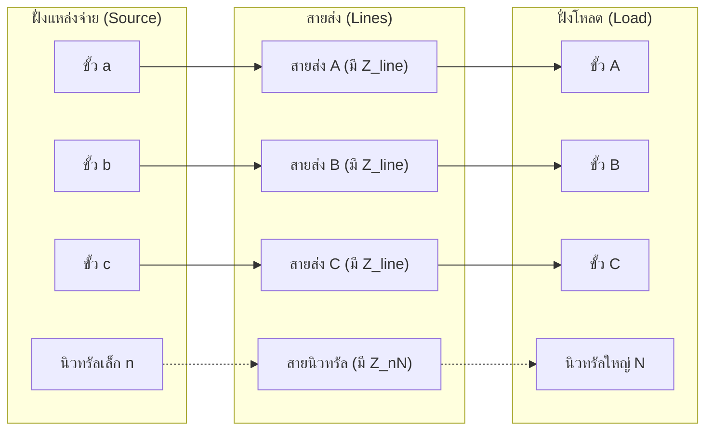
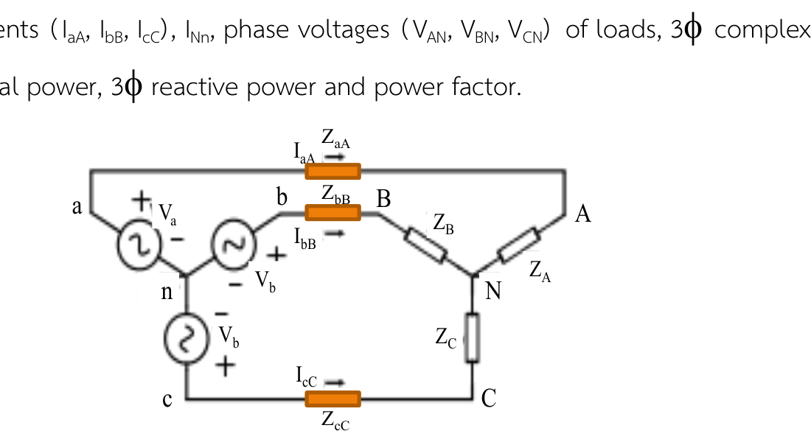

# คัมภีร์เจาะลึกบทที่ 6: วงจรไฟฟ้ากระแสสลับ 3 เฟส (Three-Phase Circuits Mastery)
**วิชา:** Fundamental Electrical Engineering (FunE) • คณะวิศวกรรมศาสตร์ มหาวิทยาลัยขอนแก่น  
**ผู้สอน:** รศ.ดร. นรารัตน์ เรืองชัยจตุพร

---

## 📌 บทนำ: ทำไมโลกนี้ต้องมี "ไฟฟ้า 3 เฟส"? (Intuition จากศูนย์)

ก่อนจะไปจำสูตรและตัวห้อย มาเข้าใจภาพใหญ่ใน 2 นาทีกันก่อน:

1. **ไฟฟ้า 1 เฟส (Single-Phase)**: คือไฟบ้านปกติที่เราใช้ ($230\text{ V}$) เปรียบเสมือน **"คนปั่นจักรยานด้วยขาข้างเดียว"** เมื่อลูกบันไดหมุนมาถึงจุดบนสุดและล่างสุด กำลังงานจะตกลงเป็นศูนย์ชั่วขณะ ($p(t)$ กระเพื่อมขึ้นลง) ทำให้มอเตอร์ขนาดใหญ่หมุนไม่เรียบ สั่นสะเทือน และไม่มีแรงสตาร์ทตัวเอง
2. **ไฟฟ้า 3 เฟส (Three-Phase)**: คือการนำขดลวด 3 ชุดมาวางห่างกันเชิงมุม $120^\circ$ ทางเรขาคณิตในเครื่องกำเนิดไฟฟ้า เปรียบเสมือน **"เครื่องยนต์ 3 สูบที่ผลัดกันจุดระเบิดส่งกำลังต่อเนื่อง"**
   * **กำลังไฟฟ้าชั่วขณะคงที่เสมอ ($p(t) = \text{Constant}$)**: มอเตอร์ 3 เฟสเดินเครื่องเรียบ ไร้การสั่นสะเทือน (Vibration-free) และมีทอร์กสตาร์ทตัวเองได้ทันที
   * **ประหยัดสายไฟมหาศาล**: การส่งกำลังไฟฟ้าปริมาณเท่ากัน ระบบ 3 เฟสใช้ปริมาณเนื้อทองแดง/อะลูมิเนียมของสายส่งน้อยกว่าระบบ 1 เฟสถึง **25% – 50%**
   * **ให้แรงดันใช้งานได้ 2 ระดับในระบบเดียว**: เสียบโหลดเฟสเดียวได้ $230\text{ V}$ หรือเสียบเครื่องจักร 3 เฟสได้ $400\text{ V}$

*รูปที่ 1: การกำเนิดไฟฟ้า 3 เฟส จากขดลวด 3 ชุดในเครื่องกำเนิดไฟฟ้า วางห่างกัน $120^\circ$ ผลิตแรงดันไซน์ 3 รูปคลื่นที่เยื้องกัน $120^\circ$ (จากสไลด์ที่ 3)*

*รูปที่ 2: รูปคลื่นไซน์ทั้ง 3 เฟส ($v_a, v_b, v_c$) โดยมีคาบเวลา $T = 360^\circ$ และแต่ละเฟสห่างกัน $360^\circ / 3 = 120^\circ$ (จากสไลด์ที่ 10)*

---

## 🔤 ถอดรหัส "ทุกตัวแปรและตัวห้อย" (Subscripts Decoded)

สาเหตุหลักที่ทำให้นักศึกษา "งงและทำข้อสอบไม่ได้" คือความสับสนเรื่องตัวห้อย! มาเคลียร์ให้ขาดตรงนี้:

### 1. ความหมายของตัวอักษรและตัวห้อย
* **ตัวพิมพ์เล็ก ($a, b, c, n$)**: ใช้เรียกฝั่ง **แหล่งจ่าย (Source / Generator)** โดยที่ $n$ คือจุดร่วมสายนิวทรัลของแหล่งจ่าย
* **ตัวพิมพ์ใหญ่ ($A, B, C, N$)**: ใช้เรียกฝั่ง **โหลด (Load / Receiver)** โดยที่ $N$ คือจุดร่วมสายนิวทรัลของโหลด
* **ตัวห้อย 2 ตัว แปลว่า "ความต่างศักย์ระหว่าง 2 จุดนั้น"**:
  * $V_{an} = V_a - V_n$ : แรงดันที่ขั้ว $a$ เทียบกับนิวทรัล $n$ เรียกว่า **Phase Voltage ของแหล่งจ่าย**
  * $V_{AN} = V_A - V_N$ : แรงดันที่ขั้วโหลด $A$ เทียบกับนิวทรัล $N$ เรียกว่า **Phase Voltage ของโหลด**
  * $V_{ab} = V_a - V_b$ : แรงดันระหว่างสายส่งเส้น $a$ กับเส้น $b$ เรียกว่า **Line Voltage**
  * $V_{Nn} = V_N - V_n$ : ความต่างศักย์ระหว่างนิวทรัลของโหลดกับนิวทรัลของแหล่งจ่าย เรียกว่า **แรงดันจุดนิวทรัลเลื่อน (Neutral Shift Voltage)**

---

### 2. ตารางเปรียบเทียบ Line vs Phase ให้เห็นภาพชัดเจน

| ปริมาณ | สัญลักษณ์ | คำนิยามทางกายภาพ | ในวงจร Star (Y) | ในวงจร Delta ($\Delta$) |
| :--- | :---: | :--- | :--- | :--- |
| **Phase Voltage** | $V_p$ หรือ $V_{\text{phase}}$ | แรงดันที่ตกคร่อม **"ขดลวดเพียง 1 ขด"** | ตกคร่อมระหว่างขั้วเฟสกับนิวทรัล ($V_{an}$) | ตกคร่อมระหว่างหัวท้ายขดลวด ($V_{ab}$) |
| **Line Voltage** | $V_L$ หรือ $V_{\text{line}}$ | แรงดันที่วัดระหว่าง **"สายส่ง 2 เส้นใดๆ"** | วัดคร่อมระหว่างสาย เช่น $V_{ab}, V_{bc}, V_{ca}$ | วัดคร่อมระหว่างสาย เช่น $V_{ab}, V_{bc}, V_{ca}$ |
| **Phase Current** | $I_p$ หรือ $I_{\text{phase}}$ | กระแสที่ไหลผ่าน **"เนื้อขดลวด 1 ขด"** | ไหลผ่านขดลวดเฟสเดี่ยวๆ | ไหลวนในกิ่งเดลตา เช่น $I_{ab}$ |
| **Line Current** | $I_L$ หรือ $I_{\text{line}}$ | กระแสที่วิ่งมาตาม **"สายไฟส่งกำลัง 1 เส้น"** | วิ่งมาตามสายส่ง เช่น $I_{aA}, I_{bB}, I_{cC}$ | วิ่งมาตามสายส่ง เช่น $I_a, I_b, I_c$ |

---

## 🧭 ลำดับเฟส (Phase Sequence): Positive ($abc$) vs Negative ($acb$)

แรงดันทั้ง 3 เฟสจะมีความถี่เท่ากัน ขนาดเท่ากัน ($|V_p|$) แต่มีมุมเฟสต่างกัน $120^\circ$:

### 1. ลำดับเฟสบวก (Positive Sequence หรือ $abc$ sequence) — *ใช้เป็นมาตรฐาน 95% ของข้อสอบ*
ลูกศรเฟสเซอร์จะหมุนทวนเข็มนาฬิกา โดยเฟส $a$ จะผ่านจุดอ้างอิงก่อน ตามด้วย $b$ แล้วตามด้วย $c$:

$$\mathbf{V}_{an} = V_p \angle 0^\circ$$

$$\mathbf{V}_{bn} = V_p \angle -120^\circ$$

$$\mathbf{V}_{cn} = V_p \angle -240^\circ = V_p \angle +120^\circ$$

### 2. ลำดับเฟสลบ (Negative Sequence หรือ $acb$ sequence) — *ข้อสอบออกเมื่อต้องการดักคนท่องจำ!*
เฟส $a$ ผ่านก่อน ตามด้วย $c$ แล้วค่อยตามด้วย $b$:

$$\mathbf{V}_{an} = V_p \angle 0^\circ$$

$$\mathbf{V}_{bn} = V_p \angle +120^\circ$$

$$\mathbf{V}_{cn} = V_p \angle -120^\circ$$

*รูปที่ 3: เฟสเซอร์ไดอะแกรมของแรงดันเฟส $V_{an}, V_{bn}, V_{cn}$ มุมห่างกัน $120^\circ$ พอดี (จากสไลด์ที่ 11)*

> [!WARNING]
> **กับดักคะแนนสอบ:** ถ้าโจทย์ระบุว่าระบบเป็น **Negative Sequence ($acb$)** ความสัมพันธ์ของมุมนำหน้า/ตามหลังจะสลับทันที! เช่น จากเดิม $V_{ab}$ นำหน้า $V_{an}$ อยู่ $+30^\circ$ จะกลายเป็น **ตามหลัง $-30^\circ$** ทันที

---

## ⚡ เจาะลึกการต่อแบบ Star (Y) vs Delta ($\Delta$)

### 1. การต่อแบบ Star (Y-Connection)

*รูปที่ 4: โครงสร้างวงจรแบบ Y-to-Y มีสายไฟหลัก 3 เส้น ($a, b, c$) และสายนิวทรัล ($n-N$) (จากสไลด์ที่ 14)*

#### กฎกระแสในวงจร Y:
กระแสที่วิ่งมาตามสายส่ง ($I_L$) ไม่มีทางแยกไปไหน มันต้องวิ่งทะลุเข้าขดลวดเฟส ($I_p$) โดยตรง:
$$I_L = I_p$$

#### กฎแรงดันในวงจร Y (พิสูจน์ที่มาของ $\sqrt{3} \angle +30^\circ$):
หาแรงดันระหว่างสาย $V_{ab}$ โดยใช้กฎ KVL:
$$V_{ab} = V_{an} - V_{bn}$$
แทนค่า $V_{an} = V_p \angle 0^\circ$ และ $V_{bn} = V_p \angle -120^\circ$:
$$V_{ab} = V_p (1\angle 0^\circ - 1\angle -120^\circ) = V_p \left(1 - \left(-\frac{1}{2} - j\frac{\sqrt{3}}{2}\right)\right)$$
$$V_{ab} = V_p \left(\frac{3}{2} + j\frac{\sqrt{3}}{2}\right)$$
แปลงเป็น Polar form:
* ขนาด: $\sqrt{\left(\frac{3}{2}\right)^2 + \left(\frac{\sqrt{3}}{2}\right)^2} = \sqrt{\frac{9}{4} + \frac{3}{4}} = \sqrt{\frac{12}{4}} = \sqrt{3}$
* มุม: $\arctan\left(\frac{\sqrt{3}/2}{3/2}\right) = \arctan\left(\frac{1}{\sqrt{3}}\right) = 30^\circ$

$$\mathbf{V}_{ab} = \sqrt{3}\, V_p \angle +30^\circ$$

$$\mathbf{V}_{bc} = \sqrt{3}\, V_p \angle -90^\circ$$

$$\mathbf{V}_{ca} = \sqrt{3}\, V_p \angle +150^\circ \quad (\text{หรือ } -210^\circ)$$

*รูปที่ 5: เวกเตอร์เฟสเซอร์พิสูจน์ $V_{ab} = V_{an} - V_{bn} = \sqrt{3}\,V_p\angle +30^\circ$ (จากสไลด์ที่ 18)*

> [!IMPORTANT]
> **สรุปสูตร Star (Y):**
> 1. กระแสเท่ากัน: $I_L = I_p$
> 2. แรงดันไลน์ใหญ่กว่าแรงดันเฟส $\sqrt{3}$ เท่า: $V_L = \sqrt{3}\, V_p$
> 3. Line Voltage **นำหน้า (leads)** Phase Voltage อยู่ $+30^\circ$ เสมอ (ในลำดับ $abc$)

---

### 2. การต่อแบบ Delta ($\Delta$-Connection)

*รูปที่ 6: โครงสร้างวงจรแบบ Y-to-Delta โหลดต่อเป็นรูปสามเหลี่ยมคร่อมสายส่งคู่ใดๆ (จากสไลด์ที่ 15)*

#### กฎแรงดันในวงจร $\Delta$:
ขดลวดแต่ละเฟสต่อคร่อมระหว่างสายส่งคู่หนึ่งโดยตรง ดังนั้นแรงดันตกคร่อมขดลวดจึงเท่ากับแรงดันระหว่างสายส่งทันที:
$$V_L = V_p$$

#### กฎกระแสในวงจร $\Delta$ (พิสูจน์ที่มาของ $\sqrt{3} \angle -30^\circ$):
พิจารณากระแสที่ไหลเข้าโหนด $a$ ตามกฎ KCL:
$$I_a = I_{ab} - I_{ca}$$
เมื่อพิสูจน์ด้วยเวกเตอร์เฟสเซอร์ในทำนองเดียวกับแรงดันของ Y จะได้:

$$\mathbf{I}_a = \sqrt{3}\, I_p \angle -30^\circ$$

$$\mathbf{I}_b = \sqrt{3}\, I_p \angle -150^\circ$$

$$\mathbf{I}_c = \sqrt{3}\, I_p \angle +90^\circ$$

*รูปที่ 7: เวกเตอร์เฟสเซอร์กระแสในวงจรเดลตา พิสูจน์ $I_a = \sqrt{3}\,I_{ab}\angle -30^\circ$ (จากสไลด์ที่ 22)*

> [!IMPORTANT]
> **สรุปสูตร Delta ($\Delta$):**
> 1. แรงดันเท่ากัน: $V_L = V_p$
> 2. กระแสไลน์ใหญ่กว่ากระแสในขดลวด $\sqrt{3}$ เท่า: $I_L = \sqrt{3}\, I_p$
> 3. Line Current **ตามหลัง (lags)** Phase Current อยู่ $-30^\circ$ เสมอ (ในลำดับ $abc$)

---

### 3. ตารางสรุป Master Summary จากสไลด์อาจารย์

*รูปที่ 8: ตาราง Master Summary เปรียบเทียบความสัมพันธ์แรงดันและกระแสของ Y และ Delta (จากสไลด์ที่ 23)*

| ระบบการต่อ | ปริมาณที่ "เท่ากัน" | ปริมาณที่ต้อง "คูณ $\sqrt{3}$" | ความสัมพันธ์ของมุม (Sequence $abc$) |
| :---: | :---: | :---: | :---: |
| **Star (Y)** | **กระแสเท่ากัน** ($I_L = I_p$) | $V_L = \sqrt{3}\, V_p$ | Line Voltage **นำหน้า** Phase Voltage อยู่ **$+30^\circ$** |
| **Delta ($\Delta$)** | **แรงดันเท่ากัน** ($V_L = V_p$) | $I_L = \sqrt{3}\, I_p$ | Line Current **ตามหลัง** Phase Current อยู่ **$-30^\circ$** |

---

## 🔄 การแปลงอิมพีแดนซ์ Delta $\leftrightarrow$ Wye ($Z_\Delta \leftrightarrow Z_Y$)

ในระบบ 3 เฟสสมดุล เรานิยมแปลงโหลด Delta ให้กลายเป็นโหลด Wye (Y) เพราะวงจร Y มีจุด Neutral ร่วม ทำให้เราสามารถตัดตอนมาคิดเพียง **"1 เฟส (Per-Phase Equivalent Circuit)"** ได้ทันที!

*รูปที่ 9: แผนผังการแปลงอิมพีแดนซ์ระหว่าง Delta และ Wye (จากสไลด์ที่ 34)*

สูตรการแปลงสำหรับโหลดสมดุล ($Z_A = Z_B = Z_C$):

$$Z_Y = \frac{Z_\Delta}{3} \qquad \Longleftrightarrow \qquad Z_\Delta = 3\, Z_Y$$

> [!TIP]
> **วิธีจำไม่ให้สับสนว่า "เมื่อไหร่คูณ 3 เมื่อไหร่หาร 3":**
> โหลดที่ต่อแบบ $\Delta$ ขดลวดแต่ละเส้นจะรับแรงดันสูงเต็มๆ ($V_L$) จึงกินกระแสมากกว่าแบบ Y ถึง 3 เท่า! ดังนั้น อิมพีแดนซ์ของ Delta จะต้องมีค่า **ใหญ่กว่า** Y อยู่ 3 เท่าเสมอ ($\Delta = 3 \times Y$) และเมื่อแปลงจาก $\Delta \to Y$ ค่าความต้านทานต้อง **เล็กลง (หาร 3)**

---

## 📊 กำลังไฟฟ้า 3 เฟส (3-Phase Power Formulas)

*รูปที่ 10: สูตรกำลังไฟฟ้า Real, Reactive และ Complex Power ในระบบ 3 เฟส (จากสไลด์ที่ 27)*

กำลังไฟฟ้ารวมของระบบ 3 เฟสสมดุล คือผลรวมของกำลังไฟฟ้าทั้ง 3 เฟส:

$$P_{3\phi} = 3 \times P_{1\phi} = 3\, V_p I_p \cos\theta$$

เมื่อเราแทนค่าความสัมพันธ์ Line เข้าไป:
* ในวงจร Y: $V_p = \frac{V_L}{\sqrt{3}}$ และ $I_p = I_L \implies P = 3 \left(\frac{V_L}{\sqrt{3}}\right) I_L \cos\theta = \sqrt{3}\, V_L I_L \cos\theta$
* ในวงจร $\Delta$: $V_p = V_L$ และ $I_p = \frac{I_L}{\sqrt{3}} \implies P = 3 V_L \left(\frac{I_L}{\sqrt{3}}\right) \cos\theta = \sqrt{3}\, V_L I_L \cos\theta$

ไม่ว่าจะต่อแบบ Y หรือ $\Delta$ สูตรกำลังไฟฟ้าที่ใช้ค่า Line จะเหมือนกัน 100%:

### 1. กำลังไฟฟ้าจริง (Real / Active Power, $P$)
$$P = \sqrt{3}\, V_L I_L \cos\theta \quad [\text{Watt, W}]$$

### 2. กำลังไฟฟ้ารีแอกทีฟ (Reactive Power, $Q$)
$$Q = \sqrt{3}\, V_L I_L \sin\theta \quad [\text{VAR}]$$

### 3. กำลังไฟฟ้าปรากฏ (Apparent Power, $|S|$)
$$|S| = \sqrt{3}\, V_L I_L = \sqrt{P^2 + Q^2} \quad [\text{VA}]$$

### 4. กำลังไฟฟ้าเชิงซ้อน (Complex Power, $\mathbf{S}$)
$$\mathbf{S} = P + jQ = \sqrt{3}\, V_L I_L^* = 3\, \mathbf{V}_p \mathbf{I}_p^* \quad [\text{VA}]$$

* **$\theta$ คืออะไร?**: $\theta = \theta_v - \theta_i$ คือมุมของอิมพีแดนซ์โหลด ($Z = |Z|\angle \theta$)
* **Power Factor ($PF$)**: $PF = \cos\theta$
  * ถ้าโหลดเป็น Inductive (มีตัวเหนี่ยวนำ $L$ เช่น มอเตอร์): กระแสตามหลังแรงดัน $\implies$ **Lagging PF** ($+Q$)
  * ถ้าโหลดเป็น Capacitive (มีตัวเก็บประจุ $C$): กระแสนำหน้าแรงดัน $\implies$ **Leading PF** ($-Q$)

> [!CAUTION]
> **กฎเหล็กเรื่องตัวคูณ:**
> * ถ้าใช้ปริมาณ **Line** ($V_L, I_L$) $\to$ ต้องมีตัวคูณ **$\sqrt{3}$**
> * ถ้าใช้ปริมาณ **Phase** ($V_p, I_p$) $\to$ ต้องมีตัวคูณ **$3$**
> * **ห้ามนำ $\sqrt{3}$ ไปคูณกับค่า Phase หรือเอา $3$ ไปคูณกับค่า Line เด็ดขาด!**

---

## 📈 วิธีวัดกำลังไฟฟ้าด้วย 2 วัตต์มิเตอร์ (Two-Wattmeter Method)

ในระบบ 3 สาย (ไม่มีสายนิวทรัล) เราสามารถใช้วัตต์มิเตอร์เพียง 2 ตัว วัดกำลังไฟฟ้ารวมของระบบ 3 เฟสได้ทั้งหมด แม้โหลดจะไม่สมดุลก็ตาม!

*รูปที่ 11: แผนผังวงจร Two-Wattmeter Method ขดลวดกระแส $CC_1$ ต่ออนุกรมกับสาย $A$, $CC_2$ ต่ออนุกรมกับสาย $C$ และขดลวดแรงดัน $PC_1, PC_2$ ต่อคร่อมมาที่สาย $B$*

### 1. สมการการอ่านค่าของวัตต์มิเตอร์แต่ละตัว
* วัตต์มิเตอร์ตัวที่ 1 ($W_1$): วัดกระแสสาย A และวัดแรงดัน $V_{ab}$
  $$W_1 = V_L I_L \cos(30^\circ - \theta)$$
* วัตต์มิเตอร์ตัวที่ 2 ($W_2$): วัดกระแสสาย C และวัดแรงดัน $V_{cb}$
  $$W_2 = V_L I_L \cos(30^\circ + \theta)$$

### 2. สูตรมหัศจรรย์ 3 สูตรที่ต้องท่องเข้าห้องสอบ
1. **หากำลังไฟฟ้าจริงรวม ($P_{\text{total}}$)**:
   $$P_{\text{total}} = W_1 + W_2$$
2. **หากำลังไฟฟ้ารีแอกทีฟรวม ($Q_{\text{total}}$)**:
   $$Q_{\text{total}} = \sqrt{3}\,(W_1 - W_2)$$
3. **หามุมและ Power Factor**:
   $$\tan\theta = \sqrt{3}\,\frac{W_1 - W_2}{W_1 + W_2} \qquad \Longrightarrow \qquad PF = \cos\theta$$

### 3. ตารางวิเคราะห์พฤติกรรมของเข็มวัตต์มิเตอร์ (ข้อสอบชอบถามบรรยาย)

| ค่า Power Factor ของโหลด | ค่ามุม $\theta$ | ค่าที่วัตต์มิเตอร์ $W_1$ อ่านได้ | ค่าที่วัตต์มิเตอร์ $W_2$ อ่านได้ | ข้อสังเกตและปรากฏการณ์ |
| :---: | :---: | :---: | :---: | :--- |
| **$PF = 1.0$ (ความต้านทานล้วน)** | $0^\circ$ | $W_1 > 0$ | $W_2 = W_1$ | เข็มทั้งสองตัวชี้ค่าเท่ากันเป๊ะ |
| **$0.5 < PF < 1.0$** | $0^\circ < \theta < 60^\circ$ | $W_1 > 0$ | $W_2 > 0$ (แต่น้อยกว่า $W_1$) | เข็มทั้งสองตัวอ่านค่าเป็นบวกทั้งคู่ |
| **$PF = 0.5$** | $60^\circ$ | $W_1 = P_{\text{total}}$ | **$W_2 = 0$** | **วัตต์มิเตอร์ตัวที่ 2 อ่านได้ศูนย์พอดี!** |
| **$PF < 0.5$** | $\theta > 60^\circ$ | $W_1 > 0$ | **$W_2 < 0$ (ติดลบ)** | **เข็ม $W_2$ ตีกลับซ้ายสุด!** ต้องสลับขั้วขดลวดกระแส แล้วบันทึกค่าเป็นลบ |
| **$PF = 0$ (เหนี่ยวนำบริสุทธิ์)** | $90^\circ$ | $W_1 = -W_2$ | $W_2 = -W_1$ | ผลบวก $W_1 + W_2 = 0$ (ไม่มี Real Power) |

---

## 🎯 ตะลุยโจทย์จริงจากง่ายไปยาก (Step-by-Step Solutions)

---

### 🟢 โจทย์ระดับ 1 (โจทย์พื้นฐาน): คำนวณระบบ Balanced Y-Y
> **โจทย์ (การบ้านบทที่ 6 ข้อ 1):**  
> จากรูปวงจร Balanced Y-Y แหล่งจ่าย 3 เฟสสมดุล ลำดับเฟสบวก ($abc$) ต่อแบบ Star มีแรงดันเฟส $V_{an} = 220\angle 0^\circ\text{ V}, V_{bn} = 220\angle -120^\circ\text{ V}, V_{cn} = 220\angle -240^\circ\text{ V}$ จ่ายให้โหลดสมดุลต่อแบบ Star มีอิมพีแดนซ์ต่อเฟส $Z_L = 20 + j50\ \Omega$ และสายส่งมีอิมพีแดนซ์ $Z_{\text{line}} = 10 + j5\ \Omega$  
> **จงหา:**
> 1. แรงดันไลน์ของแหล่งจ่าย ($V_{ab}, V_{bc}, V_{ca}$)
> 2. กระแสในสายส่งแต่ละเส้น ($I_{aA}, I_{bB}, I_{cC}$)
> 3. กระแสที่ไหลในสายนิวทรัล ($I_{Nn}$)
> 4. กำลังไฟฟ้าเชิงซ้อนรวม ($S_{\text{total}}$)

*รูปที่ 12: รูปวงจรจริงจากใบงานการบ้านบทที่ 6 รูปที่ 1 (Balanced Y-Y System)*

#### 💡 วิธีทำละเอียดทีละขั้น:

**ขั้นที่ 1: หาแรงดันไลน์ของแหล่งจ่าย ($V_L$)**  
จากคุณสมบัติของระบบ Star ลำดับเฟสบวก: $V_L = \sqrt{3}\, V_p \angle +30^\circ$
* ขนาดแรงดันไลน์: $|V_L| = \sqrt{3} \times 220 = 381.05\text{ V}$
* $V_{ab} = 381.05\angle (0^\circ + 30^\circ) = \mathbf{381.05\angle 30^\circ\text{ V}}$
* $V_{bc}$ มุมตามหลัง $V_{ab}$ อยู่ $120^\circ$: $V_{bc} = \mathbf{381.05\angle -90^\circ\text{ V}}$
* $V_{ca}$ มุมตามหลัง $V_{bc}$ อยู่ $120^\circ$: $V_{ca} = \mathbf{381.05\angle -210^\circ\text{ V}}$ (หรือ $381.05\angle +150^\circ$)

**ขั้นที่ 2: วาดวงจรสมมูล 1 เฟส (Per-Phase Equivalent Circuit สำหรับเฟส A)**  
เนื่องจากระบบสมดุล จุดนิวทรัล $n$ และ $N$ มีศักย์เท่ากัน ($V_{nN} = 0$) เราจึงตัดมาคิดเฟส $A$ ขาเดียวได้:
รวมอิมพีแดนซ์ทั้งหมดในเฟส A:
$$Z_{\text{total}} = Z_{\text{line}} + Z_L = (10 + j5) + (20 + j50) = 30 + j55\ \Omega$$
แปลงเป็น Polar form:
* $|Z_{\text{total}}| = \sqrt{30^2 + 55^2} = \sqrt{900 + 3025} = \sqrt{3925} = 62.65\ \Omega$
* $\theta = \arctan\left(\frac{55}{30}\right) = 61.39^\circ$
* $Z_{\text{total}} = 62.65\angle 61.39^\circ\ \Omega$

**ขั้นที่ 3: คำนวณกระแสในสายส่ง ($I_{aA}, I_{bB}, I_{cC}$)**  
$$I_{aA} = \frac{V_{an}}{Z_{\text{total}}} = \frac{220\angle 0^\circ}{62.65\angle 61.39^\circ} = \mathbf{3.51\angle -61.39^\circ\text{ A}}$$
เนื่องจากระบบสมดุล เฟส $B$ และ $C$ จะมีขนาดเท่ากัน แต่มุมต่างกัน $120^\circ$:
* $I_{bB} = \mathbf{3.51\angle -181.39^\circ\text{ A}}$
* $I_{cC} = \mathbf{3.51\angle +58.61^\circ\text{ A}}$

**ขั้นที่ 4: คำนวณกระแสสายนิวทรัล ($I_{Nn}$)**  
ในวงจรที่สมดุล กระแสทั้ง 3 เฟสจะหักล้างกันพอดี:
$$I_{Nn} = I_{aA} + I_{bB} + I_{cC} = \mathbf{0\text{ A}}$$

**ขั้นที่ 5: คำนวณ Complex Power รวม ($S_{\text{total}}$)**
$$S_{\text{total}} = 3\, V_{an} I_{aA}^* = 3 \times 220 \times 3.51\angle +61.39^\circ = \mathbf{2,316.6\angle 61.39^\circ\text{ VA}}$$
$$S_{\text{total}} = 1,109\text{ W} + j2,034\text{ VAR}$$

---

### 🟡 โจทย์ระดับ 2 (โจทย์มอเตอร์และการแปลงโหลด): ระบบ Balanced Y-$\Delta$
> **โจทย์:** มอเตอร์เหนี่ยวนำ 3 เฟสตัวหนึ่งต่อแบบ Delta ($\Delta$) มีพิกัดขนาด $10\text{ hp}$ ทำงานที่ระบบแรงดัน $380\text{ V}, 50\text{ Hz}$ มีประสิทธิภาพ $\eta = 85\%$ และ Power Factor $PF = 0.80$ lagging  
> **จงหา:**
> 1. กำลังไฟฟ้าขาเข้า ($P_{\text{in}}$)
> 2. กระแสไลน์ที่จ่ายเข้ามอเตอร์ ($I_L$)
> 3. กระแสที่ไหลผ่านขดลวดแต่ละเฟสของมอเตอร์ ($I_\Delta$)
> 4. อิมพีแดนซ์ต่อเฟสของมอเตอร์ ($Z_\Delta$) และถ้าแปลงเป็นวงจรสมมูล Y ($Z_Y$) จะมีค่าเท่าใด?

#### 💡 วิธีทำละเอียดทีละขั้น:

**ขั้นที่ 1: แปลงกำลังกลทาง Output (แรงม้า) เป็นกำลังไฟฟ้าขาเข้า ($P_{\text{in}}$)**  
* $1\text{ hp} = 746\text{ W}$
* กำลังงานกลที่เพลามอเตอร์: $P_{\text{out}} = 10 \times 746 = 7,460\text{ W}$
* จากสูตรประสิทธิภาพ: $\eta = \frac{P_{\text{out}}}{P_{\text{in}}} \implies P_{\text{in}} = \frac{P_{\text{out}}}{\eta}$
$$P_{\text{in}} = \frac{7,460}{0.85} = \mathbf{8,776.47\text{ W}} \approx 8.78\text{ kW}$$

**ขั้นที่ 2: คำนวณหากระแสไลน์ ($I_L$)**  
จากสูตรกำลังไฟฟ้า 3 เฟส: $P_{\text{in}} = \sqrt{3}\, V_L I_L \cos\theta$
$$I_L = \frac{P_{\text{in}}}{\sqrt{3}\, V_L \times PF} = \frac{8,776.47}{\sqrt{3} \times 380 \times 0.80} = \frac{8,776.47}{526.54} = \mathbf{16.67\text{ A}}$$

**ขั้นที่ 3: คำนวณหากระแสเฟสในขดลวดมอเตอร์ ($I_\Delta$)**  
เนื่องจากมอเตอร์ต่อแบบ **Delta ($\Delta$)** กระแสไลน์จะแยกไหลเข้า 2 ขดลวด:
$$I_\Delta = \frac{I_L}{\sqrt{3}} = \frac{16.67}{\sqrt{3}} = \mathbf{9.62\text{ A}}$$

**ขั้นที่ 4: คำนวณหาอิมพีแดนซ์ต่อเฟสของมอเตอร์ ($Z_\Delta$)**  
ในวงจร Delta แรงดันตกคร่อมขดลวดจะเท่ากับแรงดันไลน์เต็มๆ: $V_p = V_L = 380\text{ V}$
* ขนาดของอิมพีแดนซ์: $|Z_\Delta| = \frac{V_p}{I_\Delta} = \frac{380}{9.62} = 39.50\ \Omega$
* หามุมของอิมพีแดนซ์: $\theta = \arccos(0.80) = 36.87^\circ$ (เป็นบวกเพราะ lagging)
$$\mathbf{Z}_\Delta = 39.50\angle 36.87^\circ\ \Omega = 31.60 + j23.70\ \Omega$$

**ขั้นที่ 5: แปลงเป็นอิมพีแดนซ์สมมูลแบบ Y ($Z_Y$)**  
$$Z_Y = \frac{Z_\Delta}{3} = \frac{39.50\angle 36.87^\circ}{3} = \mathbf{13.17\angle 36.87^\circ\ \Omega} = 10.53 + j7.90\ \Omega$$

---

### 🔴 โจทย์ระดับ 3 (ข้อสอบจริง มข. ปราบเซียน): Unbalanced Y-Y 4-Wire มีสาย Neutral
> **ข้อสอบจริง (การบ้านบทที่ 6 ข้อ 2):**  
> วงจร 3 เฟส 4 สาย (4-Wire Y-Y) แหล่งจ่ายสมดุล $V_{an} = 220\angle 0^\circ\text{ V}, V_{bn} = 220\angle -120^\circ\text{ V}, V_{cn} = 220\angle +120^\circ\text{ V}$  
> สายส่งแต่ละเส้นมีอิมพีแดนซ์ $Z_{\text{line}} = 10 + j5\ \Omega$  
> สายนิวทรัลมีอิมพีแดนซ์ $Z_{nN} = 10 + j5\ \Omega$  
> โหลดต่อแบบ Y ไม่สมดุล (Unbalanced Load):  
> * $Z_A = 20 + j50\ \Omega$
> * $Z_B = 10 + j50\ \Omega$
> * $Z_C = 20 + j20\ \Omega$  
> **จงหา:** แรงดันจุดนิวทรัลเลื่อน ($V_{Nn}$), กระแสในสายส่งแต่ละเส้น ($I_a, I_b, I_c$) และกระแสสายนิวทรัล ($I_{nN}$)

*รูปที่ 13: รูปวงจรจริงจากใบงานการบ้านบทที่ 6 รูปที่ 2 (Unbalanced Y-Y 4-Wire with Neutral Line)*

#### 💡 วิธีทำละเอียดทีละขั้น (สูตร Node Voltage / Millman's Theorem):

**ขั้นที่ 1: รวมอิมพีแดนซ์ของแต่ละเฟส ($Z_a', Z_b', Z_c'$)**  
รวมค่าความต้านทานสายส่งเข้ากับโหลดของแต่ละเฟส:
* เฟส A: $Z_a' = Z_{\text{line}} + Z_A = (10 + j5) + (20 + j50) = 30 + j55\ \Omega = 62.65\angle 61.39^\circ\ \Omega$
* เฟส B: $Z_b' = Z_{\text{line}} + Z_B = (10 + j5) + (10 + j50) = 20 + j55\ \Omega = 58.52\angle 70.02^\circ\ \Omega$
* เฟส C: $Z_c' = Z_{\text{line}} + Z_C = (10 + j5) + (20 + j20) = 30 + j25\ \Omega = 39.05\angle 39.81^\circ\ \Omega$
* สายนิวทรัล: $Z_{nN} = 10 + j5\ \Omega = 11.18\angle 26.57^\circ\ \Omega$

**ขั้นที่ 2: แปลงเป็น Admittance ($Y = 1/Z$)**
* $Y_a = \frac{1}{62.65\angle 61.39^\circ} = 0.0160\angle -61.39^\circ = 0.00766 - j0.01402\ \text{S}$
* $Y_b = \frac{1}{58.52\angle 70.02^\circ} = 0.0171\angle -70.02^\circ = 0.00584 - j0.01605\ \text{S}$
* $Y_c = \frac{1}{39.05\angle 39.81^\circ} = 0.0256\angle -39.81^\circ = 0.01968 - j0.01640\ \text{S}$
* $Y_n = \frac{1}{11.18\angle 26.57^\circ} = 0.0894\angle -26.57^\circ = 0.08000 - j0.04000\ \text{S}$

ผลรวมของ Admittance ที่โหนด $N$:
$$\sum Y = Y_a + Y_b + Y_c + Y_n = 0.11318 - j0.08647 = 0.1424\angle -37.38^\circ\ \text{S}$$

**ขั้นที่ 3: คำนวณหาแรงดันเลื่อนจุดนิวทรัล ($V_{Nn}$) ด้วยทฤษฎีมิลล์แมน (Millman's Theorem)**  
ใช้ KCL ที่โหนด $N$ (กำหนดให้ $n$ เป็นจุดอ้างอิง $0\text{ V}$):
$$\frac{V_{Nn} - V_{an}}{Z_a'} + \frac{V_{Nn} - V_{bn}}{Z_b'} + \frac{V_{Nn} - V_{cn}}{Z_c'} + \frac{V_{Nn}}{Z_{nN}} = 0$$

$$V_{Nn} = \frac{V_{an} Y_a + V_{bn} Y_b + V_{cn} Y_c}{Y_a + Y_b + Y_c + Y_n}$$

คำนวณตัวเศษ:
* $V_{an} Y_a = (220\angle 0^\circ)(0.0160\angle -61.39^\circ) = 3.52\angle -61.39^\circ = 1.685 - j3.084$
* $V_{bn} Y_b = (220\angle -120^\circ)(0.0171\angle -70.02^\circ) = 3.762\angle -190.02^\circ = -3.705 + j0.655$
* $V_{cn} Y_c = (220\angle 120^\circ)(0.0256\angle -39.81^\circ) = 5.632\angle 80.19^\circ = 0.959 + j5.550$
* รวมตัวเศษ: $(1.685 - 3.705 + 0.959) + j(-3.084 + 0.655 + 5.550) = -1.061 + j3.121 = 3.296\angle 108.78^\circ\text{ A}$

หาค่า $V_{Nn}$:
$$V_{Nn} = \frac{3.296\angle 108.78^\circ}{0.1424\angle -37.38^\circ} = \mathbf{23.15\angle 146.16^\circ\text{ V}}$$

> [!NOTE]
> **ความหมายทางกายภาพ:** จุดนิวทรัล $N$ ของโหลด ไม่ได้อยู่ที่ $0\text{ V}$ อีกต่อไป! มันลอยขึ้นมาเป็น $23.15\text{ V}$ ทำให้แรงดันที่ตกคร่อมโหลดแต่ละเฟสบิดเบี้ยวไป ไม่เท่ากับ $220\text{ V}$

**ขั้นที่ 4: คำนวณกระแสในสายส่งและสายนิวทรัล**
* $I_a = \frac{V_{an} - V_{Nn}}{Z_a'} = \frac{220\angle 0^\circ - 23.15\angle 146.16^\circ}{62.65\angle 61.39^\circ} = \mathbf{3.83\angle -58.21^\circ\text{ A}}$
* $I_b = \frac{V_{bn} - V_{Nn}}{Z_b'} = \mathbf{3.74\angle -182.12^\circ\text{ A}}$
* $I_c = \frac{V_{cn} - V_{Nn}}{Z_c'} = \mathbf{5.44\angle 58.73^\circ\text{ A}}$
* กระแสสายนิวทรัลไหลกลับ:
  $$I_{nN} = \frac{V_{Nn}}{Z_{nN}} = \frac{23.15\angle 146.16^\circ}{11.18\angle 26.57^\circ} = \mathbf{2.07\angle 119.59^\circ\text{ A}}$$
  *(เช็คคำตอบ: $I_a + I_b + I_c = 2.07\angle 119.59^\circ = I_{nN}$ ถูกต้องแม่นยำ 100%!)*

---

### 🔴 โจทย์ระดับ 4: Unbalanced 3-Wire Y-Y (ไม่มีสายนิวทรัล / Floating Neutral)
> **ข้อสอบจริง (การบ้านบทที่ 6 ข้อ 3):**  
> จากโจทย์ระดับ 3 เดิม หากทำการ **"ตัดสายนิวทรัลทิ้ง"** ($Z_{nN} = \infty$)  
> **จงหา:** แรงดันจุดนิวทรัลเลื่อน $V_{Nn}$ และอธิบายอันตรายที่เกิดขึ้นกับโหลด

*รูปที่ 14: รูปวงจรจริงจากใบงานการบ้านบทที่ 6 รูปที่ 3 (Unbalanced Y-Y 3-Wire System)*

#### 💡 วิธีทำ:
เมื่อตัดสายนิวทรัลออก ค่า Admittance ของสายนิวทรัลจะเป็นศูนย์: $Y_n = \frac{1}{\infty} = 0$  
สูตรของมิลล์แมนจะตัดพจน์ $Y_n$ ทิ้ง:

$$V_{Nn} = \frac{V_{an} Y_a + V_{bn} Y_b + V_{cn} Y_c}{Y_a + Y_b + Y_c}$$

* ตัวเศษยังคงเดิม: $3.296\angle 108.78^\circ$
* ตัวส่วนตัด $Y_n$ ออก:
  $$\sum Y = Y_a + Y_b + Y_c = 0.03318 - j0.04647 = 0.0571\angle -54.48^\circ\ \text{S}$$
* คำนวณ $V_{Nn}$ ใหม่:
  $$V_{Nn} = \frac{3.296\angle 108.78^\circ}{0.0571\angle -54.48^\circ} = \mathbf{57.72\angle 163.26^\circ\text{ V}}$$

> [!WARNING]
> **อันตรายของ Floating Neutral (จุดออกสอบบรรยาย):**
> สังเกตว่าแรงดันเลื่อนจุดนิวทรัลพุ่งสูงขึ้นจาก $23.15\text{ V}$ กลายเป็น **$57.72\text{ V}$**!  
> ส่งผลให้แรงดันตกคร่อมโหลดบางเฟสลดต่ำลงมาก (Undervoltage) ขณะที่โหลดเฟสที่มีอิมพีแดนซ์สูงจะได้รับแรงดันพุ่งสูงเกินพิกัด (**Overvoltage ทะลุ $260\text{ V} - 280\text{ V}$**) ทำให้อุปกรณ์ไฟฟ้าและเครื่องใช้ไฟฟ้าไหม้เสียหายทันที!

---

### 🟡 โจทย์ระดับ 5: การวัดกำลังไฟฟ้าด้วย 2 วัตต์มิเตอร์ (Two-Wattmeter Problem)
> **โจทย์ (สไลด์ที่ 43 & ข้อสอบไฟนอล):**  
> ระบบ 3 เฟสสมดุล $380\text{ V}, 50\text{ Hz}$ จ่ายโหลดสมดุล ต่อวัตต์มิเตอร์ 2 ตัววัดกำลังไฟฟ้าตามวิธี Two-Wattmeter Method ปรากฏว่า:  
> * วัตต์มิเตอร์ตัวที่ 1 อ่านค่าได้ $W_1 = 5,200\text{ W}$  
> * วัตต์มิเตอร์ตัวที่ 2 อ่านค่าได้ $W_2 = 1,800\text{ W}$  
> **จงหา:**
> 1. Real Power รวม ($P_{\text{total}}$)
> 2. Reactive Power รวม ($Q_{\text{total}}$)
> 3. Power Factor ($PF$) ของระบบ
> 4. กระแสไลน์ ($I_L$)

*รูปที่ 15: ตัวอย่างโจทย์ Two-Wattmeter Method จากสไลด์ที่ 43 (Example 6.6)*

#### 💡 วิธีทำ:

**ขั้นที่ 1: หากำลังไฟฟ้าจริงรวม ($P_{\text{total}}$)**
$$P_{\text{total}} = W_1 + W_2 = 5,200 + 1,800 = \mathbf{7,000\text{ W}} = 7.0\text{ kW}$$

**ขั้นที่ 2: หากำลังไฟฟ้ารีแอกทีฟรวม ($Q_{\text{total}}$)**
$$Q_{\text{total}} = \sqrt{3}\,(W_1 - W_2) = \sqrt{3}\,(5,200 - 1,800) = \sqrt{3} \times 3,400 = \mathbf{5,888.97\text{ VAR}} \approx 5.89\text{ kVAR}$$

**ขั้นที่ 3: หามุมและค่า Power Factor**
$$\tan\theta = \sqrt{3}\,\frac{W_1 - W_2}{W_1 + W_2} = \frac{5,888.97}{7,000} = 0.8413$$
$$\theta = \arctan(0.8413) = 40.07^\circ$$
$$PF = \cos(40.07^\circ) = \mathbf{0.765\text{ lagging}}$$

**ขั้นที่ 4: หากระแสไลน์ ($I_L$)**
จาก $P = \sqrt{3}\, V_L I_L \cos\theta$:
$$I_L = \frac{P}{\sqrt{3}\, V_L \cdot PF} = \frac{7,000}{\sqrt{3} \times 380 \times 0.765} = \frac{7,000}{503.50} = \mathbf{13.90\text{ A}}$$

---

### 🟣 โจทย์ระดับ 6 (การแก้ Power Factor ด้วย Capacitor Bank ต่อแบบ Delta)
> **โจทย์ (การบ้านข้อ 10 & ข้อสอบตัดเกรด):**  
> จากโรงงานในโจทย์ระดับ 5 ที่มีโหลด $P = 7\text{ kW}$ และ $PF_1 = 0.765$ lagging ต่ออยู่กับระบบ $380\text{ V}, 50\text{ Hz}$ โรงงานต้องการปรับปรุงค่า Power Factor ให้เพิ่มขึ้นเป็น $PF_2 = 0.95$ lagging โดยการติดตั้ง Capacitor Bank ต่อแบบ **Delta ($\Delta$)**  
> **จงหา:**
> 1. กำลังไฟฟ้ารีแอกทีฟที่ Capacitor Bank ต้องจ่ายชดเชย ($Q_C$)
> 2. ค่าความจุต่อเฟสของตัวเก็บประจุ ($C_\Delta$) ในหน่วยไมโครฟารัด ($\mu\text{F}$)

*รูปที่ 16: วงจรการต่อคาปาซิเตอร์แบงก์แบบเดลตาขนานกับโหลด เพื่อจ่ายกำลังไฟฟ้ารีแอกทีฟ $Q_C$ ชดเชย*

#### 💡 วิธีทำ:

**ขั้นที่ 1: หามุมของ Power Factor เดิมและใหม่**
* มุมเดิม ($\theta_1$): $\theta_1 = 40.07^\circ \implies \tan\theta_1 = \tan(40.07^\circ) = 0.8413$
* มุมใหม่ที่ต้องการ ($\theta_2$): $\theta_2 = \arccos(0.95) = 18.19^\circ \implies \tan\theta_2 = \tan(18.19^\circ) = 0.3287$

**ขั้นที่ 2: คำนวณหาค่า $Q_C$ รวมทั้ง 3 เฟส**
$$Q_C = P\,(\tan\theta_1 - \tan\theta_2)$$
$$Q_C = 7,000\text{ W} \times (0.8413 - 0.3287) = 7,000 \times 0.5126 = \mathbf{3,588.2\text{ VAR}} \approx 3.59\text{ kVAR}$$

**ขั้นที่ 3: คำนวณหาค่าความจุต่อเฟส ($C_\Delta$)**  
เนื่องจากตัวเก็บประจุต่อแบบ **Delta ($\Delta$)**:
* คาปาซิเตอร์แต่ละตัวจะรับแรงดันไลน์เต็มๆ: $V_C = V_L = 380\text{ V}$
* กำลังงานรีแอกทีฟต่อ 1 เฟส: $Q_{C,\text{phase}} = \frac{Q_C}{3} = \frac{3,588.2}{3} = 1,196.07\text{ VAR}$
* จากสูตร: $Q_{C,\text{phase}} = \frac{V_C^2}{X_C} = \omega C_\Delta V_L^2 = 2\pi f C_\Delta V_L^2$

$$C_\Delta = \frac{Q_{C,\text{phase}}}{2\pi f V_L^2} = \frac{1,196.07}{2\pi \times 50 \times (380)^2} = \frac{1,196.07}{314.16 \times 144,400} = \frac{1,196.07}{45,364,704}$$

$$C_\Delta = 2.636 \times 10^{-5}\text{ F} = \mathbf{26.36\ \mu\text{F}}$$

> [!TIP]
> **ทำไมภาคอุตสาหกรรมถึงบังคับต่อ Capacitor Bank แบบ Delta เสมอ?**
> ถ้าเราต่อ Capacitor แบบ Star (Y) แต่ละตัวจะรับแรงดันแค่ $220\text{ V}$ สูตรจะกลายเป็น $C_Y = 3 \times C_\Delta = 3 \times 26.36 = 79.1\ \mu\text{F}$ ต้องซื้อคาปาซิเตอร์ขนาดใหญ่ขึ้นถึง 3 เท่า แพงกว่า และกินพื้นที่ตู้คอนโทรลมากกว่า! การต่อแบบ Delta จึงช่วยประหยัดต้นทุนอุปกรณ์ได้ถึง 3 เท่าทันที

---

## 🏆 Checklist สรุปสูตรลัดก่อนก้าวเท้าเข้าห้องสอบ

1. **Star (Y)**:
   * $I_L = I_p$
   * $V_L = \sqrt{3}\, V_p \angle +30^\circ$ (Positive sequence)
2. **Delta ($\Delta$)**:
   * $V_L = V_p$
   * $I_L = \sqrt{3}\, I_p \angle -30^\circ$ (Positive sequence)
3. **แปลงโหลด**:
   * $Z_Y = \frac{Z_\Delta}{3} \iff Z_\Delta = 3 Z_Y$
4. **กำลังไฟฟ้า (ใช้ค่า Line เสมอ)**:
   * $P = \sqrt{3}\, V_L I_L \cos\theta$
   * $Q = \sqrt{3}\, V_L I_L \sin\theta$
   * $S = \sqrt{3}\, V_L I_L = P + jQ$
5. **2 วัตต์มิเตอร์**:
   * $P_{\text{total}} = W_1 + W_2$
   * $Q_{\text{total}} = \sqrt{3}(W_1 - W_2)$
   * $\tan\theta = \sqrt{3} \frac{W_1 - W_2}{W_1 + W_2}$
6. **มิลล์แมน (โหนดนิวทรัล N)**:
   * $V_{Nn} = \frac{V_{an} Y_a + V_{bn} Y_b + V_{cn} Y_c}{Y_a + Y_b + Y_c + Y_n}$
   * ถ้าตัดสายนิวทรัล: ตัดพจน์ $Y_n$ ออก (Floating Neutral)
