# Chapter 6: Three-Phase Alternating Current Circuits (Comprehensive Mastery Guide)
**Course:** Fundamental Electrical Engineering (FunE) • Faculty of Engineering, Khon Kaen University  
**Instructor:** Assoc. Prof. Dr. Nararat Ruangchaijatupon

---

## 📌 Introduction: Why Three-Phase AC Power? (Intuition from First Principles)

Before memorizing formulas and subscripts, let us understand the physical and economic intuition:

1. **Single-Phase Power ($1\phi$)**: The standard household supply ($230\text{ V}$) is like **"pedaling a bicycle with only one leg"**. When the crank reaches the top and bottom dead centers, instantaneous power drops to zero ($p(t)$ pulsates at twice the supply frequency, $2\omega$). Consequently, large single-phase motors vibrate, run unevenly, and lack inherent starting torque.
2. **Three-Phase Power ($3\phi$)**: Three identical coils positioned $120^\circ$ apart in space inside an electrical alternator. It acts like a **"three-cylinder engine firing sequentially in perfect balance"**:
   * **Constant Instantaneous Power ($p(t) = \text{Constant}$)**: In a balanced three-phase system, the total instantaneous power delivered to the load never drops to zero. Large motors operate smoothly without mechanical vibrations and produce self-starting rotating magnetic fields.
   * **Massive Conductor Material Savings**: Delivering a given amount of power over a transmission line requires **$25\% - 50\%$ less copper or aluminum** in a three-phase system compared to a single-phase system carrying the same power at equivalent losses.
   * **Two Distinct Voltage Levels from a Single System**: A standard 3-phase 4-wire system provides both $230\text{ V}$ (Phase Voltage, line-to-neutral for lights and appliances) and $400\text{ V}$ (Line Voltage, line-to-line for heavy machinery and industrial motors).

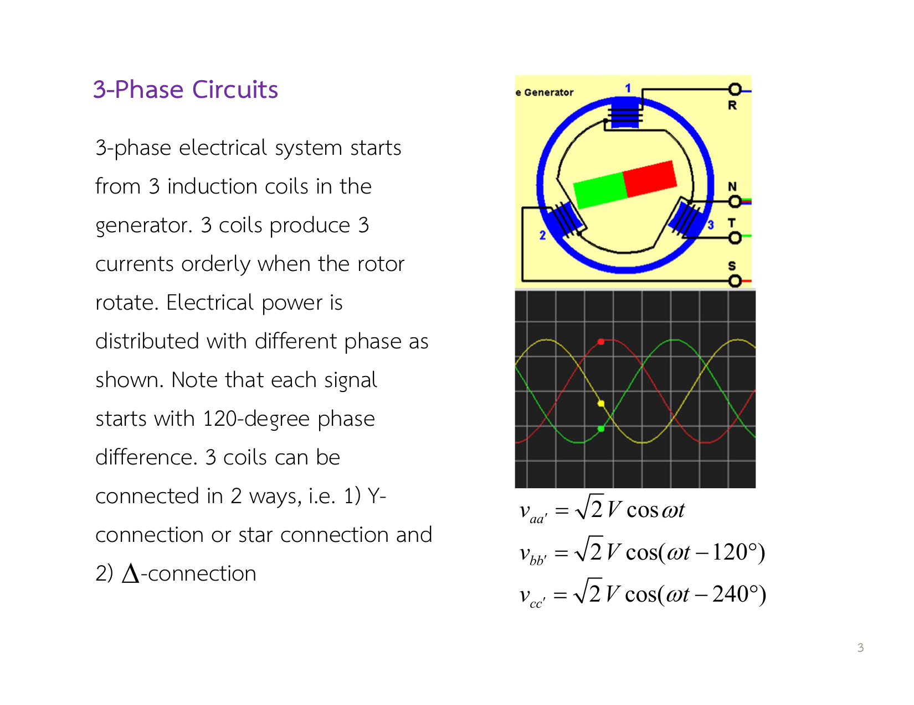
*Figure 1: Generation of 3-phase voltages from three coils displaced by $120^\circ$ in the generator stator, producing three equal sinusoidal waveforms phase-shifted by $120^\circ$ (From Slide 3).*

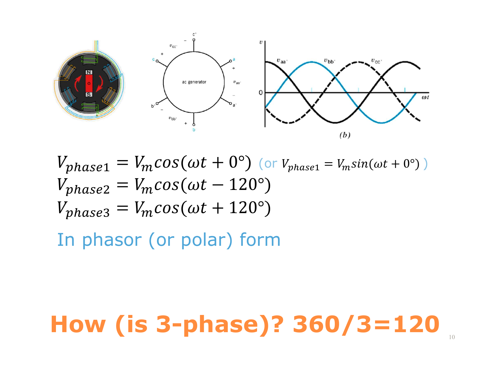
*Figure 2: The three sinusoidal waveforms ($v_a, v_b, v_c$) with period $T = 360^\circ$, each shifted by $360^\circ / 3 = 120^\circ$ (From Slide 10).*

---

## 🔤 Complete Subscript & Notation Decoder (Variables Decoded)

The primary reason students struggle with three-phase circuits is confusing subscripts. Let us clarify them permanently:

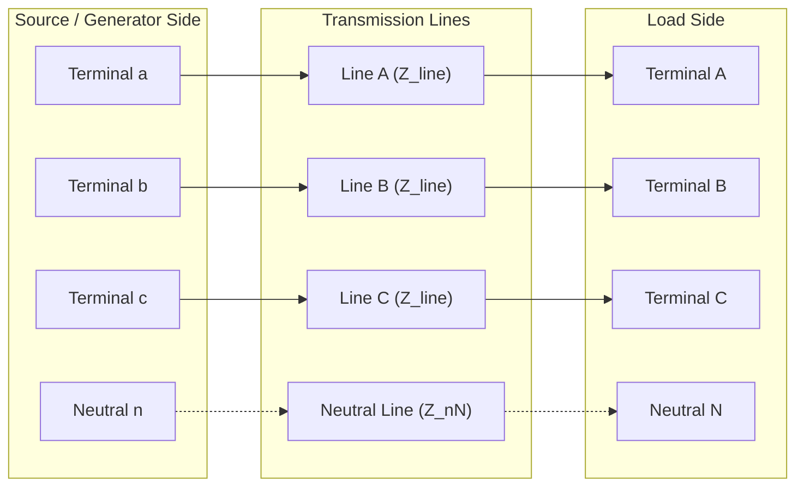

### 1. Meaning of Subscript Letters
* **Lowercase Letters ($a, b, c, n$)**: Represent the **Source / Generator side**, where $n$ is the source neutral point.
* **Uppercase Letters ($A, B, C, N$)**: Represent the **Load / Receiver side**, where $N$ is the load neutral point.
* **Double Subscripts Represent Potential Difference**:
  * $\mathbf{V}_{an} = \mathbf{V}_a - \mathbf{V}_n$ : Voltage from source terminal $a$ to source neutral $n$ (**Source Phase Voltage**).
  * $\mathbf{V}_{AN} = \mathbf{V}_A - \mathbf{V}_N$ : Voltage across load phase $A$ to load neutral $N$ (**Load Phase Voltage**).
  * $\mathbf{V}_{ab} = \mathbf{V}_a - \mathbf{V}_b$ : Voltage between transmission line $a$ and line $b$ (**Line-to-Line Voltage** or **Line Voltage**).
  * $\mathbf{V}_{Nn} = \mathbf{V}_N - \mathbf{V}_n$ : Voltage difference between load neutral and source neutral (**Neutral Shift Voltage**).

---

### 2. Line vs. Phase Quantities Comparison Table

| Quantity | Symbol | Physical Definition | In Star / Wye ($Y$) Circuit | In Delta ($\Delta$) Circuit |
| :--- | :---: | :--- | :--- | :--- |
| **Phase Voltage** | $V_p$ or $V_{\text{phase}}$ | Voltage dropped across **one single coil/branch** | Measured from phase terminal to neutral ($\mathbf{V}_{an}$) | Measured across individual delta branch ($\mathbf{V}_{ab}$) |
| **Line Voltage** | $V_L$ or $V_{\text{line}}$ | Voltage measured between **any two transmission lines** | Measured line-to-line, e.g. $\mathbf{V}_{ab}, \mathbf{V}_{bc}, \mathbf{V}_{ca}$ | Measured line-to-line, e.g. $\mathbf{V}_{ab}, \mathbf{V}_{bc}, \mathbf{V}_{ca}$ |
| **Phase Current** | $I_p$ or $I_{\text{phase}}$ | Current flowing through **the internal coil winding** | Current through single phase arm ($I_p = I_L$) | Current circulating in delta branch ($\mathbf{I}_{ab}$) |
| **Line Current** | $I_L$ or $I_{\text{line}}$ | Current travelling along **the external transmission line wire** | Current in transmission line ($\mathbf{I}_{aA}, \mathbf{I}_{bB}, \mathbf{I}_{cC}$) | Current in transmission line ($\mathbf{I}_a, \mathbf{I}_b, \mathbf{I}_c$) |

---

## 🧭 Phase Sequence: Positive ($abc$) vs. Negative ($acb$)

In a balanced system, all three phase voltages have equal magnitude ($V_p$) and are displaced by $120^\circ$:

### 1. Positive Sequence ($abc$ Sequence) — *Standard in 95% of Problems*
The phasor rotates counter-clockwise. Phase $a$ passes the reference axis first, followed by phase $b$, then phase $c$:

$$\mathbf{V}_{an} = V_p \angle 0^\circ$$

$$\mathbf{V}_{bn} = V_p \angle -120^\circ$$

$$\mathbf{V}_{cn} = V_p \angle -240^\circ = V_p \angle +120^\circ$$

### 2. Negative Sequence ($acb$ Sequence) — *Used in Exam Trap Questions*
Phase $a$ passes first, followed by phase $c$, then phase $b$:

$$\mathbf{V}_{an} = V_p \angle 0^\circ$$

$$\mathbf{V}_{bn} = V_p \angle +120^\circ$$

$$\mathbf{V}_{cn} = V_p \angle -120^\circ$$

*Figure 3: Phasor diagrams of positive ($abc$) vs negative ($acb$) phase sequences (From Slide 11).*

---

## 🔗 The 4 Interconnection Topologies (Source-to-Load)

Both source and load can be connected in either Star ($Y$) or Delta ($\Delta$). This yields four possible topologies:

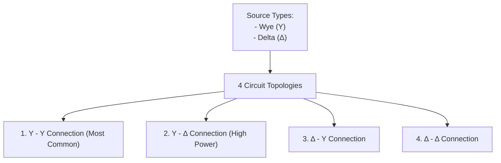

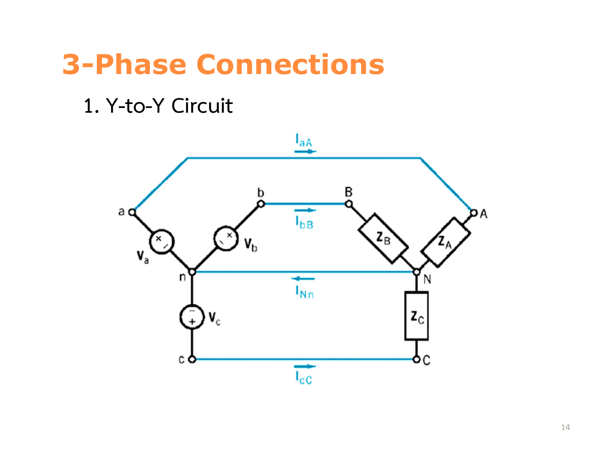
*Figure 4: A 3-phase 4-wire Y-Y connected system showing source, line impedance, and star-connected load (From Slide 14).*

---

### 1. Mathematical Proof of Wye ($Y$) System: $V_L = \sqrt{3} V_p \angle +30^\circ$

In a Wye-connected source, applying Kirchhoff's Voltage Law (KVL) between terminal $a$ and terminal $b$:

$$\mathbf{V}_{ab} = \mathbf{V}_{an} - \mathbf{V}_{bn}$$

For positive sequence with $\mathbf{V}_{an} = V_p \angle 0^\circ$ and $\mathbf{V}_{bn} = V_p \angle -120^\circ$:

$$\mathbf{V}_{ab} = V_p (1 + j0) - V_p \left(-\frac{1}{2} - j\frac{\sqrt{3}}{2}\right) = V_p \left( \frac{3}{2} + j\frac{\sqrt{3}}{2} \right)$$

Converting to polar form:

$$|\mathbf{V}_{ab}| = V_p \sqrt{\left(\frac{3}{2}\right)^2 + \left(\frac{\sqrt{3}}{2}\right)^2} = V_p \sqrt{\frac{9 + 3}{4}} = V_p \sqrt{3} = \sqrt{3} V_p$$

$$\theta = \arctan\left(\frac{\sqrt{3}/2}{3/2}\right) = \arctan\left(\frac{1}{\sqrt{3}}\right) = 30^\circ$$

$$\mathbf{V}_{ab} = \sqrt{3} V_p \angle +30^\circ$$

$$\mathbf{V}_{bc} = \sqrt{3} V_p \angle -90^\circ$$

$$\mathbf{V}_{ca} = \sqrt{3} V_p \angle +150^\circ$$

> [!IMPORTANT]
> **Summary for Wye ($Y$) Connection**:
> * **Line Voltage leads Phase Voltage by $30^\circ$**: $V_L = \sqrt{3} V_p \angle +30^\circ$
> * **Line Current equals Phase Current**: $I_L = I_p$

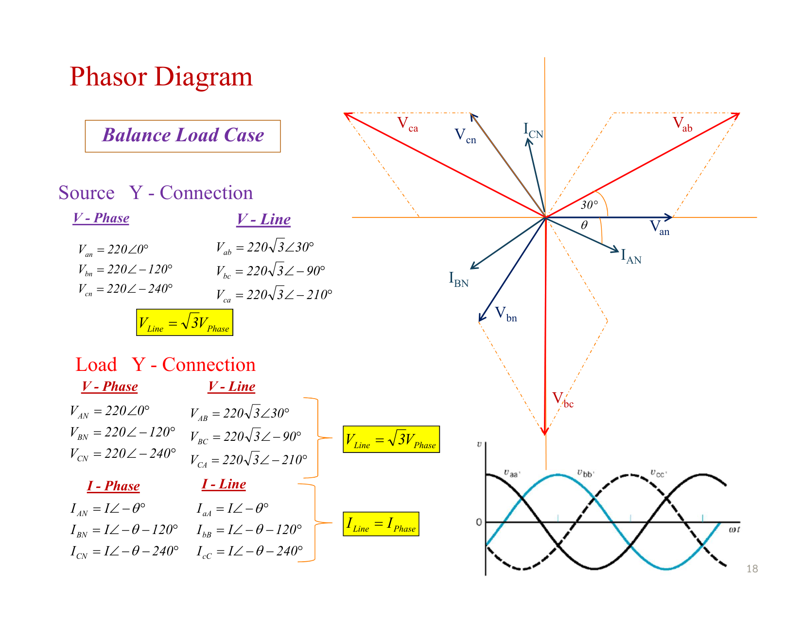
*Figure 5: Graphical phasor proof showing $\mathbf{V}_{ab} = \mathbf{V}_{an} - \mathbf{V}_{bn} = \sqrt{3}V_p\angle 30^\circ$ (From Slide 18).*

---

### 2. Mathematical Proof of Delta ($\Delta$) System: $I_L = \sqrt{3} I_p \angle -30^\circ$

In a Delta connection, the phase branches are connected directly between the line conductors:

$$V_L = V_p$$

Applying Kirchhoff's Current Law (KCL) at terminal node $A$:

$$\mathbf{I}_a = \mathbf{I}_{AB} - \mathbf{I}_{CA}$$

Assuming balanced positive sequence currents $\mathbf{I}_{AB} = I_p \angle 0^\circ$ and $\mathbf{I}_{CA} = I_p \angle +120^\circ$:

$$\mathbf{I}_a = I_p (1 + j0) - I_p \left(-\frac{1}{2} + j\frac{\sqrt{3}}{2}\right) = I_p \left(\frac{3}{2} - j\frac{\sqrt{3}}{2}\right) = \sqrt{3} I_p \angle -30^\circ$$

> [!IMPORTANT]
> **Summary for Delta ($\Delta$) Connection**:
> * **Line Voltage equals Phase Voltage**: $V_L = V_p$
> * **Line Current lags Phase Current by $30^\circ$**: $I_L = \sqrt{3} I_p \angle -30^\circ$

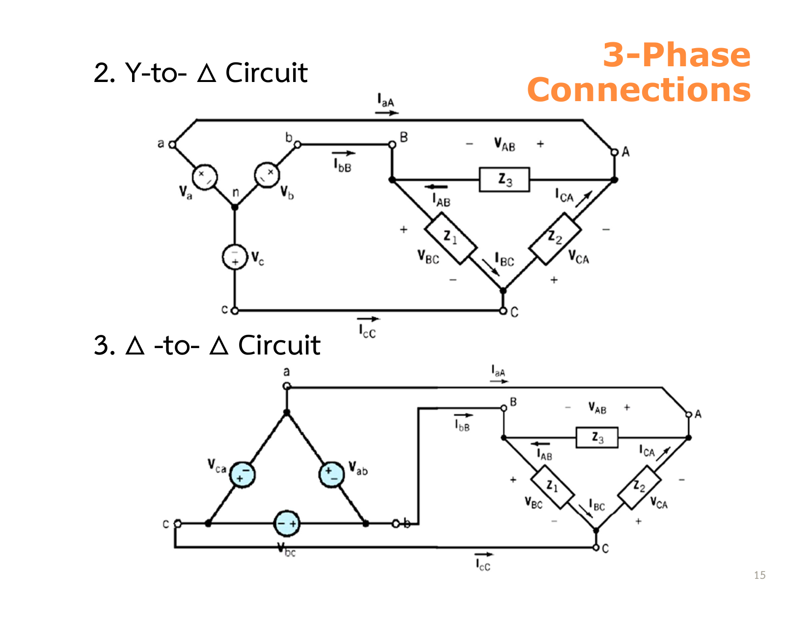
*Figure 6: Wye source supplying a Delta-connected load (From Slide 15).*

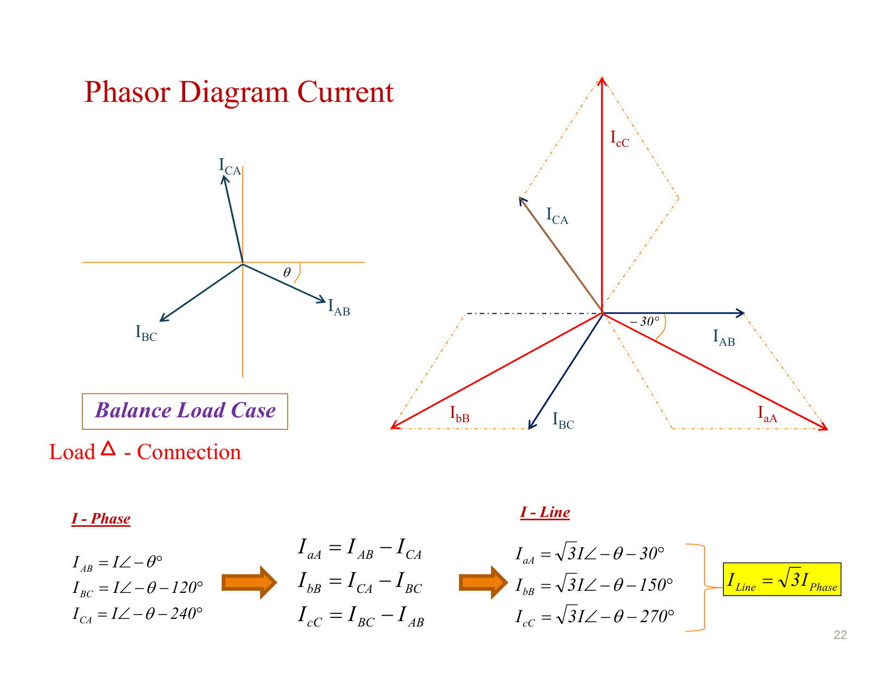
*Figure 7: Phasor relationship showing $\mathbf{I}_a = \sqrt{3}I_{AB}\angle -30^\circ$ (From Slide 22).*

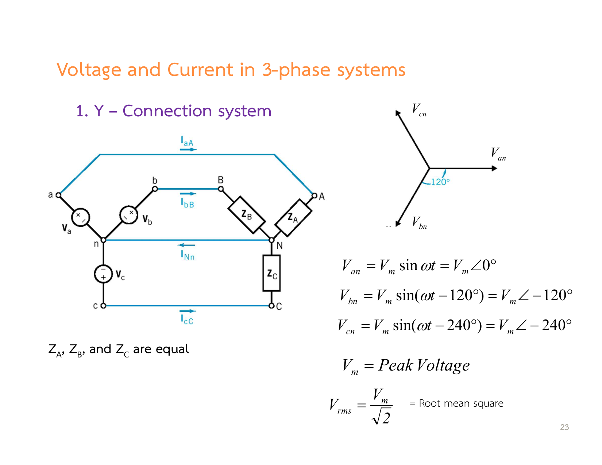
*Figure 8: Comprehensive summary table of Line vs Phase quantities for Wye and Delta connections (From Slide 23).*

---

### 3. Delta-Wye Impedance Transformation ($\Delta \leftrightarrow Y$)

When solving balanced circuits containing Delta loads, transform the Delta load into an equivalent Wye load to solve on a **Per-Phase Equivalent** basis:

$$Z_Y = \frac{Z_\Delta}{3} \iff Z_\Delta = 3 Z_Y$$

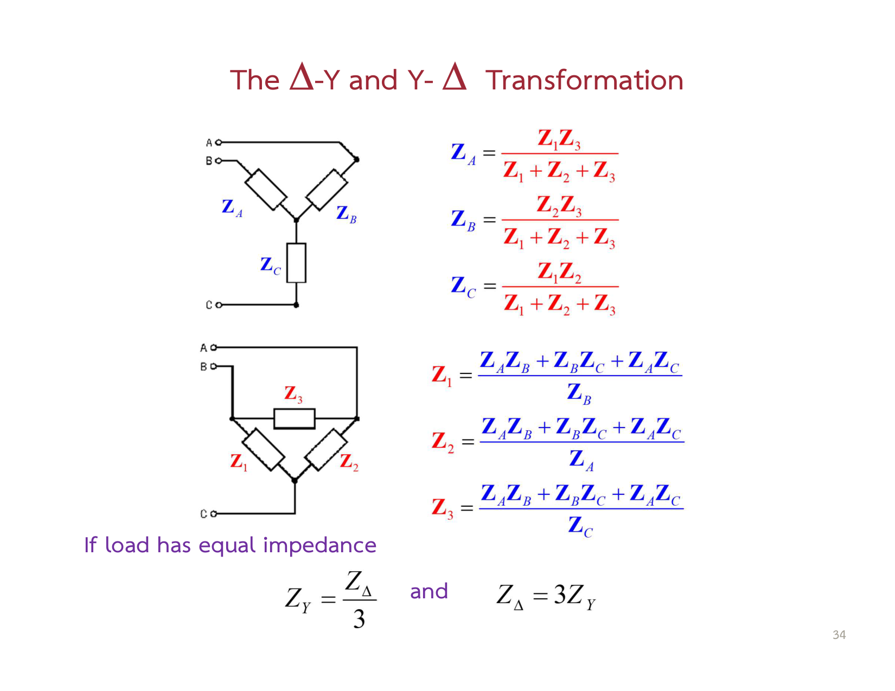
*Figure 9: Transforming a balanced Delta load to an equivalent Wye load $Z_Y = Z_\Delta / 3$ (From Slide 34).*

---

## ⚡ Power in Three-Phase Circuits

The total power consumed by a balanced three-phase load (whether connected in Wye or Delta) is three times the single-phase power:

### 1. Complex, Real, and Reactive Power Formulas

$$\mathbf{S}_{3\phi} = 3 \mathbf{S}_{1\phi} = 3 \mathbf{V}_p \mathbf{I}_p^* = \sqrt{3} V_L I_L \angle \theta$$

$$P_{3\phi} = 3 V_p I_p \cos\theta = \sqrt{3} V_L I_L \cos\theta \quad [\text{Watts, W}]$$

$$Q_{3\phi} = 3 V_p I_p \sin\theta = \sqrt{3} V_L I_L \sin\theta \quad [\text{Volt-Amperes Reactive, VAR}]$$

$$S_{3\phi} = \sqrt{P_{3\phi}^2 + Q_{3\phi}^2} = \sqrt{3} V_L I_L \quad [\text{Volt-Amperes, VA}]$$

> [!CAUTION]
> In the formula $\sqrt{3} V_L I_L \cos\theta$, the angle $\theta$ is **the phase angle of the load impedance** ($\theta = \theta_v - \theta_i$ of individual phase branch), **NOT** the angle between line voltage and line current!

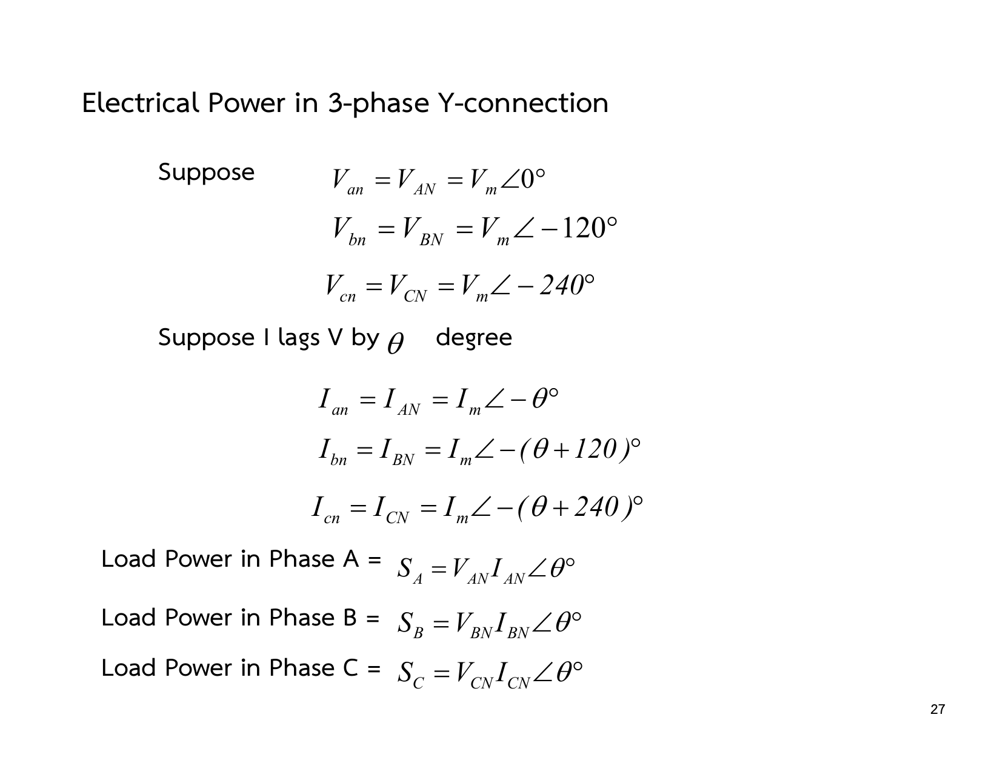
*Figure 10: Real, reactive, and apparent power formulas for balanced three-phase systems (From Slide 27).*

---

## 📊 Two-Wattmeter Method for Power Measurement

The two-wattmeter method measures the total real and reactive power of a three-phase three-wire system (balanced or unbalanced) using only two wattmeters:

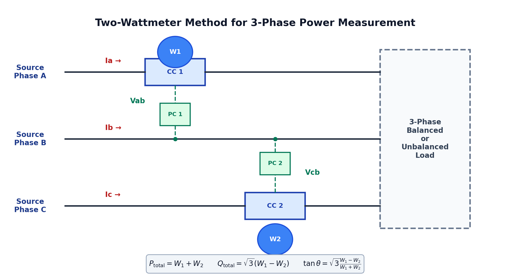
*Figure 11: Circuit diagram of the Two-Wattmeter Method with Current Coils (CC) in lines A and C, and Potential Coils (PC) connected across common line B.*

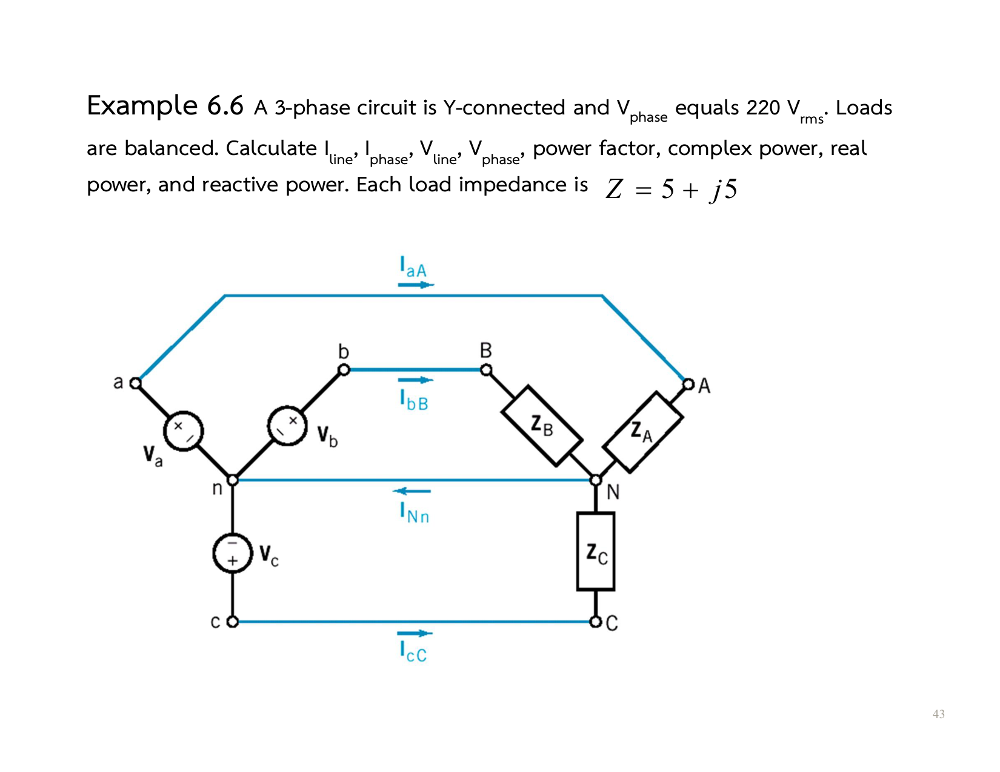
*Figure 12: Derivation and vector angles of individual wattmeter readings (From Slide 43).*

### 1. Wattmeter Reading Equations (Balanced Load, Phase Sequence $abc$)
* Wattmeter 1 measures line current $\mathbf{I}_a$ and voltage $\mathbf{V}_{ab}$:
  $$W_1 = V_{ab} I_a \cos(\angle \mathbf{V}_{ab} - \angle \mathbf{I}_a) = V_L I_L \cos(30^\circ - \theta)$$
* Wattmeter 2 measures line current $\mathbf{I}_c$ and voltage $\mathbf{V}_{cb}$:
  $$W_2 = V_{cb} I_c \cos(\angle \mathbf{V}_{cb} - \angle \mathbf{I}_c) = V_L I_L \cos(30^\circ + \theta)$$

### 2. Master Formulas Derived from $W_1$ and $W_2$
1. **Total Real Power ($P_{\text{total}}$)**:
   $$P_{\text{total}} = W_1 + W_2$$
2. **Total Reactive Power ($Q_{\text{total}}$)**:
   $$Q_{\text{total}} = \sqrt{3}(W_1 - W_2)$$
3. **Power Factor Angle ($\theta$)**:
   $$\tan\theta = \sqrt{3}\frac{W_1 - W_2}{W_1 + W_2} \implies \text{pf} = \cos\theta$$

| Load Power Factor ($\text{pf} = \cos\theta$) | Load Angle ($\theta$) | Wattmeter 1 Reading ($W_1$) | Wattmeter 2 Reading ($W_2$) | Special Phenomenon |
| :---: | :---: | :---: | :---: | :--- |
| **$\text{pf} = 1.0$ (Purely Resistive)** | $\theta = 0^\circ$ | $W_1 = W_2 > 0$ | $W_1 = W_2 > 0$ | Both wattmeters read identical positive values. |
| **$\text{pf} = 0.5$ (Lagging)** | $\theta = +60^\circ$ | $W_1 > 0$ | **$W_2 = 0$** | **Wattmeter 2 reads exactly ZERO!** |
| **$0 \le \text{pf} < 0.5$ (Lagging)** | $\theta > 60^\circ$ | $W_1 > 0$ | **$W_2 < 0$ (Negative!)** | **Wattmeter 2 deflects backwards!** Reverse CC terminals to read. |
| **$\text{pf} = 0$ (Purely Reactive)** | $\theta = 90^\circ$ | $W_1 = -W_2$ | $W_2 = -W_1$ | $W_1 + W_2 = 0$ (Zero total real power). |

---

## ⚙️ Power Factor Correction with Delta Capacitor Banks

Most industrial loads are inductive (induction motors, transformers) operating at lagging power factors. Installing a parallel capacitor bank supplies the required reactive power locally, unloading transmission lines:

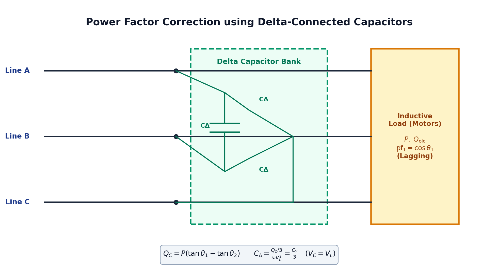
*Figure 13: Schematic of a three-phase inductive motor load corrected by a parallel Delta-connected capacitor bank.*

### 1. Step-by-Step Design Formula
1. Calculate the required total reactive power compensation:
   $$Q_C = P(\tan\theta_1 - \tan\theta_2)$$
2. In a **Delta-connected** capacitor bank, each capacitor sees the full line-to-line voltage ($V_C = V_L$):
   $$Q_{C,\text{per phase}} = \frac{Q_C}{3} = \omega C_\Delta V_L^2 \implies C_\Delta = \frac{Q_C}{3 \omega V_L^2}$$
3. If connected in **Wye ($Y$)**, the voltage across each capacitor is only $V_p = V_L / \sqrt{3}$:
   $$C_Y = \frac{Q_C}{\omega V_L^2} = 3 C_\Delta$$

> [!TIP]
> **Why Delta is Universally Preferred in Industry**:
> A Delta-connected capacitor bank requires **$3\times$ smaller capacitance** than a Wye bank ($C_\Delta = \frac{1}{3} C_Y$) to provide identical reactive VARs. Smaller capacitance means smaller physical size, lighter weight, and lower equipment cost!

---

## 📝 5 Authentic Exam Problems with Full Step-by-Step Solutions

---

### 🔴 Problem 1 (Level 1: Fundamentals of Phase Sequence & Line Voltages)
**Problem Statement:**  
A balanced three-phase Wye-connected source has a positive sequence ($abc$) with phase voltage $\mathbf{V}_{an} = 120\angle 10^\circ\text{ V rms}$.  
Find:
1. The remaining phase voltages $\mathbf{V}_{bn}$ and $\mathbf{V}_{cn}$.
2. All three line-to-line voltages $\mathbf{V}_{ab}, \mathbf{V}_{bc}, \mathbf{V}_{ca}$.

#### 💡 Step-by-Step Model Solution:
**Step 1: Determine Phase Voltages**  
In positive sequence, each phase lags by $120^\circ$:
$$\mathbf{V}_{an} = 120\angle 10^\circ\text{ V}$$
$$\mathbf{V}_{bn} = 120\angle (10^\circ - 120^\circ) = 120\angle -110^\circ\text{ V}$$
$$\mathbf{V}_{cn} = 120\angle (10^\circ + 120^\circ) = 120\angle +130^\circ\text{ V}$$

**Step 2: Calculate Line Voltages**  
Line voltage magnitude is $V_L = \sqrt{3} V_p = \sqrt{3} \times 120 \approx 207.85\text{ V}$, leading phase voltage by $30^\circ$:
$$\mathbf{V}_{ab} = \sqrt{3} \times 120 \angle (10^\circ + 30^\circ) = 207.85\angle 40^\circ\text{ V}$$
$$\mathbf{V}_{bc} = 207.85\angle (40^\circ - 120^\circ) = 207.85\angle -80^\circ\text{ V}$$
$$\mathbf{V}_{ca} = 207.85\angle (40^\circ + 120^\circ) = 207.85\angle 160^\circ\text{ V}$$

---

### 🔴 Problem 2 (Level 2: Balanced Y-Y System with Line Impedance - Homework 6 Prob. 1)
**Problem Statement:**  
A balanced 3-phase 4-wire Y-Y system has:
* Source: $\mathbf{V}_{an} = 110\angle 0^\circ\text{ V rms}$, $abc$ sequence.
* Line impedance: $\mathbf{Z}_{\text{line}} = 5 - j2\ \Omega$ per phase.
* Load impedance: $\mathbf{Z}_Y = 10 + j8\ \Omega$ per phase.
* Neutral wire impedance: $\mathbf{Z}_n = 0\ \Omega$.  
Find:
1. The line currents $\mathbf{I}_{aA}, \mathbf{I}_{bB}, \mathbf{I}_{cC}$.
2. The phase voltages at the load terminals $\mathbf{V}_{AN}, \mathbf{V}_{BN}, \mathbf{V}_{CN}$.
3. The total complex power $\mathbf{S}_{\text{total}}$ delivered to the load.

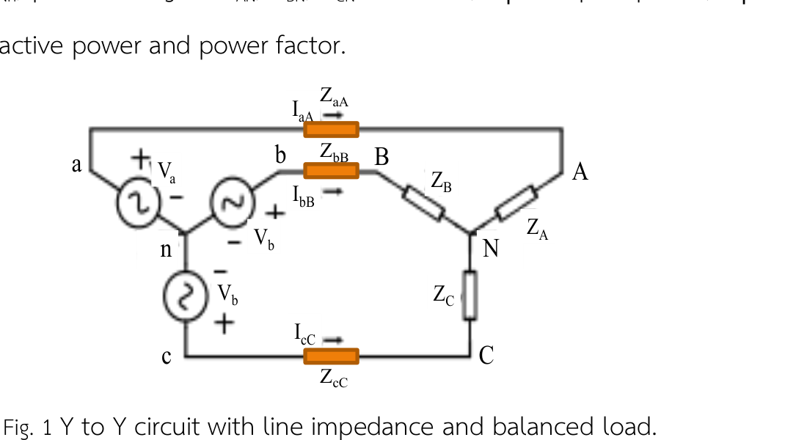
*Figure 14: Balanced Y-Y system with line impedance (Homework 6 Problem 1).*

#### 💡 Step-by-Step Model Solution:
**Step 1: Single-Phase Equivalent Circuit Analysis**  
Total impedance per phase:
$$\mathbf{Z}_{\text{total}} = \mathbf{Z}_{\text{line}} + \mathbf{Z}_Y = (5 - j2) + (10 + j8) = 15 + j6\ \Omega$$
$$\mathbf{Z}_{\text{total}} = \sqrt{15^2 + 6^2}\angle \arctan(6/15) = \sqrt{225 + 36}\angle 21.8^\circ = 16.16\angle 21.8^\circ\ \Omega$$

**Step 2: Line Current Calculation**
$$\mathbf{I}_{aA} = \frac{\mathbf{V}_{an}}{\mathbf{Z}_{\text{total}}} = \frac{110\angle 0^\circ}{16.16\angle 21.8^\circ} = 6.81\angle -21.8^\circ\text{ A}$$
$$\mathbf{I}_{bB} = 6.81\angle (-21.8^\circ - 120^\circ) = 6.81\angle -141.8^\circ\text{ A}$$
$$\mathbf{I}_{cC} = 6.81\angle (-21.8^\circ + 120^\circ) = 6.81\angle 98.2^\circ\text{ A}$$
$$\mathbf{I}_n = -(\mathbf{I}_{aA} + \mathbf{I}_{bB} + \mathbf{I}_{cC}) = 0\text{ A (Balanced!)}$$

**Step 3: Load Phase Voltages**
$$\mathbf{V}_{AN} = \mathbf{I}_{aA} \mathbf{Z}_Y = (6.81\angle -21.8^\circ) \times (10 + j8)$$
$$10 + j8 = \sqrt{100 + 64}\angle \arctan(8/10) = 12.81\angle 38.66^\circ\ \Omega$$
$$\mathbf{V}_{AN} = 6.81 \times 12.81 \angle (-21.8^\circ + 38.66^\circ) = 87.24\angle 16.86^\circ\text{ V}$$
$$\mathbf{V}_{BN} = 87.24\angle (16.86^\circ - 120^\circ) = 87.24\angle -103.14^\circ\text{ V}$$
$$\mathbf{V}_{CN} = 87.24\angle (16.86^\circ + 120^\circ) = 87.24\angle 136.86^\circ\text{ V}$$

**Step 4: Total Complex Power Delivered to the Load**
$$\mathbf{S}_{3\phi} = 3 \times |\mathbf{I}_{aA}|^2 \times \mathbf{Z}_Y = 3 \times (6.81)^2 \times (10 + j8) = 3 \times 46.38 \times (10 + j8)$$
$$\mathbf{S}_{3\phi} = 1,391.4 + j1,113.1\text{ VA} = 1.39\text{ kW} + j1.11\text{ kVAR}$$

---

### 🔴 Problem 3 (Level 3: Balanced Y-Δ System with Line Impedance)
**Problem Statement:**  
A balanced three-phase system has:
* Source: Wye-connected, line-to-line voltage $V_L = 208\text{ V rms}$, $abc$ sequence, taking $\mathbf{V}_{ab}$ as reference ($208\angle 0^\circ\text{ V}$).
* Line impedance: $\mathbf{Z}_{\text{line}} = 1 + j1\ \Omega$.
* Load: Delta-connected with branch impedance $\mathbf{Z}_\Delta = 12 + j9\ \Omega$.  
Find:
1. The line currents $\mathbf{I}_a, \mathbf{I}_b, \mathbf{I}_c$.
2. The phase currents circulating inside the Delta load $\mathbf{I}_{AB}, \mathbf{I}_{BC}, \mathbf{I}_{CA}$.

#### 💡 Step-by-Step Model Solution:
**Step 1: Transform Delta Load to Equivalent Wye Load**
$$\mathbf{Z}_Y = \frac{\mathbf{Z}_\Delta}{3} = \frac{12 + j9}{3} = 4 + j3\ \Omega$$

**Step 2: Determine Source Phase Voltage**
Since $\mathbf{V}_{ab} = 208\angle 0^\circ\text{ V}$ and $\mathbf{V}_{ab} = \sqrt{3} \mathbf{V}_{an}\angle +30^\circ$:
$$\mathbf{V}_{an} = \frac{208}{\sqrt{3}}\angle (0^\circ - 30^\circ) = 120.09\angle -30^\circ\text{ V}$$

**Step 3: Total Impedance and Line Current**
$$\mathbf{Z}_{\text{total}} = \mathbf{Z}_{\text{line}} + \mathbf{Z}_Y = (1 + j1) + (4 + j3) = 5 + j4 = 6.403\angle 38.66^\circ\ \Omega$$
$$\mathbf{I}_a = \frac{\mathbf{V}_{an}}{\mathbf{Z}_{\text{total}}} = \frac{120.09\angle -30^\circ}{6.403\angle 38.66^\circ} = 18.755\angle -68.66^\circ\text{ A}$$
$$\mathbf{I}_b = 18.755\angle (-68.66^\circ - 120^\circ) = 18.755\angle -188.66^\circ\text{ A} = 18.755\angle 171.34^\circ\text{ A}$$
$$\mathbf{I}_c = 18.755\angle (-68.66^\circ + 120^\circ) = 18.755\angle 51.34^\circ\text{ A}$$

**Step 4: Calculate Delta Phase Currents**
Phase current magnitude is $I_p = I_L / \sqrt{3} = 18.755 / \sqrt{3} = 10.828\text{ A}$, leading line current by $30^\circ$:
$$\mathbf{I}_{AB} = \frac{18.755}{\sqrt{3}}\angle (-68.66^\circ + 30^\circ) = 10.83\angle -38.66^\circ\text{ A}$$
$$\mathbf{I}_{BC} = 10.83\angle (-38.66^\circ - 120^\circ) = 10.83\angle -158.66^\circ\text{ A}$$
$$\mathbf{I}_{CA} = 10.83\angle (-38.66^\circ + 120^\circ) = 10.83\angle 81.34^\circ\text{ A}$$

---

### 🔴 Problem 4 (Level 4: Unbalanced Y-Y System & Neutral Shift - Homework 6 Prob. 2)
**Problem Statement:**  
An unbalanced 3-phase 3-wire Y-Y system (NO neutral wire, $\mathbf{Z}_n = \infty$) has:
* Source: $\mathbf{V}_{an} = 100\angle 0^\circ\text{ V}$, $\mathbf{V}_{bn} = 100\angle -120^\circ\text{ V}$, $\mathbf{V}_{cn} = 100\angle 120^\circ\text{ V}$.
* Line impedance: $\mathbf{Z}_{\text{line}} = 0\ \Omega$.
* Unbalanced load: $\mathbf{Z}_A = 10\ \Omega$, $\mathbf{Z}_B = j10\ \Omega$, $\mathbf{Z}_C = -j10\ \Omega$.  
Find:
1. The Neutral Shift Voltage ($\mathbf{V}_{Nn} = \mathbf{V}_N - \mathbf{V}_n$).
2. The load phase voltages $\mathbf{V}_{AN}, \mathbf{V}_{BN}, \mathbf{V}_{CN}$.
3. The line currents $\mathbf{I}_{aA}, \mathbf{I}_{bB}, \mathbf{I}_{cC}$.

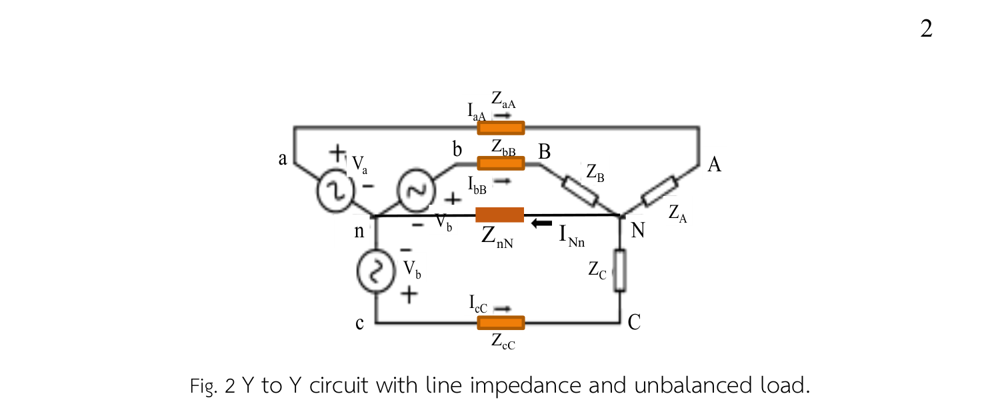
*Figure 15: Unbalanced Y-Y load with disconnected neutral wire (Homework 6 Problem 2).*

#### 💡 Step-by-Step Model Solution:
**Step 1: Calculate Load Admittances**
$$\mathbf{Y}_A = \frac{1}{10} = 0.1\ \text{S}$$
$$\mathbf{Y}_B = \frac{1}{j10} = -j0.1\ \text{S}$$
$$\mathbf{Y}_C = \frac{1}{-j10} = +j0.1\ \text{S}$$
Sum of admittances:
$$\sum \mathbf{Y} = \mathbf{Y}_A + \mathbf{Y}_B + \mathbf{Y}_C = 0.1 - j0.1 + j0.1 = 0.1\ \text{S}$$

**Step 2: Calculate Neutral Shift Voltage using Millman's Theorem / KCL**
$$\mathbf{V}_{Nn} = \frac{\mathbf{V}_{an}\mathbf{Y}_A + \mathbf{V}_{bn}\mathbf{Y}_B + \mathbf{V}_{cn}\mathbf{Y}_C}{\sum \mathbf{Y}}$$
Numerator:
$$\mathbf{V}_{an}\mathbf{Y}_A = (100\angle 0^\circ)(0.1) = 10$$
$$\mathbf{V}_{bn}\mathbf{Y}_B = (100\angle -120^\circ)(-j0.1) = (100\angle -120^\circ)(0.1\angle -90^\circ) = 10\angle -210^\circ = 10\angle 150^\circ = -8.66 + j5$$
$$\mathbf{V}_{cn}\mathbf{Y}_C = (100\angle 120^\circ)(+j0.1) = (100\angle 120^\circ)(0.1\angle 90^\circ) = 10\angle 210^\circ = -8.66 - j5$$
Summing the terms:
$$\text{Numerator} = 10 + (-8.66 + j5) + (-8.66 - j5) = 10 - 17.32 = -7.32\text{ V}$$
$$\mathbf{V}_{Nn} = \frac{-7.32}{0.1} = -73.2\angle 0^\circ = 73.2\angle 180^\circ\text{ V}$$

**Step 3: Calculate Load Phase Voltages**
$$\mathbf{V}_{AN} = \mathbf{V}_{an} - \mathbf{V}_{Nn} = 100 - (-73.2) = 173.2\angle 0^\circ\text{ V}$$
$$\mathbf{V}_{BN} = \mathbf{V}_{bn} - \mathbf{V}_{Nn} = (-50 - j86.6) - (-73.2) = 23.2 - j86.6 = 89.65\angle -75^\circ\text{ V}$$
$$\mathbf{V}_{CN} = \mathbf{V}_{cn} - \mathbf{V}_{Nn} = (-50 + j86.6) - (-73.2) = 23.2 + j86.6 = 89.65\angle 75^\circ\text{ V}$$

**Step 4: Calculate Line Currents**
$$\mathbf{I}_{aA} = \frac{\mathbf{V}_{AN}}{\mathbf{Z}_A} = \frac{173.2\angle 0^\circ}{10} = 17.32\angle 0^\circ\text{ A}$$
$$\mathbf{I}_{bB} = \frac{\mathbf{V}_{BN}}{\mathbf{Z}_B} = \frac{89.65\angle -75^\circ}{10\angle 90^\circ} = 8.965\angle -165^\circ\text{ A}$$
$$\mathbf{I}_{cC} = \frac{\mathbf{V}_{CN}}{\mathbf{Z}_C} = \frac{89.65\angle 75^\circ}{10\angle -90^\circ} = 8.965\angle 165^\circ\text{ A}$$
*(Verification: $\mathbf{I}_{aA} + \mathbf{I}_{bB} + \mathbf{I}_{cC} = 17.32 + 2(-8.66) = 0\text{ A}$. Perfect KCL match!)*

---

### 🔴 Problem 5 (Level 5: Two-Wattmeter Method & Power Factor Correction Exam Problem)
**Problem Statement:**  
A three-phase, $400\text{ V rms}, 50\text{ Hz}$ supply feeds a balanced inductive load. Two wattmeters connected to measure total input power read:
$$W_1 = 12.5\text{ kW} \quad \text{and} \quad W_2 = 4.5\text{ kW}$$
1. Find the total real power $P_{\text{total}}$, reactive power $Q_{\text{total}}$, apparent power $S_{\text{total}}$, and the power factor.
2. Determine the line current $I_L$.
3. Calculate the required capacitance per phase ($C_\Delta$) of a Delta-connected capacitor bank to improve the overall power factor to $0.95\text{ lagging}$.

#### 💡 Step-by-Step Model Solution:
**Step 1: Calculate Total Powers from Wattmeter Readings**
$$P_{\text{total}} = W_1 + W_2 = 12.5 + 4.5 = 17.0\text{ kW}$$
$$Q_{\text{total}} = \sqrt{3}(W_1 - W_2) = \sqrt{3}(12.5 - 4.5) = \sqrt{3} \times 8.0 \approx 13.856\text{ kVAR}$$
$$S_{\text{total}} = \sqrt{P^2 + Q^2} = \sqrt{17.0^2 + 13.856^2} = \sqrt{289 + 192} = \sqrt{481} \approx 21.93\text{ kVA}$$
$$\text{pf}_1 = \cos\theta_1 = \frac{P_{\text{total}}}{S_{\text{total}}} = \frac{17.0}{21.93} \approx 0.775\text{ lagging}$$
$$\theta_1 = \arccos(0.775) \approx 39.18^\circ$$

**Step 2: Line Current Before Compensation**
$$I_L = \frac{P_{\text{total}}}{\sqrt{3} V_L \cos\theta_1} = \frac{17,000}{\sqrt{3} \times 400 \times 0.775} = \frac{17,000}{536.94} \approx 31.66\text{ A}$$

**Step 3: Capacitor Bank Sizing for $\text{pf}_2 = 0.95\text{ lagging}$**
$$\theta_2 = \arccos(0.95) \approx 18.19^\circ$$
$$\tan\theta_1 = \tan(39.18^\circ) = 0.815$$
$$\tan\theta_2 = \tan(18.19^\circ) = 0.329$$
Required reactive power compensation:
$$Q_C = P_{\text{total}} (\tan\theta_1 - \tan\theta_2) = 17.0 \times (0.815 - 0.329) = 17.0 \times 0.486 = 8.262\text{ kVAR}$$

For a **Delta-connected** capacitor bank ($V_C = V_L = 400\text{ V}$):
$$C_\Delta = \frac{Q_C / 3}{\omega V_L^2} = \frac{8,262 / 3}{2\pi \times 50 \times 400^2} = \frac{2,754}{2\pi \times 50 \times 160,000} = \frac{2,754}{50,265,482} \approx 5.48 \times 10^{-5}\text{ F} = 54.8\ \mu\text{F}$$

---

## 🎯 Final Exam Key Formulas & Cheat Sheet

1. **Wye ($Y$) Relationships**:
   * $V_L = \sqrt{3} V_p \angle +30^\circ$
   * $I_L = I_p$
2. **Delta ($\Delta$) Relationships**:
   * $V_L = V_p$
   * $I_L = \sqrt{3} I_p \angle -30^\circ$
3. **$\Delta \leftrightarrow Y$ Impedance Transformation**:
   * $Z_Y = \frac{Z_\Delta}{3} \iff Z_\Delta = 3 Z_Y$
4. **Three-Phase Power**:
   * $P = \sqrt{3} V_L I_L \cos\theta = 3 V_p I_p \cos\theta$
   * $Q = \sqrt{3} V_L I_L \sin\theta = 3 V_p I_p \sin\theta$
5. **Two-Wattmeter Method**:
   * $P_{\text{total}} = W_1 + W_2$
   * $Q_{\text{total}} = \sqrt{3}(W_1 - W_2)$
   * $\tan\theta = \sqrt{3}\frac{W_1 - W_2}{W_1 + W_2}$
6. **Capacitor Sizing**:
   * $Q_C = P(\tan\theta_1 - \tan\theta_2)$
   * $C_\Delta = \frac{Q_C / 3}{\omega V_L^2} = \frac{C_Y}{3}$
