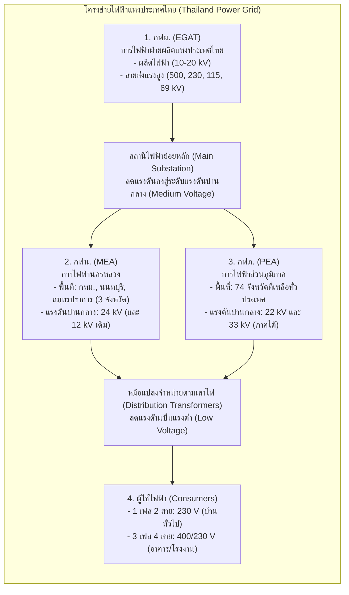
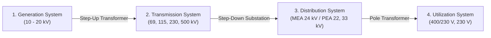

# คัมภีร์เจาะลึกบทที่ 8: ระบบการจ่ายไฟฟ้ากำลัง (Power Distribution System Mastery)
**วิชา:** Fundamental Electrical Engineering (FunE) • คณะวิศวกรรมศาสตร์ มหาวิทยาลัยขอนแก่น  
**ผู้สอน:** รศ.ดร. นรารัตน์ เรืองชัยจตุพร

---

## 📌 บทนำ: ทำไมวิศวกรต้องเข้าใจ "ระบบโครงข่ายไฟฟ้ากำลัง"? (Intuition จากศูนย์)

ไฟฟ้าที่เราเปิดใช้งานตามบ้านพักอาศัยหรือโรงงานอุตสาหกรรมในปัจจุบัน **ไม่ได้เกิดขึ้นใกล้ตัวเรา** โรงไฟฟ้าขนาดใหญ่ส่วนใหญ่ตั้งอยู่ห่างไกลออกไปหลายร้อยถึงพันกิโลเมตร เช่น โรงไฟฟ้าพลังน้ำบนยอดเขา (เขื่อนภูมิพล จ.ตาก), โรงไฟฟ้าถ่านหินใกล้เหมืองแร่ (แม่เมาะ จ.ลำปาง), หรือโรงไฟฟ้าก๊าซธรรมชาติแถบชายฝั่งทะเล (บางปะกง)

คำถามสำคัญคือ: **ทำไมเราไม่สร้างโรงไฟฟ้าไว้กลางเมืองใกล้บ้านคน? และทำไมไฟฟ้าที่ส่งมาถึงเราต้องแปลงแรงดันขึ้น-ลงหลายรอบขนาดนั้น?**

1. **ข้อจำกัดด้านทรัพยากรและสิ่งแวดล้อม**: แหล่งพลังงานต้นกำเนิด (น้ำ, ก๊าซธรรมชาติ, ถ่านหิน) อยู่ในพื้นที่เฉพาะทางธรรมชาติ อีกทั้งโรงไฟฟ้าขนาดใหญ่ต้องการระบบระบายความร้อนมหาศาลและมาตรการควบคุมมลพิษที่เข้มงวด จึงจำเป็นต้องตั้งอยู่นอกเขตชุมชน
2. **ทำไมต้องส่งด้วย "แรงดันสูงลิ่ว" (High Voltage)?**:
   * กำลังไฟฟ้าที่ส่งทางสายคือ $P = \sqrt{3} V_L I_L \cos\theta$
   * หากเราต้องการส่งกำลังงาน $P$ ปริมาณมหาศาล (เช่น $500\text{ MW}$) ถ้าส่งด้วยแรงดันต่ำ กระแสไฟฟ้า $I_L$ จะมหาศาลตาม
   * กำลังงานสูญเสียในสายส่งในรูปความร้อนคือ $P_{\text{loss}} = 3 I_L^2 R_{\text{line}}$
   * ดังนั้น **หากเพิ่มแรงดันขึ้น $5$ เท่า $\rightarrow$ กระแสในสายจะลดลง $5$ เท่า $\rightarrow$ กำลังสูญเสียจะลดลงถึง $5^2 = 25$ เท่า!**
   * การส่งด้วยแรงดันสูงมากจึงช่วยประหยัดพลังงาน ประหยัดขนาดสายไฟ (ลดต้นทุนสายทองแดง/อะลูมิเนียม) และลดแรงดันตก (Voltage Drop) ทางไกลได้อย่างมหาศาล
3. **ทำไมตอนเข้าบ้านต้องลดแรงดันเหลือ $230\text{ V}$?**:
   * เพราะเรื่อง **"ความปลอดภัยของมนุษย์ (Life Safety)"** และ **"ระยะฉนวนของอุปกรณ์ (Insulation Clearance)"** อุปกรณ์เครื่องใช้ไฟฟ้าในบ้านไม่สามารถทนแรงดันระดับหมื่นโวลต์ได้โดยไม่เกิดการอาร์กหรือลัดวงจร

*รูปที่ 1: แผนผังภาพรวม 4 ขั้นตอนของระบบไฟฟ้ากำลังไทย: การผลิต (10-20 kV) $\to$ การส่ง (69-500 kV) $\to$ การจำหน่าย (22-33 kV / 24 kV) $\to$ การใช้ไฟฟ้า (400/230 V)*

*รูปที่ 2: สไลด์หน้า 7 แสดงความสัมพันธ์และการแปลงระดับแรงดันใน 4 ขั้นตอน (Generation $\to$ Transmission $\to$ Distribution $\to$ Utilization)*

---

## 🔤 ถอดรหัส "ทุกตัวแปร ตัวย่อ และหน่วยงานในข้อสอบ" (Variables & Utilities Decoded)

ข้อสอบบทที่ 8 มักมีตัวย่อภาษาอังกฤษ หน่วยงาน และระดับแรงดันที่ต้องจำให้แม่นยำ มาสรุปเคลียร์ทุกจุดตรงนี้:

### 1. ถอดรหัส 3 การไฟฟ้าหลักของประเทศไทย

| หน่วยงาน | ชื่อเต็มภาษาไทย / อังกฤษ | หน้าที่หลักตามกฎหมาย | ขอบเขตพื้นที่รับผิดชอบ | ระดับแรงดันที่รับผิดชอบ |
| :--- | :--- | :--- | :--- | :--- |
| **กฟผ. (EGAT)** | การไฟฟ้าฝ่ายผลิตแห่งประเทศไทย *(Electricity Generating Authority of Thailand)* | ผลิตไฟฟ้าจากโรงไฟฟ้าของตนเอง รับซื้อไฟฟ้าจากเอกชน (IPP/SPP/VSPP) และดูแลระบบสายส่งแรงสูงทั่วประเทศ | ทั่วราชอาณาจักรไทย (การผลิตและสายส่ง) | **ผลิต:** $10 - 20\text{ kV}$ **สายส่ง:** $69, 115, 230, 500\text{ kV}$ |
| **กฟน. (MEA)** | การไฟฟ้านครหลวง *(Metropolitan Electricity Authority)* | รับซื้อไฟฟ้าจาก กฟผ. มาจำหน่ายและบริการผู้ใช้ไฟฟ้าในเขตเมืองหลวง | **3 จังหวัด:** กรุงเทพมหานคร, นนทบุรี, สมุทรปราการ | **แรงดันปานกลาง:** $24\text{ kV}$ (และ $12\text{ kV}$) **แรงต่ำ:** $400/230\text{ V}$ |
| **กฟภ. (PEA)** | การไฟฟ้าส่วนภูมิภาค *(Provincial Electricity Authority)* | รับซื้อไฟฟ้าจาก กฟผ. มาจำหน่ายและบริการผู้ใช้ไฟฟ้าในส่วนภูมิภาค | **74 จังหวัดที่เหลือ** ทั่วประเทศไทย (พื้นที่ครอบคลุม $99\%$ ของประเทศ) | **แรงดันปานกลาง:** $22\text{ kV}$ และ $33\text{ kV}$ **แรงต่ำ:** $400/230\text{ V}$ |

---

### 2. ถอดรหัสตัวแปรและสูตรคำนวณทางวิศวกรรมไฟฟ้ากำลัง

* $P$ : กำลังไฟฟ้าจริง (Real/Active Power) หน่วยเป็นวัตต์ ($\text{W}$), กิโลวัตต์ ($\text{kW}$), หรือเมกะวัตต์ ($\text{MW}$)
* $Q$ : กำลังไฟฟ้ารีแอกทีฟ (Reactive Power) หน่วยเป็นวาร์ ($\text{VAR}$) หรือเมกะวาร์ ($\text{MVAR}$)
* $S$ : กำลังไฟฟ้าปรากฏ (Apparent Power) หน่วยเป็นโวลต์-แอมแปร์ ($\text{VA}$) หรือเมกะโวลต์-แอมแปร์ ($\text{MVA}$)
* $V_L$ : แรงดันระหว่างสายส่ง (Line-to-Line Voltage) เช่น $500\text{ kV}, 230\text{ kV}, 115\text{ kV}, 24\text{ kV}, 22\text{ kV}, 400\text{ V}$
* $V_p$ : แรงดันเทียบกับนิวทรัล (Phase Voltage) เช่น $230\text{ V}$ ($V_L = \sqrt{3} V_p$)
* $I_L$ : กระแสไฟฟ้าที่ไหลในสายส่ง (Line Current) คำนวณจาก:
  $$I_L = \frac{P}{\sqrt{3} V_L \cos\theta}$$
* $P_{\text{loss}}$ : กำลังสูญเสียในสายส่ง 3 เฟส:
  $$P_{\text{loss}} = 3 I_L^2 R_{\text{line}} = 3 \left(\frac{P}{\sqrt{3} V_L \cos\theta}\right)^2 R_{\text{line}} = \frac{P^2 R_{\text{line}}}{V_L^2 \cos^2\theta}$$
  > [!IMPORTANT]
  > สังเกตว่า $P_{\text{loss}} \propto \frac{1}{V_L^2}$ นั่นคือ หากส่งกำลังงานเท่าเดิม การเพิ่มแรงดันขึ้น $k$ เท่า จะทำให้กำลังสูญเสียลดลงถึง $k^2$ เท่าเสมอ! ข้อสอบชอบออกข้อนี้บ่อยมาก

---

## ⚡ 4 ขั้นตอนของระบบไฟฟ้ากำลัง (The 4 Levels of Power System)

ระบบไฟฟ้ากำลังแบ่งออกเป็น 4 ระบบต่อเนื่องกันอย่างเป็นเอกภาพ:

### 1. ระบบผลิตไฟฟ้า (Generation System)
* **ระดับแรงดันกำเนิด**: เครื่องกำเนิดไฟฟ้ากระแสสลับ (Alternator / Synchronous Generator) ผลิตแรงดันออกมาในช่วง **$10\text{ kV} - 20\text{ kV}$**
* **สาเหตุที่ไม่ผลิตที่ $500\text{ kV}$ ตั้งแต่แรก**: เพราะข้อจำกัดด้าน **ฉนวนไฟฟ้า (Electrical Insulation)** ภายในสล็อตของสเตเตอร์เครื่องกำเนิดไฟฟ้า หากทำขดลวดทนแรงดันระดับแสนโวลต์ ตัวเครื่องจะต้องมีขนาดมหึมาและฉนวนจะหนาเกินไปจนระบายความร้อนไม่ได้ จึงผลิตที่ $10-20\text{ kV}$ แล้วส่งเข้า **หม้อแปลงเพิ่มแรงดัน (Step-Up Transformer)** ทันที

*รูปที่ 3: แผนที่โครงข่ายสายส่งกำลังไฟฟ้าแห่งชาติของ กฟผ. เชื่อมโยงโรงไฟฟ้าทั่วประเทศ (จากสไลด์ที่ 10)*

---

### 2. ระบบส่งกำลังไฟฟ้า (Transmission System)
* **ผู้รับผิดชอบ**: กฟผ. (EGAT) แต่เพียงผู้เดียวในประเทศไทย
* **โครงสร้างทางกายภาพ**: ส่วนใหญ่เป็น **สายส่งเหนือดิน (Overhead Transmission Lines)** ติดตั้งบนเสาโครงเหล็กแรงสูง (Steel Lattice Towers) หรือเสาคอนกรีตอัดแรง เพื่อให้อยู่ห่างจากพื้นดิน ปลอดภัยจากการสัมผัส และใช้บรรยากาศเป็นฉนวนธรรมชาติ
* **4 พิกัดแรงดันมาตรฐานของสายส่ง กฟผ. (Nominal Transmission Voltages)**:
  1. **$500\text{ kV}$ (แรงดันสูงสุดพิเศษ EHV)**: ใช้ส่งกำลังงานมหาศาลข้ามภาค เช่น สายส่งจากโรงไฟฟ้าพลังน้ำประเทศลาว (น้ำงึม, น้ำเทิน) เข้าสู่ภาคกลาง และสายส่งเชื่อมโยงโรงไฟฟ้าแม่เมาะ จ.ลำปาง
  2. **$230\text{ kV}$ (แรงดันสูง)**: โครงข่ายแกนหลัก (Main Backbone Grid) เชื่อมระหว่างสถานีไฟฟ้าย่อยหลักแต่ละภูมิภาค
  3. **$115\text{ kV}$ (แรงดันสูง)**: กระจายกำลังไฟฟ้าสู่ตัวจังหวัดและสถานีไฟฟ้าย่อยรอบนอก
  4. **$69\text{ kV}$ (แรงดันสูงย่อย Sub-transmission)**: ระบบดั้งเดิม ปัจจุบันพบในบางพื้นที่ของ กฟน. และพื้นที่เฉพาะ

*รูปที่ 4: สายส่งกำลังไฟฟ้าเหนือดินและระดับแรงดัน $69, 115, 230, 500\text{ kV}$ (จากสไลด์ที่ 38)*

---

### 3. ระบบจำหน่าย (Distribution System)
รับกำลังไฟฟ้าจากสถานีไฟฟ้าย่อยหลักของ กฟผ. แล้วลดแรงดันลงเป็น **ระดับแรงดันปานกลาง (Medium Voltage: MV)** เพื่อจ่ายเข้าไปตามถนน ตรอกซอกซอย และป้อนเข้าหม้อแปลงจำหน่าย
* **กฟน. (MEA)**: รับแรงดัน $69\text{ kV} / 115\text{ kV}$ ลดลงเหลือ **$24\text{ kV}$** (และ $12\text{ kV}$ ในเขตอนุรักษ์เดิม) จัดวางระบบแบบ Loop Network
* **กฟภ. (PEA)**: รับแรงดัน $115\text{ kV}$ ลดลงเหลือ **$22\text{ kV}$** (เป็นระบบหลักครอบคลุมทั่วประเทศ) และ **$33\text{ kV}$** (ใช้ในพื้นที่ภาคใต้บางส่วน เช่น หาดใหญ่ ภูเก็ต เพื่อส่งระยะไกลโดยแรงดันไม่ตก)

*รูปที่ 5: ระบบจำหน่าย 24 kV และวงจร 69 kV ในเขต กฟน. (จากสไลด์ที่ 42)*

*รูปที่ 6: ระบบจำหน่าย 22 kV และ 33 kV Multigrounded System ของ กฟภ. (จากสไลด์ที่ 46)*

---

### 4. ระบบการใช้ไฟฟ้า (Utilization System / Low Voltage System)
เป็นขั้นตอนสุดท้ายที่จ่ายไฟตรงสู่บ้านพักอาศัย อาคารพาณิชย์ และโรงงาน โดยลดแรงดันผ่าน **หม้อแปลงจำหน่าย (Distribution Transformer)** ที่ติดตั้งตามเสาไฟหรือในห้องหม้อแปลงอาคาร:
* **ระบบ 1 เฟส 2 สาย (1-Phase 2-Wire)**:
  * แรงดันใช้งาน: **$230\text{ V}$** (สาย Line 1 เส้น + สายนิวทรัล Neutral 1 เส้น)
  * ใช้สำหรับ: บ้านพักอาศัยทั่วไป เครื่องใช้ไฟฟ้าขนาดเล็ก (โหลดรวมไม่เกิน $10\text{ kW}$)
* **ระบบ 3 เฟส 4 สาย (3-Phase 4-Wire)**:
  * แรงดันใช้งาน: **$400 / 230\text{ V}$** ($V_{\text{Line}} = 400\text{ V}$, $V_{\text{Phase}} = 230\text{ V}$)
  * ประกอบด้วยสาย 4 เส้น: เฟส $A, B, C$ และสาย $N$ (Neutral)
  * ข้อดี: ต่อไฟได้ 2 รูปแบบในระบบเดียว คือ ถ้าดึงไฟเฟสใดเฟสหนึ่งคู่กับสายนิวทรัลจะได้ $230\text{ V}$ (สำหรับแสงสว่างและปลั๊กไฟ) แต่ถ้าดึงไฟระหว่างสายคู่สายจะได้ $400\text{ V}$ (สำหรับมอเตอร์ 3 เฟส, ปั๊มน้ำ, ลิฟต์, และแอร์ชิลเลอร์)

*รูปที่ 7: วงจรระบบจำหน่ายแรงต่ำ 400/230 V ตามมาตรฐานประเทศไทย (จากสไลด์ที่ 50)*

---

## 🏭 5 ประเภทโรงไฟฟ้าหลักของ กฟผ. (5 Types of EGAT Power Plants)

กฟผ. จำแนกประเภทโรงไฟฟ้าตามแหล่งพลังงานต้นกำเนิดและลักษณะการทำงาน เพื่อตอบสนองความต้องการไฟฟ้าที่ผันผวนตลอด 24 ชั่วโมง โดยแบ่งเป็น:
1. **โรงไฟฟ้าฐาน (Base Load Power Plant)**: เดินเครื่องตลอด 24 ชั่วโมง ต้นทุนเชื้อเพลิงต่อหน่วยต่ำ เริ่ม/หยุดเดินเครื่องช้า (ใช้เวลาหลายชั่วโมงถึงวัน)
2. **โรงไฟฟ้ารับโหลดสูงสุด (Peak Load Power Plant)**: เดินเครื่องเฉพาะช่วงที่มีความต้องการใช้ไฟฟ้าสูงสุด (เช่น ช่วงบ่ายหรือหัวค่ำ) สตาร์ทเร็วได้ภายใน 5–15 นาที

---

### 1. โรงไฟฟ้าพลังน้ำ (Hydro Power Plant)
* **หลักการทำงาน**: สร้างเขื่อนกักเก็บน้ำที่ระดับความสูง พลังงานศักย์ของน้ำจะถูกเปลี่ยนเป็นพลังงานจลน์เมื่อปล่อยผ่านท่อส่งน้ำ (Penstock) ไปหมุน **กังหันน้ำ (Water Turbine)** ซึ่งต่อเพลาร่วมกับเครื่องกำเนิดไฟฟ้า
* **สูตรคำนวณกำลังไฟฟ้าพลังน้ำ**:
  $$P_e = \eta \cdot \rho \cdot g \cdot Q \cdot H$$
  * $\rho = 1,000\text{ kg/m}^3$ (ความหนาแน่นของน้ำ)
  * $g = 9.81\text{ m/s}^2$ (ความเร่งโน้มถ่วง)
  * $Q$ : อัตราการไหลของน้ำ ($\text{m}^3/\text{s}$)
  * $H$ : ความสูงของระดับน้ำหรือเฮดประสิทธิผล ($\text{m}$)
  * $\eta$ : ประสิทธิภาพรวมของกังหันและเครื่องกำเนิดไฟฟ้า ($\approx 85\% - 92\%$)
* **ประเภทของกังหันน้ำ (Turbine Types)**:
  1. **Pelton Turbine (กังหันแบบอิมพัลส์)**: เหมาะกับ **เฮดสูงมาก ($H > 300\text{ m}$)** และอัตราน้ำไหลน้อย ใช้หัวฉีดน้ำแรงดันสูงพุ่งชนกะเปาะ
  2. **Francis Turbine (กังหันแบบรีแอกชัน)**: เหมาะกับ **เฮดปานกลาง ($30 - 300\text{ m}$)** เป็นชนิดที่นิยมใช้มากที่สุดในโลกและในไทย (เช่น เขื่อนภูมิพล, เขื่อนสิริกิติ์)
  3. **Kaplan Turbine (กังหันแบบใบพัดเรือ)**: เหมาะกับ **เฮดต่ำ ($H < 30\text{ m}$)** แต่อัตราน้ำไหลมหาศาล (เช่น เขื่อนเจ้าพระยา)
* **โรงไฟฟ้าพลังน้ำแบบสูบกลับ (Pumped Storage - เช่น ลำตะคองชลภาวัฒนา จ.นครราชสีมา)**:
  * ในช่วงกลางคืนที่ไฟเหลือ (Off-Peak) จะใช้พลังงานไฟฟ้าราคาถูกสูบน้ำจากอ่างล่างกลับขึ้นไปเก็บที่อ่างบน
  * ในช่วงกลางวันที่มีความต้องการไฟสูง (Peak Load) จะปล่อยน้ำลงมาปั่นไฟทันที เปรียบเสมือน **"แบตเตอรี่น้ำขนาดยักษ์"**

*รูปที่ 8: โครงสร้างโรงไฟฟ้าพลังน้ำ อ่างเก็บน้ำ ท่อส่งน้ำ และกังหันน้ำ (จากสไลด์ที่ 13)*

*รูปที่ 9: ลักษณะใบพัดกังหันน้ำ 3 ชนิดหลักตามระดับความสูงของหัวน้ำ (จากสไลด์ที่ 20)*

*รูปที่ 10: ระบบสูบน้ำกลับขึ้นอ่างเก็บน้ำด้านบนเพื่อเป็นแหล่งสำรองพลังงานช่วง Peak Load (จากสไลด์ที่ 19)*

---

### 2. โรงไฟฟ้าพลังความร้อน / กังหันไอน้ำ (Thermal / Steam Power Plant)
* **หลักการทำงาน**: เผาไหม้เชื้อเพลิง (ถ่านหินลิกไนต์, ก๊าซธรรมชาติ, หรือน้ำมันเตา) ในหม้อต้มน้ำ (Boiler) ผลิตไอน้ำแรงดันสูงและอุณหภูมิสูง เพื่อนำไปขับเคลื่อน **กังหันไอน้ำ (Steam Turbine)** แล้วควบแน่นไอน้ำกลับเป็นน้ำใน Condenser
* **ลักษณะการใช้งาน**: ทำหน้าที่เป็น **โรงไฟฟ้าฐาน (Base Load)** เพราะใช้เวลาสตาร์ทเครื่องนาน (หลายชั่วโมง) แต่ให้กำลังผลิตมหาศาลสม่ำเสมอ
* **ตัวอย่างสำคัญในไทย**: **โรงไฟฟ้าแม่เมาะ จ.ลำปาง** (ใช้ถ่านหินลิกไนต์จากเหมืองแม่เมาะ)

*รูปที่ 11: วงจรการผลิตไอน้ำ หม้อต้ม กังหันไอน้ำ และระบบควบแน่น (จากสไลด์ที่ 21)*

---

### 3. โรงไฟฟ้ากังหันก๊าซและเครื่องยนต์ดีเซล (Gas Turbine & Diesel Power Plant)
* **กังหันก๊าซ (Gas Turbine)**:
  * ดูดอากาศเข้ามาอัดด้วยคอมเพรสเซอร์ (Compressor) ฉีดเชื้อเพลิงก๊าซธรรมชาติแล้วจุดระเบิดในห้องเผาไหม้ ก๊าซร้อนแรงดันสูงจะพุ่งไปขับกังหันก๊าซโดยตรง (คล้ายเครื่องยนต์ไอพ่นเครื่องบิน)
  * **ข้อดีเด่น**: **สตาร์ทเครื่องเร็วมาก (ภายใน 10 - 15 นาที)** เหมาะอย่างยิ่งสำหรับรับ **โหลดสูงสุด (Peak Load)** และกรณีฉุกเฉิน
  * **ตัวอย่างสำคัญในไทย**: **โรงไฟฟ้าน้ำพอง จ.ขอนแก่น**, โรงไฟฟ้าลานกระบือ
* **เครื่องยนต์ดีเซล (Diesel Engine Plant)**:
  * ใช้เครื่องยนต์สันดาปภายใน 4 จังหวะขับเครื่องกำเนิดไฟฟ้า
  * ใช้งานบนเกาะห่างไกลหรือเป็นเครื่องกำเนิดไฟฟ้าสำรองฉุกเฉิน (Emergency Generator) ตามโรงพยาบาลและอาคารสูง

*รูปที่ 12: ระบบการอัดอากาศ การจุดระเบิดในห้องเผาไหม้ และการขับเพลากังหันก๊าซ (จากสไลด์ที่ 24)*

---

### 4. โรงไฟฟ้าพลังความร้อนร่วม (Combined Cycle Power Plant)
* **หลักการสำคัญ (ข้อสอบชอบออก!)**:
  * เป็นการนำ **กังหันก๊าซ (Gas Turbine)** มาจับคู่กับ **กังหันไอน้ำ (Steam Turbine)**
  * ก๊าซไอเสียที่ออกจากกังหันก๊าซยังคงมีอุณหภูมิสูงมาก ($500^\circ\text{C} - 600^\circ\text{C}$) แทนที่จะปล่อยทิ้งไป จะถูกนำเข้าสู่ **หม้อต้มน้ำกู้ความร้อน (Heat Recovery Steam Generator: HRSG)**
  * ไอน้ำที่ผลิตได้จากความร้อนเหลือทิ้งนี้จะถูกส่งไปปั่น **กังหันไอน้ำ (Steam Turbine)** ได้กำลังไฟฟ้าเพิ่มอีกชุดหนึ่ง โดย **ไม่ต้องจ่ายค่าเชื้อเพลิงเพิ่มเลย!**
* **ประสิทธิภาพ**: สูงที่สุดในบรรดาโรงไฟฟ้าฟอสซิลทุกชนิด โดยมีประสิทธิภาพสูงถึง **$50\% - 60\%$** (เทียบกับกังหันก๊าซเดี่ยวๆ ที่ได้เพียง $30\% - 35\%$)
* **ตัวอย่างสำคัญในไทย**: **โรงไฟฟ้าบางปะกง จ.ฉะเชิงเทรา**, โรงไฟฟ้าวังน้อย, โรงไฟฟ้าพระนครใต้

*รูปที่ 13: การนำความร้อนไอเสียจาก Gas Turbine ไปต้มน้ำใน HRSG เพื่อขับ Steam Turbine หมุนสองเครื่องผลิตไฟฟ้า (จากสไลด์ที่ 29)*

---

### 5. โรงไฟฟ้าพลังงานหมุนเวียน (Renewable Energy / Solar PV)
* **พลังงานแสงอาทิตย์ (Photovoltaic: PV)**:
  * แผงโซลาร์เซลล์แปลงแสงอาทิตย์เป็นไฟฟ้ากระแสตรง (DC)
  * ใช้ **อินเวอร์เตอร์ (Inverter / DC-to-AC Converter)** แปลงเป็นไฟฟ้ากระแสสลับ (AC) ความถี่ $50\text{ Hz}$ ซิงโครไนซ์เข้ากับโครงข่ายไฟฟ้า
  * ระบบ Hybrid Power System: ผสมผสานโซลาร์เซลล์ กังหันลม แบตเตอรี่ และเครื่องยนต์ดีเซลสำหรับพื้นที่ห่างไกล

*รูปที่ 14: แผนผังระบบ Solar PV: แผงเซลล์แสงอาทิตย์ อินเวอร์เตอร์ ตู้ควบคุม และการเชื่อมต่อสายส่ง (จากสไลด์ที่ 36)*

*รูปที่ 15: ระบบไฮบริดที่ผสานพลังงานหมุนเวียน แบตเตอรี่ และเครื่องกำเนิดไฟฟ้าสำรอง (จากสไลด์ที่ 37)*

---

## 🔌 ระบบจำหน่ายและเกณฑ์การต่อไฟผู้ใช้ไฟฟ้า (Consumer Connections & Metering)

เมื่อไฟฟ้าเดินทางมาถึงเขตชุมชน การเชื่อมต่อและการคิดค่าไฟจะขึ้นอยู่กับ **ขนาดโหลด** และ **ระดับแรงดัน**:

*รูปที่ 16: การเปรียบเทียบผู้ใช้ไฟฟ้าแรงต่ำ (Low Voltage) vs ผู้ใช้ไฟฟ้าแรงปานกลาง (Medium Voltage)*

### 1. ขนาดมิเตอร์มาตรฐานและการเลือกใช้งาน (Meter Sizing Criteria)

| พิกัดมิเตอร์ | ระบบแรงดัน | กระแสพิกัดปกติ / กระแสสูงสุด | ลักษณะการใช้งาน | ชนิดการวัด (Metering) |
| :---: | :---: | :---: | :--- | :---: |
| **5(15) A** | 1 เฟส 230 V | $5\text{ A}$ (ทนพีคได้ $15\text{ A}$) | บ้านพักอาศัยขนาดเล็ก โคมไฟ พัดลม ทีวี ตู้เย็น (ไม่มีแอร์) | Direct Meter |
| **15(45) A** | 1 เฟส 230 V | $15\text{ A}$ (ทนพีคได้ $45\text{ A}$) | **บ้านพักอาศัยมาตรฐานทั่วไป** (มีแอร์ 1-3 ตัว, เครื่องทำน้ำอุ่น) | Direct Meter |
| **30(100) A** | 1 เฟส 230 V | $30\text{ A}$ (ทนพีคได้ $100\text{ A}$) | บ้านขนาดใหญ่ มีแอร์หลายเครื่อง เครื่องใช้ไฟฟ้ากำลังสูง | Direct Meter |
| **15(45) A** | 3 เฟส 400/230 V | $15\text{ A}$ ต่อเฟส (พีค $45\text{ A}$) | โฮมออฟฟิศ หอพัก อาคารพาณิชย์ หรือบ้านที่มีแอร์ 3 เฟส | Direct Meter |
| **30(100) A** | 3 เฟส 400/230 V | $30\text{ A}$ ต่อเฟส (พีค $100\text{ A}$) | อาคารสำนักงาน ร้านอาหาร โรงงานขนาดเล็ก | Direct Meter |
| **> 100 A** | 3 เฟส 400/230 V | กระแสเกิน $100\text{ A}$ | ห้างสรรพสินค้า โรงพยาบาล โรงงานอุตสาหกรรม | **CT Metering** (ผ่านหม้อแปลงกระแส) |

*รูปที่ 17: เกณฑ์พิจารณาขนาดมิเตอร์และระดับแรงดันตามความต้องการไฟฟ้าของผู้ใช้ (จากสไลด์ที่ 52)*

---

### 2. ผู้ใช้ไฟฟ้าแรงปานกลางและการต่อสายใต้ดิน (Medium Voltage Customers)
* **ผู้ใช้ไฟแรงปานกลาง (Medium Voltage Customer)**: ผู้ใช้ไฟฟ้าที่มีโหลดขนาดใหญ่มาก (เกินกำลังของหม้อแปลงบนเสาของการไฟฟ้า) จะต้องรับไฟที่ระดับแรงปานกลาง ($24\text{ kV}$ ใน กฟน. หรือ $22\text{ kV} / 33\text{ kV}$ ใน กฟภ.) และลงทุนติดตั้ง **สถานีไฟฟ้าย่อยและหม้อแปลงส่วนตัว (Private Substation)** ภายในบริเวณพื้นที่ของตนเอง
* **การวัดหน่วยไฟฟ้า (Metering)**: ติดตั้งมิเตอร์วัดทางด้านแรงสูง โดยใช้ **หม้อแปลงกระแส (CT)** และ **หม้อแปลงแรงดัน (PT)** ลดทอนสัญญาณเข้าเครื่องวัด พร้อมคิดค่าไฟตามอัตราตามช่วงเวลาของการใช้งาน (TOU: Time of Use Rate)
* **รูปแบบการนำสายไฟเข้าอาคาร**:
  1. **สายอากาศ (Overhead Service Drop)**: ยึดสายข้ามอากาศเข้าแผงรับไฟ
  2. **สายเคเบิลใต้ดิน (Underground Cable Connection)**: ติดตั้ง Riser Pole ที่โคนเสาไฟฟ้า ใส่ปลายสายเคเบิล (Cable Head) รูดสายใต้ดินเข้าสู่อาคาร ปลอดภัยจากสภาพอากาศ สวยงาม และทนทานต่อพายุลมแรง

*รูปที่ 18: ผังการติดตั้ง CT และการต่อสายจากระบบจำหน่ายเข้าสู่สถานีย่อยของผู้ใช้ไฟ (จากสไลด์ที่ 54)*

*รูปที่ 19: การต่อสายใต้ดินจากเสาไฟฟ้าแรงสูง (Riser Pole) ลอดท่อเข้าสู่อาคาร (จากสไลด์ที่ 55)*

---

## 🏛️ สถานีไฟฟ้าย่อย (Electrical Substations)

สถานีไฟฟ้าย่อยคือจุดศูนย์กลางในการ **ควบคุม แปลงแรงดัน ตัดตอนวงจร และป้องกันระบบไฟฟ้ากำลัง**:

*รูปที่ 20: องค์ประกอบสำคัญในสถานีไฟฟ้าย่อย: สวิตช์เกียร์, หม้อแปลงกำลัง, บัสบาร์, และกับดักฟ้าผ่า (จากสไลด์ที่ 58)*

### 1. 6 องค์ประกอบสำคัญของสถานีไฟฟ้าย่อย (Substation Elements)
1. **หม้อแปลงไฟฟ้ากำลัง (Power Transformer)**: ทำหน้าที่แปลงระดับแรงดันขึ้นหรือลงระหว่างระบบส่งและระบบจำหน่าย (เช่น $115\text{ kV} \to 22\text{ kV}$)
2. **เซอร์กิตเบรกเกอร์ (Circuit Breaker: CB)**: ทำหน้าที่ตัดต่อวงจรขณะมีกระแสโหลดปกติ และ **ตัดวงจรอัตโนมัติขณะเกิดการลัดวงจร (Short Circuit)** ที่มีกระแสกระชากมหาศาล เพื่อป้องกันอุปกรณ์อื่นพังเสียหาย
3. **สวิตช์ใบมีดปลดวงจร (Disconnecting Switch / Isolator)**: ใช้เปิดวงจรเพื่อตัดกระแสให้เห็นชัดเจนทางกายภาพ (Visible Break) **ต้องเปิดเฉพาะตอนที่ไม่มีกระแสโหลดไหลแล้วเท่านั้น (No-load switching)** เพื่อความปลอดภัยของช่างขณะซ่อมบำรุง
4. **บัสบาร์ (Busbars)**: ราวตัวนำทองแดงหรืออะลูมิเนียมขนาดใหญ่ ทำหน้าที่เป็นจุดศูนย์รวมและกระจายกำลังไฟฟ้าไปยังสายป้อน (Feeders) เส้นต่างๆ
5. **กับดักเสิร์จ / กับดักฟ้าผ่า (Surge / Lightning Arrester)**: ต่อขนานระหว่างสายส่งกับกราวด์ดิน ทำหน้าที่ระบายแรงดันกระชาก (Surge Voltage) ที่เกิดจากฟ้าผ่าลงสู่ดินทันที เพื่อไม่ให้หม้อแปลงระเบิด
6. **หม้อแปลงเครื่องมือวัด (Instrument Transformers: CT & PT)**: ลดทอนกระแสสูงและแรงดันสูงลงมาในระดับปลอดภัย ($5\text{ A}$ และ $110\text{ V}$) เพื่อป้อนให้กับมิเตอร์วัดค่าและรีเลย์ป้องกัน (Protection Relays)

---

### 2. เปรียบเทียบสถานีไฟฟ้าย่อยกลางแจ้ง (AIS) vs สถานีไฟฟ้าย่อยในร่ม (GIS)

| หัวข้อเปรียบเทียบ | สถานีกลางแจ้ง (Air Insulated Substation: AIS) | สถานีในร่ม (Gas Insulated Substation: GIS) |
| :--- | :--- | :--- |
| **ตัวกลางฉนวน** | **อากาศบริสุทธิ์รอบข้าง (Air)** | **ก๊าซซัลเฟอร์เฮกซาฟลูออไรด์ ($\text{SF}_6$)** ที่มีคุณสมบัติฉนวนดีกว่าอากาศถึง 3 เท่า |
| **พื้นที่ติดตั้ง** | **ใช้พื้นที่กว้างขวางมาก** ต้องมีระยะห่างระหว่างตัวนำเพื่อกันการอาร์ก | **ประหยัดพื้นที่มหาศาล (ใช้พื้นที่เพียง $10\% - 15\%$ ของ AIS)** |
| **ทำเลที่ตั้ง** | พื้นที่นอกเมือง ชานเมือง หรือต่างจังหวัดที่มีที่ดินราคาถูก | **ใจกลางเมืองหลวง ย่านธุรกิจ** หรือชั้นใต้ดินของตึกระฟ้า |
| **ผลกระทบจากสภาพแวดล้อม** | ฝุ่น ละอองน้ำเค็ม มลพิษ นก และฟ้าผ่าอาจทำให้เกิดการลัดวงจร | **อุปกรณ์ทั้งหมดปิดผนึกในท่อโลหะมิดชิด (Enclosed)** ไร้ผลกระทบจากมลภาวะ |
| **ต้นทุนค่าก่อสร้าง** | ต้นทุนอุปกรณ์เริ่มต้นต่ำกว่า | ต้นทุนตัวอุปกรณ์สูงกว่า แต่ประหยัดค่าที่ดินในเมือง |

*รูปที่ 21: สถานีไฟฟ้าย่อยแบบ GIS (Gas Insulated Substation) ขนาดกะทัดรัด ปลอดภัย และไม่รบกวนทัศนียภาพ (จากสไลด์ที่ 59)*

---

## 📝 5 ตัวอย่างโจทย์ข้อสอบจริงพร้อมวิธีคิดละเอียด (Step-by-Step Model Solutions)

---

### 🔴 ข้อสอบข้อที่ 1 (ระดับง่าย - กฎการอนุรักษ์พลังงานและการสูญเสียในสายส่ง)
**โจทย์:**  
โรงไฟฟ้าต้องการส่งกำลังไฟฟ้าจริง $P = 120\text{ MW}$ ไปยังสถานีไฟฟ้าย่อยปลายทางที่ระยะทาง $150\text{ km}$ โหลดมีเพาเวอร์แฟกเตอร์ $\cos\theta = 0.85\text{ lagging}$ สายส่งมีความต้านทานรวม $R_{\text{line}} = 10\ \Omega$ ต่อเฟส  
จงคำนวณ:
1. กระแสในสายส่ง ($I_L$) และกำลังงานสูญเสียในสายส่ง ($P_{\text{loss}}$) หากส่งด้วยแรงดัน **$115\text{ kV}$**
2. กระแสในสายส่ง ($I_L$) และกำลังงานสูญเสียในสายส่ง ($P_{\text{loss}}$) หากเพิ่มแรงดันเป็น **$500\text{ kV}$**
3. คำนวณร้อยละของกำลังงานสูญเสียที่ลดลงได้จากการเพิ่มแรงดัน

#### 💡 วิธีคิดทีละขั้น (Step-by-Step):
**ขั้นที่ 1: คำนวณกรณีแรงดัน $V_{L1} = 115\text{ kV}$**
$$I_{L1} = \frac{P}{\sqrt{3} V_{L1} \cos\theta} = \frac{120 \times 10^6}{\sqrt{3} \times (115 \times 10^3) \times 0.85} = \frac{120 \times 10^6}{169,308.08} \approx 708.77\text{ A}$$
คำนวณกำลังสูญเสียในสายส่ง 3 เฟส:
$$P_{\text{loss1}} = 3 \times I_{L1}^2 \times R_{\text{line}} = 3 \times (708.77)^2 \times 10 = 3 \times 502,354.91 \times 10 \approx 15,070,647\text{ W} \approx 15.07\text{ MW}$$
*(คิดเป็นสูญเสียถึง $\frac{15.07}{120} \times 100\% = 12.56\%$ ของกำลังงานที่ส่ง)*

**ขั้นที่ 2: คำนวณกรณีแรงดัน $V_{L2} = 500\text{ kV}$**
$$I_{L2} = \frac{P}{\sqrt{3} V_{L2} \cos\theta} = \frac{120 \times 10^6}{\sqrt{3} \times (500 \times 10^3) \times 0.85} = \frac{120 \times 10^6}{736,121.59} \approx 163.02\text{ A}$$
คำนวณกำลังสูญเสียในสายส่ง 3 เฟส:
$$P_{\text{loss2}} = 3 \times I_{L2}^2 \times R_{\text{line}} = 3 \times (163.02)^2 \times 10 = 3 \times 26,575.52 \times 10 \approx 797,266\text{ W} \approx 0.80\text{ MW}$$
*(คิดเป็นสูญเสียเพียง $\frac{0.80}{120} \times 100\% = 0.67\%$ เท่านั้น!)*

**ขั้นที่ 3: คำนวณร้อยละที่ลดลง**
$$\% \text{Reduction} = \frac{P_{\text{loss1}} - P_{\text{loss2}}}{P_{\text{loss1}}} \times 100\% = \frac{15.07 - 0.80}{15.07} \times 100\% = 94.69\%$$
> [!TIP]
> **ตรวจคำตอบด้วยทฤษฎีสัดส่วนกำลังสอง**:
> $$\frac{P_{\text{loss2}}}{P_{\text{loss1}}} = \left(\frac{V_{L1}}{V_{L2}}\right)^2 = \left(\frac{115}{500}\right)^2 = (0.23)^2 = 0.0529 \implies \text{ลดลง } 1 - 0.0529 = 94.71\%$$
> ตัวเลขตรงกันอย่างสมบูรณ์แบบ!

---

### 🔴 ข้อสอบข้อที่ 2 (ระดับปานกลาง - การคำนวณกำลังผลิตของโรงไฟฟ้าพลังน้ำ)
**โจทย์:**  
เขื่อนอุบลรัตน์ จ.ขอนแก่น มีระดับความสูงของหัวน้ำประสิทธิผล (Effective Head) $H = 45\text{ m}$ มีอัตราการปล่อยน้ำผ่านท่อส่งน้ำ $Q = 60\text{ m}^3/\text{s}$ กำหนดความหนาแน่นของน้ำ $\rho = 1,000\text{ kg/m}^3$, ความเร่งโน้มถ่วง $g = 9.81\text{ m/s}^2$ หากกังหันน้ำมีประสิทธิภาพ $\eta_{\text{turbine}} = 90\%$ และเครื่องกำเนิดไฟฟ้ามีประสิทธิภาพ $\eta_{\text{gen}} = 95\%$  
จงคำนวณ:
1. กำลังไฮดรอลิกของมวลน้ำ (Hydraulic Power, $P_h$) ในหน่วย $\text{MW}$
2. กำลังไฟฟ้าสุทธิที่ผลิตได้ส่งออกสู่สายส่ง ($P_e$) ในหน่วย $\text{MW}$
3. ระบุชนิดกังหันน้ำที่เหมาะสมที่สุดสำหรับระดับหัวน้ำนี้

#### 💡 วิธีคิดทีละขั้น (Step-by-Step):
**ขั้นที่ 1: คำนวณกำลังไฮดรอลิกของน้ำ ($P_h$)**
$$P_h = \rho \cdot g \cdot Q \cdot H = (1,000\text{ kg/m}^3) \times (9.81\text{ m/s}^2) \times (60\text{ m}^3/\text{s}) \times (45\text{ m})$$
$$P_h = 26,487,000\text{ W} = 26.487\text{ MW}$$

**ขั้นที่ 2: คำนวณประสิทธิภาพรวม ($\eta_{\text{total}}$) และกำลังไฟฟ้าสุทธิ ($P_e$)**
$$\eta_{\text{total}} = \eta_{\text{turbine}} \times \eta_{\text{gen}} = 0.90 \times 0.95 = 0.855 \quad (85.5\%)$$
$$P_e = \eta_{\text{total}} \times P_h = 0.855 \times 26.487\text{ MW} \approx 22.65\text{ MW}$$

**ขั้นที่ 3: ระบุชนิดกังหันน้ำที่เหมาะสม**
* เนื่องจากระดับความสูงของหัวน้ำอยู่ที่ $H = 45\text{ m}$ ซึ่งอยู่ในช่วง **$30\text{ m} - 300\text{ m}$** กังหันน้ำที่เหมาะสมและมีประสิทธิภาพสูงสุดคือ **Francis Turbine (กังหันฟรานซิส)**

---

### 🔴 ข้อสอบข้อที่ 3 (ระดับข้อสอบจริง - การคำนวณกระแสโหลดและเลือกขนาดมิเตอร์ กฟภ.)
**โจทย์:**  
หอพักนักศึกษาแห่งหนึ่งในจังหวัดขอนแก่น ใช้ไฟฟ้าระบบ 3 เฟส 4 สาย $400/230\text{ V}, 50\text{ Hz}$ มีอุปกรณ์ไฟฟ้าในอาคารประกอบด้วย:
* โหลดเครื่องปรับอากาศ 3 เฟส: กำลังไฟฟ้ารวม $45\text{ kW}$ ที่ $\text{pf} = 0.80\text{ lagging}$
* โหลดแสงสว่างและปลั๊กไฟ 1 เฟส (กระจายสมดุลลงทั้ง 3 เฟส): กำลังไฟฟ้ารวม $21\text{ kW}$ ที่ $\text{pf} = 1.0$  
จงคำนวณ:
1. กำลังไฟฟ้าจริงรวม ($P_{\text{total}}$) และกำลังไฟฟ้ารีแอกทีฟรวม ($Q_{\text{total}}$) ของหอพัก
2. กำลังไฟฟ้าปรากฏรวม ($S_{\text{total}}$) และเพาเวอร์แฟกเตอร์รวมของอาคาร ($\text{pf}_{\text{total}}$)
3. กระแสไฟฟ้ารวมที่ดึงจากสายส่ง ($I_L$)
4. จงระบุขนาดมิเตอร์มาตรฐานและการเลือกใช้งานตามเกณฑ์ของการไฟฟ้า

#### 💡 วิธีคิดทีละขั้น (Step-by-Step):
**ขั้นที่ 1: แยกคำนวณ $P$ และ $Q$ ของแต่ละโหลด**
* โหลดแอร์ 3 เฟส ($P_1 = 45\text{ kW}$):
  $$\cos\theta_1 = 0.80 \implies \tan\theta_1 = \tan(\arccos 0.80) = \tan(36.87^\circ) = 0.75$$
  $$Q_1 = P_1 \times \tan\theta_1 = 45 \times 0.75 = 33.75\text{ kVAR}$$
* โหลดแสงสว่าง ($P_2 = 21\text{ kW}$):
  $$\cos\theta_2 = 1.0 \implies Q_2 = 0\text{ kVAR}$$

**ขั้นที่ 2: รวมกำลังไฟฟ้า $P_{\text{total}}$ และ $Q_{\text{total}}$**
$$P_{\text{total}} = P_1 + P_2 = 45 + 21 = 66\text{ kW}$$
$$Q_{\text{total}} = Q_1 + Q_2 = 33.75 + 0 = 33.75\text{ kVAR}$$

**ขั้นที่ 3: คำนวณกำลังไฟฟ้าปรากฏ ($S_{\text{total}}$) และเพาเวอร์แฟกเตอร์รวม**
$$S_{\text{total}} = \sqrt{P_{\text{total}}^2 + Q_{\text{total}}^2} = \sqrt{66^2 + 33.75^2} = \sqrt{4,356 + 1,139.06} = \sqrt{5,495.06} \approx 74.13\text{ kVA}$$
$$\text{pf}_{\text{total}} = \frac{P_{\text{total}}}{S_{\text{total}}} = \frac{66}{74.13} \approx 0.890\text{ lagging}$$

**ขั้นที่ 4: คำนวณกระแสสายส่ง ($I_L$) ที่แรงดัน 3 เฟส $400\text{ V}$**
$$I_L = \frac{S_{\text{total}}}{\sqrt{3} \times V_L} = \frac{74.13 \times 10^3}{\sqrt{3} \times 400} = \frac{74,130}{692.82} \approx 107.0\text{ A}$$

**ขั้นที่ 5: พิจารณาเลือกมิเตอร์มาตรฐาน**
* กระแสสายส่งที่คำนวณได้คือ $I_L = 107.0\text{ A}$ ซึ่ง **มีค่าเกิน $100\text{ A}$** (มิเตอร์แบบต่อตรง direct meter พิกัดสูงสุดคือ 30(100) A ไม่สามารถรองรับได้อย่างปลอดภัย)
* **สรุปเกณฑ์การติดตั้ง**: ต้องใช้ **มิเตอร์ระบบ 3 เฟส 4 สาย $400/230\text{ V}$ ต่อร่วมกับหม้อแปลงกระแส (CT Metering)** โดยเลือกอัตราทด CT พิกัด เช่น $150/5\text{ A}$ หรือ $200/5\text{ A}$

---

### 🔴 ข้อสอบข้อที่ 4 (ระดับวิเคราะห์เชิงระบบ - การเปรียบเทียบโรงไฟฟ้าและความมั่นคงระบบ)
**โจทย์:**  
ในการวางแผนเดินเครื่องระบบไฟฟ้าของ กฟผ. จงอธิบายและวิเคราะห์ตามหลักวิศวกรรม:
1. เหตุใดโรงไฟฟ้าพลังความร้อนแม่เมาะจึงต้องเดินเครื่องเป็น **Base Load** ในขณะที่โรงไฟฟ้ากังหันก๊าซน้ำพองถูกใช้เป็น **Peak Load**?
2. โรงไฟฟ้าพลังความร้อนร่วม (Combined Cycle) เช่น โรงไฟฟ้าบางปะกง มีกระบวนการอย่างไรที่ทำให้ได้ประสิทธิภาพทางความร้อนสูงกว่าโรงไฟฟ้ากังหันก๊าซธรรมดาถึงเกือบ 2 เท่า?

#### 💡 แนวทางการตอบที่ได้คะแนนเต็ม:
1. **การจำแนก Base Load vs Peak Load**:
   * **โรงไฟฟ้าแม่เมาะ (Base Load)**: ใช้หม้อต้มไอน้ำขนาดมหึมาและเชื้อเพลิงถ่านหินลิกไนต์ การจุดเตาเพื่อผลิตไอน้ำต้องใช้เวลาวอร์มเครื่องหลายชั่วโมงถึงเป็นวัน และการดับเครื่องแต่ละครั้งมีความสูญเสียความร้อนสูงมาก แต่มีข้อได้เปรียบคือต้นทุนถ่านหินต่อกิโลวัตต์-ชั่วโมงต่ำมาก จึงคุ้มค่าที่สุดเมื่อเดินเครื่องต่อเนื่องคงที่ตลอด 24 ชั่วโมง
   * **โรงไฟฟ้าน้ำพอง (Peak Load)**: กังหันก๊าซ (Gas Turbine) ทำงานคล้ายเครื่องยนต์ไอพ่น ไม่ต้องรอต้มน้ำ สามารถสตาร์ทเครื่องจากศูนย์จนขนานไฟเข้าสู่ระบบได้เต็มกำลังภายใน **$10 - 15\text{ นาที}$** จึงเหมาะอย่างยิ่งในการเดินเครื่องเสริมชั่วคราวในช่วงที่คนเปิดไฟพร้อมกันสูงสุดตอนหัวค่ำ
2. **ความลับประสิทธิภาพของ Combined Cycle**:
   * กังหันก๊าซแบบวงจรเดี่ยวจะปล่อยไอเสียทิ้งสู่อากาศที่อุณหภูมิสูงถึง $500^\circ\text{C} - 600^\circ\text{C}$ ทำให้เกิดการสูญเสียพลังงานความร้อนมหาศาล ($60\% - 70\%$)
   * โรงไฟฟ้าพลังความร้อนร่วมนำไอเสียร้อนนี้เข้าสู่หม้อต้ม **HRSG (Heat Recovery Steam Generator)** ผลิตไอน้ำแรงดันสูงไปขับเคลื่อน **กังหันไอน้ำ (Steam Turbine)** ได้กำลังไฟฟ้าเพิ่มอีกประมาณ $50\%$ ของกังหันก๊าซ โดยใช้เชื้อเพลิงเท่าเดิม ทำให้ประสิทธิภาพรวมของวัฏจักร (Thermal Efficiency) เพิ่มขึ้นจาก $30-35\%$ พุ่งสูงถึง **$55-60\%$**

---

### 🔴 ข้อสอบข้อที่ 5 (ระดับสูง - การวิเคราะห์สถานีไฟฟ้าย่อยและการออกแบบฉนวน AIS vs GIS)
**โจทย์:**  
การไฟฟ้านครหลวง (กฟน.) มีโครงการก่อสร้างสถานีไฟฟ้าย่อยขนาด $115/24\text{ kV}$ ในย่านศูนย์กลางธุรกิจใจกลางกรุงเทพมหานคร (เช่น ย่านสยามหรือสีลม)  
1. วิศวกรควรเลือกออกแบบสถานีไฟฟ้าย่อยประเภทใดระหว่าง **AIS (Air Insulated Substation)** กับ **GIS (Gas Insulated Substation)**? จงให้เหตุผลสนับสนุนอย่างน้อย 3 ข้อ
2. หากเกิดฟ้าผ่าลงบนสายส่งแรงสูง $115\text{ kV}$ ที่กำลังวิ่งเข้าสู่สถานีไฟฟ้าย่อย อุปกรณ์ตัวใดจะทำหน้าที่ปกป้องหม้อแปลงไฟฟ้ากำลัง และมีกลไกการทำงานอย่างไร?

#### 💡 แนวทางการตอบที่ได้คะแนนเต็ม:
1. **การเลือกประเภทสถานีไฟฟ้าย่อย**:
   * **ต้องเลือกใช้ GIS (Gas Insulated Substation)** อย่างแน่นอน ด้วยเหตุผลสำคัญ 3 ประการ:
     1. **การประหยัดพื้นที่ (Footprint Space)**: ย่านใจกลางเมืองมีราคาที่ดินตารางวาละหลายล้านบาท สถานี GIS ใช้ก๊าซ $\text{SF}_6$ ซึ่งมีค่าความเป็นฉนวนไฟฟ้าสูงกว่าอากาศถึง 3 เท่า ทำให้สามารถย่อระยะห่างระหว่างอุปกรณ์ได้ จึง **ใช้พื้นที่ดินเพียง $10\% - 15\%$** เมื่อเทียบกับสถานีแบบ AIS
     2. **ความปลอดภัยและทัศนียภาพ**: สถานี GIS สามารถสร้างเป็นอาคารปิดมิดชิด (Indoor) กลมกลืนกับตึกสูง ไม่มีชิ้นส่วนมีกระแสเปิดโล่ง ปลอดภัยจากบุคคลภายนอก และไม่ส่งเสียงรบกวน
     3. **ความทนทานต่อมลภาวะ**: ตัวนำและอุปกรณ์ตัดตอนทั้งหมดถูกบรรจุในท่อโลหะปิดผนึก ไม่ได้รับผลกระทบจากฝุ่น ควัน เขม่า หรือความชื้น ทำให้ความเสี่ยงจากการลัดวงจรต่ำและค่าบำรุงรักษาในระยะยาวต่ำกว่า
2. **การทำงานของอุปกรณ์ป้องกันฟ้าผ่า**:
   * อุปกรณ์ที่ทำหน้าที่คือ **กับดักเสิร์จ / กับดักฟ้าผ่า (Surge / Lightning Arrester)** ซึ่งติดตั้งอยู่หน้าหม้อแปลงไฟฟ้ากำลัง
   * **กลไกการทำงาน**: ทำจากแท่งสารกึ่งตัวนำประเภท **ซิงก์ออกไซด์ (Zinc Oxide: ZnO)** ซึ่งมีความต้านทานแบบไม่เชิงเส้น (Non-linear Resistance):
     * ในสภาวะแรงดันปกติ ($115\text{ kV}$): ตัว Arrester จะมีความต้านทานสูงมากเกือบเป็นอนันต์ ($\approx \infty$) เสมือนเป็นวงจรเปิด ไม่มีกระแสรั่วลงดิน
     * เมื่อเกิดเสิร์จฟ้าผ่า (แรงดันกระชากพุ่งสูงเป็นเมกะโวลต์): ความต้านทานของ ZnO จะลดลงฮวบฮาบกลายเป็นเกือบศูนย์ ($\approx 0\ \Omega$) ทันทีภายในเสี้ยวไมโครวินาที เหนี่ยวนำกระแสฟ้าผ่าลงสู่ระบบกราวด์ดินอย่างปลอดภัย ทำให้แรงดันที่ตกคร่อมหม้อแปลงถูกจำกัดไว้ไม่เกินค่าพิกัดฉนวน (BIL) หม้อแปลงจึงไม่ระเบิด

---

## 🎯 สรุปสาระสำคัญสำหรับห้องสอบ (Final Exam Cheat-Sheet Summary)

1. **4 ระดับระบบไฟฟ้า**:
   * ผลิต: $10-20\text{ kV}$ (กฟผ.)
   * สายส่ง: $69, 115, 230, 500\text{ kV}$ (กฟผ.)
   * จำหน่าย: $24\text{ kV}$ (กฟน.), $22\text{ kV} / 33\text{ kV}$ (กฟภ.)
   * ผู้ใช้ไฟ: $400/230\text{ V}$ (3 เฟส 4 สาย), $230\text{ V}$ (1 เฟส 2 สาย)
2. **ความสัมพันธ์แรงดันและกำลังสูญเสีย**:
   * $I_L = \frac{P}{\sqrt{3} V_L \cos\theta}$
   * $P_{\text{loss}} \propto \frac{1}{V_L^2}$ (เพิ่มแรงดัน $k$ เท่า $\to$ สูญเสียลดลง $k^2$ เท่า)
3. **5 โรงไฟฟ้า กฟผ.**:
   * พลังน้ำ: เขื่อนภูมิพล, อุบลรัตน์, ลำตะคอง (สูบกลับ - Peak Load)
   * กังหันน้ำ: Pelton ($H$ สูง), Francis ($H$ ปานกลาง), Kaplan ($H$ ต่ำ)
   * พลังความร้อนไอน้ำ: แม่เมาะ ลิกไนต์ (Base Load)
   * กังหันก๊าซ: น้ำพอง (Peak Load สตาร์ทเร็ว 15 นาที)
   * พลังความร้อนร่วม: บางปะกง (Gas + Steam, ประสิทธิภาพสูงสุด $55-60\%$)
4. **มิเตอร์และการต่อไฟ**:
   * 1 เฟส บ้านทั่วไป: $15(45)\text{ A}, 230\text{ V}$
   * 3 เฟส โหลดเกิน $10\text{ kW}$: $400/230\text{ V}$
   * กระแสโหลดเกิน $100\text{ A}$: **ต้องใช้ CT Metering**
5. **สถานีย่อย**:
   * AIS: ใช้อากาศเป็นฉนวน พื้นที่กว้าง นอกเมือง ราคาถูก
   * GIS: ใช้ก๊าซ $\text{SF}_6$ ขนาดเล็กเพียง $10-15\%$ ในเมืองใหญ่ ปลอดภัย
