# Chapter 8: Power Distribution Systems & National Grid (Comprehensive Mastery Guide)
**Course:** Fundamental Electrical Engineering (FunE) • Faculty of Engineering, Khon Kaen University  
**Instructor:** Assoc. Prof. Dr. Nararat Ruangchaijatupon

---

## 📌 Introduction: Why Must Engineers Understand the Electrical Power Grid?

Electrical energy powering our modern homes, schools, and heavy industries **is rarely generated nearby**. Large power generating stations are located hundreds or thousands of kilometers away: high in mountain valleys (Bhumibol Dam in Tak, Ubolratana Dam in Khon Kaen), adjacent to open-pit coal mines (Mae Moh in Lampang), or along coastal gas pipelines (Bangpakong in Chachoengsao).

Two fundamental questions arise: **Why not build generators right next to our houses? And why does electricity undergo so many voltage transformations before reaching our wall sockets?**

1. **Environmental and Resource Realities**: Primary energy sources (falling water, coal seams, natural gas terminals) exist only in specific geographic locations. Large power plants also demand vast cooling water reservoirs and stringent environmental containment zones, making them unsuitable for dense urban centers.
2. **Why High-Voltage Transmission ($500\text{ kV}$)?**:
   * Three-phase active power delivered is given by $P = \sqrt{3} V_L I_L \cos\theta$.
   * To transmit large amounts of power ($P$), a low transmission voltage requires enormous line currents ($I_L$).
   * Conductor thermal power loss in three phases is $P_{\text{loss}} = 3 I_L^2 R_{\text{line}}$.
   * Substituting $I_L$:
     $$P_{\text{loss}} = 3 \left( \frac{P}{\sqrt{3} V_L \cos\theta} \right)^2 R_{\text{line}} = \frac{P^2 R_{\text{line}}}{V_L^2 \cos^2\theta} \implies P_{\text{loss}} \propto \frac{1}{V_L^2}$$
   * **If transmission voltage is stepped up by $5\times$, line current drops by $5\times$, and transmission line power loss plummets by $5^2 = 25\times$!**
   * High-voltage transmission drastically cuts conductor cross-sectional area (saving millions in aluminum and copper costs) and minimizes line voltage drops over long distances.
3. **Why Step Down to $230\text{ V}$ at Home?**:
   * **Human Life Safety & Insulation Clearance**: High voltages create lethal electric arcs that jump across air gaps. Household appliances and wall outlets cannot safely sustain tens of thousands of volts without massive, bulky insulation.

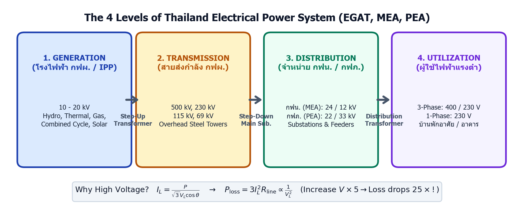
*Figure 1: Overview schematic of Thailand's power grid across 4 distinct stages: Generation (10-20 kV) $\to$ Transmission (69-500 kV) $\to$ Distribution (22-33 kV / 24 kV) $\to$ Utilization (400/230 V).*

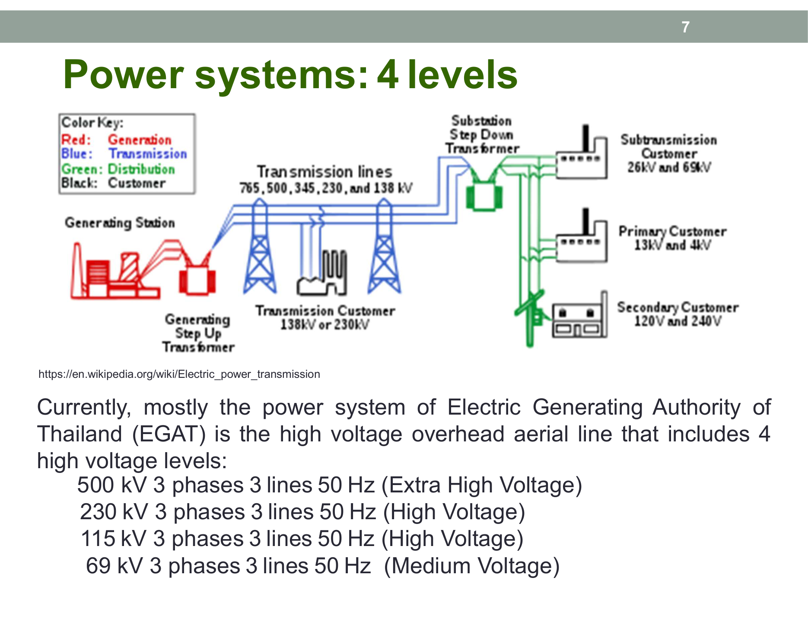
*Figure 2: Slide 7 illustrating the 4 stages and voltage transformation hierarchy (Generation $\to$ Transmission $\to$ Distribution $\to$ Utilization).*

---

## 🔤 Decoder of Utilities, Terms, and Variables (Thailand Grid Architecture)

Examinations in Chapter 8 frequently test acronyms, organizational responsibilities, and standardized voltage levels:

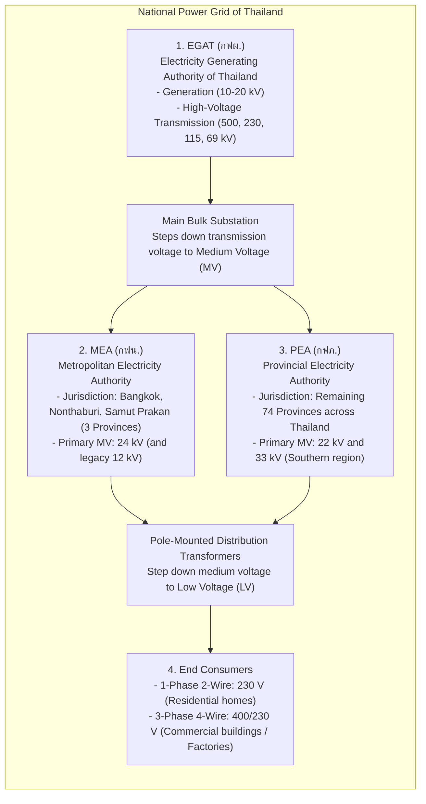

### 1. The Three Primary Electrical Utilities in Thailand

| Utility | Full Name (Thai / English) | Primary Legal Responsibilities | Territorial Jurisdiction | Voltage Classes Managed |
| :--- | :--- | :--- | :--- | :--- |
| **EGAT (กฟผ.)** | Electricity Generating Authority of Thailand *(การไฟฟ้าฝ่ายผลิตแห่งประเทศไทย)* | Generates power from its own plants, purchases bulk power from Independent Power Producers (IPP/SPP), and owns/operates the national high-voltage transmission grid. | Kingdom-wide (Generation & Transmission) | **Generation:** $10 - 20\text{ kV}$ **Transmission:** $69, 115, 230, 500\text{ kV}$ |
| **MEA (กฟน.)** | Metropolitan Electricity Authority *(การไฟฟ้านครหลวง)* | Purchases bulk power from EGAT and distributes electricity to urban end-consumers in the Bangkok metropolis. | **3 Provinces:** Bangkok, Nonthaburi, Samut Prakan | **Medium Voltage:** $24\text{ kV}$ (and legacy $12\text{ kV}$) **Low Voltage:** $400/230\text{ V}$ |
| **PEA (กฟภ.)** | Provincial Electricity Authority *(การไฟฟ้าส่วนภูมิภาค)* | Purchases bulk power from EGAT and distributes electricity to regional, rural, and industrial consumers throughout Thailand. | **Remaining 74 Provinces** (covering $99\%$ of Thailand's geographical landmass) | **Medium Voltage:** $22\text{ kV}$ and $33\text{ kV}$ **Low Voltage:** $400/230\text{ V}$ |

---

### 2. Engineering Variables and Equations

* $P$ : Real / Active Power in Watts ($\text{W}$), Kilowatts ($\text{kW}$), or Megawatts ($\text{MW}$).
* $Q$ : Reactive Power in Volt-Amperes Reactive ($\text{VAR}$) or Megavars ($\text{MVAR}$).
* $S$ : Apparent Power in Volt-Amperes ($\text{VA}$) or Megavolt-Amperes ($\text{MVA}$).
* $V_L$ : Line-to-Line Voltage, e.g. $500\text{ kV}, 230\text{ kV}, 115\text{ kV}, 24\text{ kV}, 22\text{ kV}, 400\text{ V}$.
* $V_p$ : Phase-to-Neutral Voltage, e.g. $230\text{ V}$ ($V_L = \sqrt{3} V_p$).
* $I_L$ : Transmission Line Current:
  $$I_L = \frac{P}{\sqrt{3} V_L \cos\theta}$$
* $P_{\text{loss}}$ : Conductor Power Loss in a 3-Phase Transmission Line:
  $$P_{\text{loss}} = 3 I_L^2 R_{\text{line}} = \frac{P^2 R_{\text{line}}}{V_L^2 \cos^2\theta}$$

> [!IMPORTANT]
> The fundamental economic rule: $P_{\text{loss}} \propto \frac{1}{V_L^2}$. Increasing the line voltage by factor $k$ reduces line losses by factor $k^2$ for the same transmitted power!

---

## ⚡ The 4 Levels of the Electrical Power System

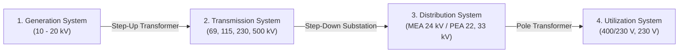

### 1. Generation System
* **Generator Terminal Voltage**: Large synchronous alternators generate electric power at **$10\text{ kV} - 20\text{ kV}$**.
* **Why not generate directly at $500\text{ kV}$?**: Because stator winding slots have physical insulation limits. Insulating a machine for $500\text{ kV}$ would require stator slots so thick that cooling would become impossible and alternator dimensions would be unmanageable. Power is therefore generated at $10-20\text{ kV}$ and immediately stepped up via a **Generator Step-Up (GSU) Transformer**.

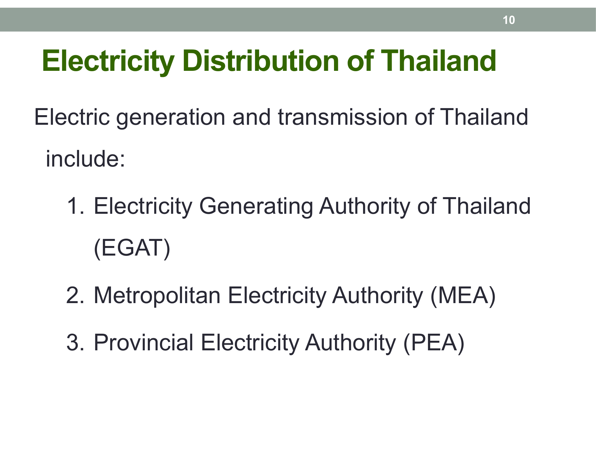
*Figure 3: National transmission grid map of EGAT interconnecting power stations across all four regions (From Slide 10).*

---

### 2. Transmission System
* **Operator**: Managed exclusively by EGAT in Thailand.
* **Physical Infrastructure**: Primarily **Overhead Transmission Lines** mounted on tall galvanized steel lattice towers or prestressed concrete poles, using the surrounding ambient air as natural electrical insulation.
* **4 Standard EGAT Transmission Voltages**:
  1. **$500\text{ kV}$ (Extra High Voltage - EHV)**: Long-distance inter-regional bulk power highways (e.g. Mae Moh to Central Region, imports from Lao PDR hydro projects like Nam Theun 2).
  2. **$230\text{ kV}$ (High Voltage - HV)**: Regional transmission backbone connecting major grid substations.
  3. **$115\text{ kV}$ (High Voltage - HV)**: Sub-transmission feeding provincial load centers and industrial estates.
  4. **$69\text{ kV}$ (High Voltage - HV)**: Legacy sub-transmission in select MEA urban pockets and special industrial zones.

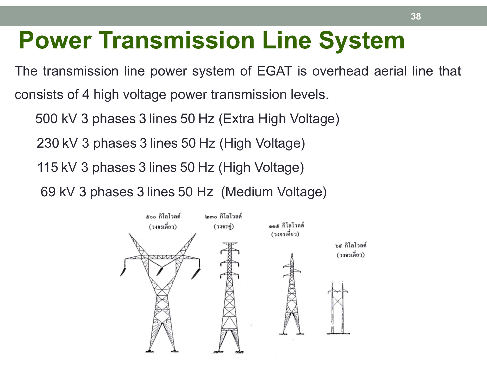
*Figure 4: Aerial overhead lines and EGAT voltage levels: 69, 115, 230, and 500 kV (From Slide 38).*

---

### 3. Distribution System
Receives high-voltage power from EGAT bulk substations and steps it down to **Medium Voltage (MV)** for distribution along streets:
* **MEA (กฟน.)**: Steps down $69\text{ kV} / 115\text{ kV}$ to **$24\text{ kV}$** (and legacy $12\text{ kV}$) using looped underground and overhead feeders.
* **PEA (กฟภ.)**: Steps down $115\text{ kV}$ to **$22\text{ kV}$** (standard nationwide) and **$33\text{ kV}$** (southern Thailand, where longer feeder runs require higher voltage to prevent excessive voltage drop).

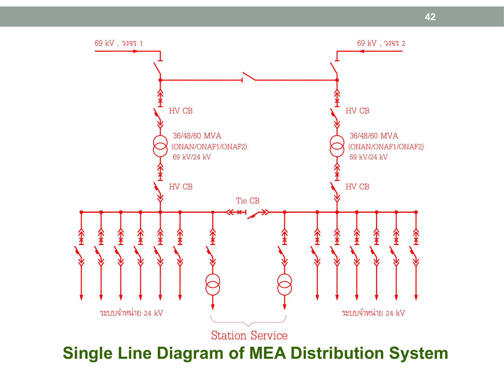
*Figure 5: 24 kV distribution system and 69 kV sub-transmission in the MEA jurisdiction (From Slide 42).*

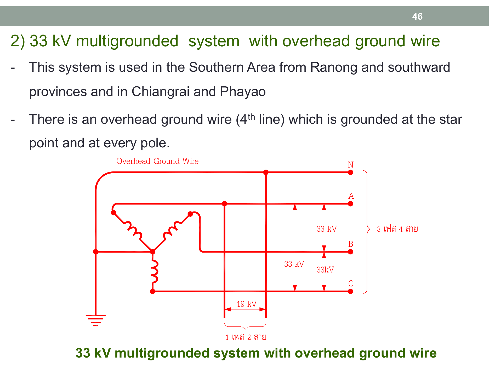
*Figure 6: PEA 22 kV and 33 kV multigrounded distribution network (From Slide 46).*

---

### 4. Utilization System (Low Voltage Supply)
The final step delivering power to residential homes, commercial complexes, and industrial plants via **Distribution Transformers**:
* **1-Phase 2-Wire ($230\text{ V}$)**:
  * Operating Voltage: **$230\text{ V}$** (1 Line conductor + 1 Neutral conductor).
  * Application: Standard residential homes with total connected load below $10\text{ kW}$.
* **3-Phase 4-Wire ($400 / 230\text{ V}$)**:
  * Operating Voltage: **$V_L = 400\text{ V}$** (Line-to-Line), **$V_p = 230\text{ V}$** (Line-to-Neutral).
  * Conductors: 3 Phase wires ($A, B, C$) + 1 Neutral wire ($N$).
  * Benefit: Supplies both single-phase loads ($230\text{ V}$ for lighting and sockets) and heavy three-phase equipment ($400\text{ V}$ for elevators, water pumps, chillers, and 3-phase motors).

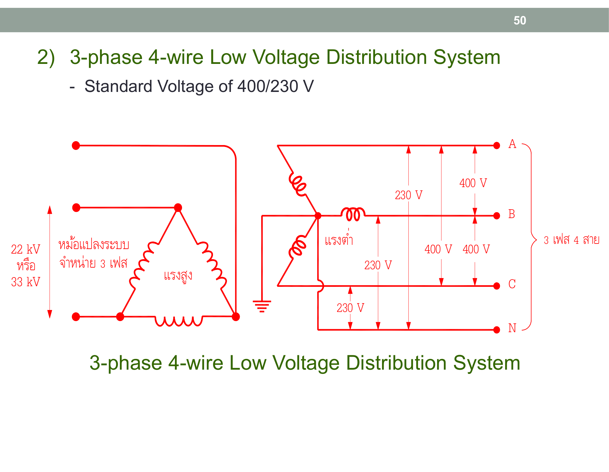
*Figure 7: 3-Phase 4-Wire 400/230 V and 1-Phase 2-Wire 230 V distribution standards in Thailand (From Slide 50).*

---

## 🏭 5 Types of EGAT Power Plants (Base Load vs. Peak Load)

EGAT balances different generating sources according to daily load curve fluctuations:
1. **Base Load Power Plants**: Operate continuously 24 hours a day with low fuel cost per kWh. Very slow start-up/shut-down times (hours to days).
2. **Peak Load Power Plants**: Dispatched during periods of maximum grid demand (afternoon and early evening). Can start up and synchronize with the grid within 5–15 minutes.

---

### 1. Hydroelectric Power Plants
* **Working Principle**: Water stored behind a dam possesses gravitational potential energy. Water released through a penstock converts potential energy into kinetic energy to spin a **Water Turbine** coupled to an alternator.
* **Electrical Power Formula**:
  $$P_e = \eta \cdot \rho \cdot g \cdot Q \cdot H$$
  * $\rho = 1,000\text{ kg/m}^3$ (Water density)
  * $g = 9.81\text{ m/s}^2$ (Acceleration due to gravity)
  * $Q$ : Water flow rate ($\text{m}^3/\text{s}$)
  * $H$ : Effective water head ($\text{m}$)
  * $\eta$ : Overall efficiency ($\approx 85\% - 92\%$)
* **Turbine Classifications**:
  1. **Pelton Turbine (Impulse Turbine)**: Best for **very high head ($H > 300\text{ m}$)** and low flow rate. High-velocity water jets strike bucket runners.
  2. **Francis Turbine (Reaction Turbine)**: Best for **medium head ($30 - 300\text{ m}$)**. The most widely used turbine in Thailand and globally (Bhumibol Dam, Sirikit Dam, Ubolratana Dam).
  3. **Kaplan Turbine (Propeller/Axial Turbine)**: Best for **low head ($H < 30\text{ m}$)** and very large flow rates (Chao Phraya Dam).
* **Pumped Storage Hydro (Lam Takhong Jolabha Vadhana in Nakhon Ratchasima)**:
  * Acts as a **gigantic water battery**: During low-demand nighttime (Off-Peak), surplus electricity pumps water from the lower reservoir to the upper reservoir on Khao Yai Thiang.
  * During daytime peak demand (Peak Load), water flows back down through reversible pump-turbines, delivering up to $1,000\text{ MW}$ in minutes.

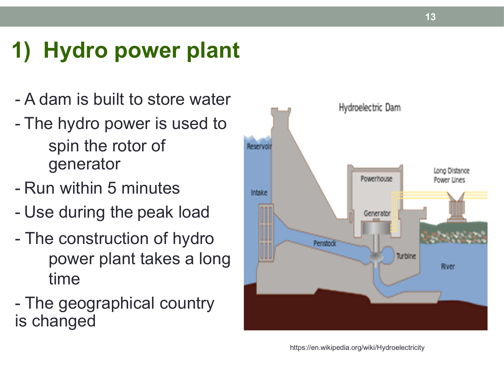
*Figure 8: Reservoir, penstock, turbine, and generator arrangement in a hydroelectric power plant (From Slide 13).*

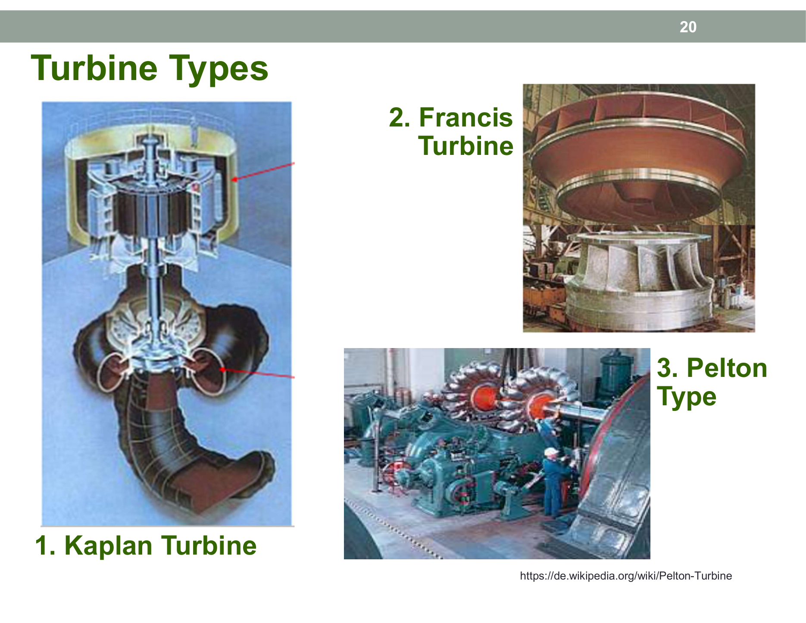
*Figure 9: The three principal water turbine designs categorized by head and flow characteristics (From Slide 20).*

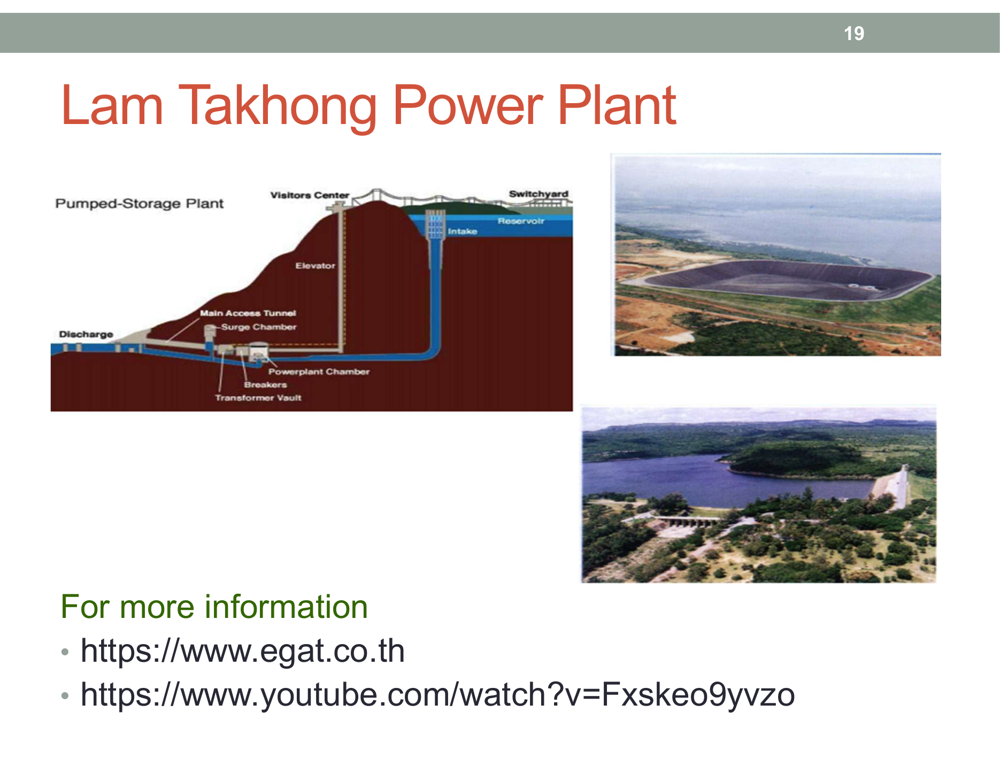
*Figure 10: Underground powerhouse and upper reservoir configuration at Lam Takhong (From Slide 19).*

---

### 2. Thermal / Steam Power Plants
* **Working Principle**: Fossil fuels (lignite coal, natural gas, or fuel oil) burn inside a boiler to convert water into high-pressure, superheated steam, which drives a **Steam Turbine** before condensing back to water.
* **Grid Role**: **Base Load Power Plant**. Start-up from cold requires several hours, but it provides reliable, massive baseload output at low fuel cost.
* **Landmark Thai Example**: **Mae Moh Power Plant in Lampang** (powered by local lignite open-cast mines).

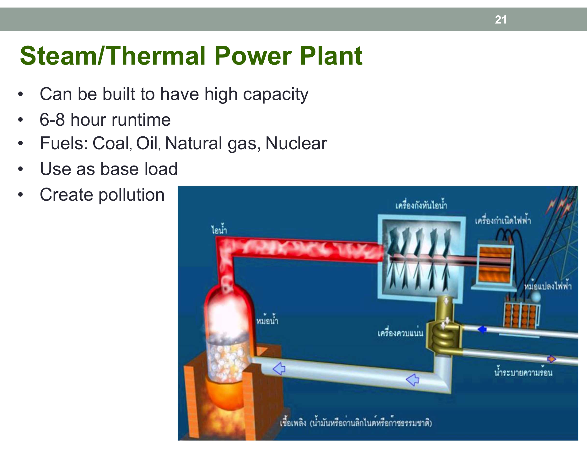
*Figure 11: Boiler, steam turbine, generator, and condenser thermodynamic cycle (From Slide 21).*

---

### 3. Gas Turbine and Diesel Power Plants
* **Gas Turbine (Simple Cycle)**:
  * Ambient air is compressed by an axial compressor, mixed with natural gas, and ignited. Expanding hot combustion gases drive the turbine blades directly (identical to a jet aircraft engine).
  * **Key Advantage**: **Extremely fast start-up (10–15 minutes)** to full load. Ideal for **Peak Load** dispatch and emergency grid stabilization.
  * **Landmark Thai Example**: **Nam Pong Power Plant in Khon Kaen**, Lan Krabue in Kamphaeng Phet.
* **Diesel Engine Plant**:
  * Internal combustion engines driving alternators, used primarily on remote islands or as emergency standby generators in hospitals and data centers.

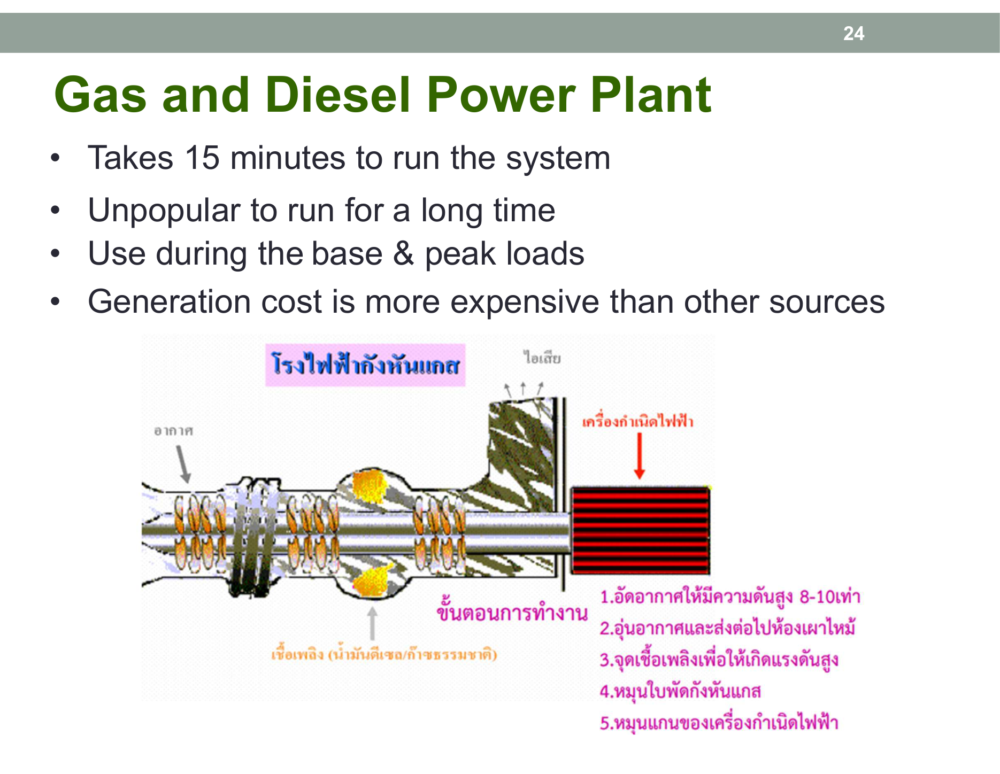
*Figure 12: Compressor, combustion chamber, and turbine rotor assembly (From Slide 24).*

---

### 4. Combined Cycle Power Plants
* **Working Principle (High-Yield Exam Concept)**:
  * Combines a **Gas Turbine (Brayton Cycle)** with a **Steam Turbine (Rankine Cycle)**.
  * Exhaust gases exiting a gas turbine are extremely hot ($500^\circ\text{C} - 600^\circ\text{C}$). Instead of discharging this heat into the atmosphere, it enters a **Heat Recovery Steam Generator (HRSG)**.
  * The steam produced powers a secondary steam turbine, generating **$50\%$ additional electricity without consuming any extra fuel!**
* **Thermal Efficiency**: Achieves **$50\% - 60\%$**, the highest efficiency of any thermal power generation technology.
* **Landmark Thai Examples**: **Bangpakong Power Plant in Chachoengsao**, Wang Noi, South Bangkok.

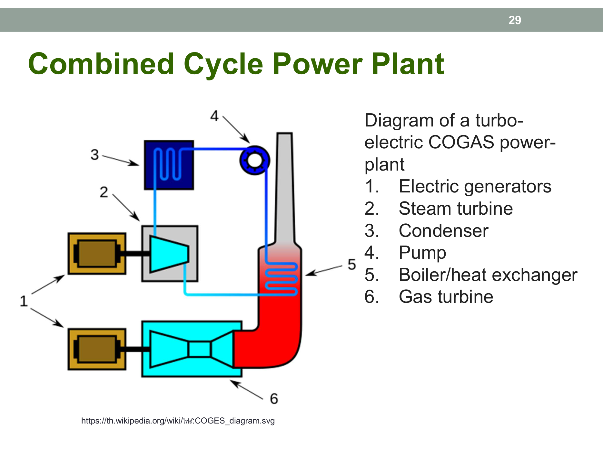
*Figure 13: Coupling gas turbine exhaust to an HRSG to drive a secondary steam turbine generator (From Slide 29).*

---

### 5. Renewable Energy (Solar PV Systems)
* **Solar Photovoltaics (PV)**:
  * Semiconductor PV cells convert sunlight into direct current (DC) electricity.
  * An **Inverter (DC/AC Converter)** synchronizes the power to $50\text{ Hz}$ AC matching the grid voltage.
  * Hybrid systems combine solar PV, battery energy storage systems (BESS), and diesel backups for microgrids.

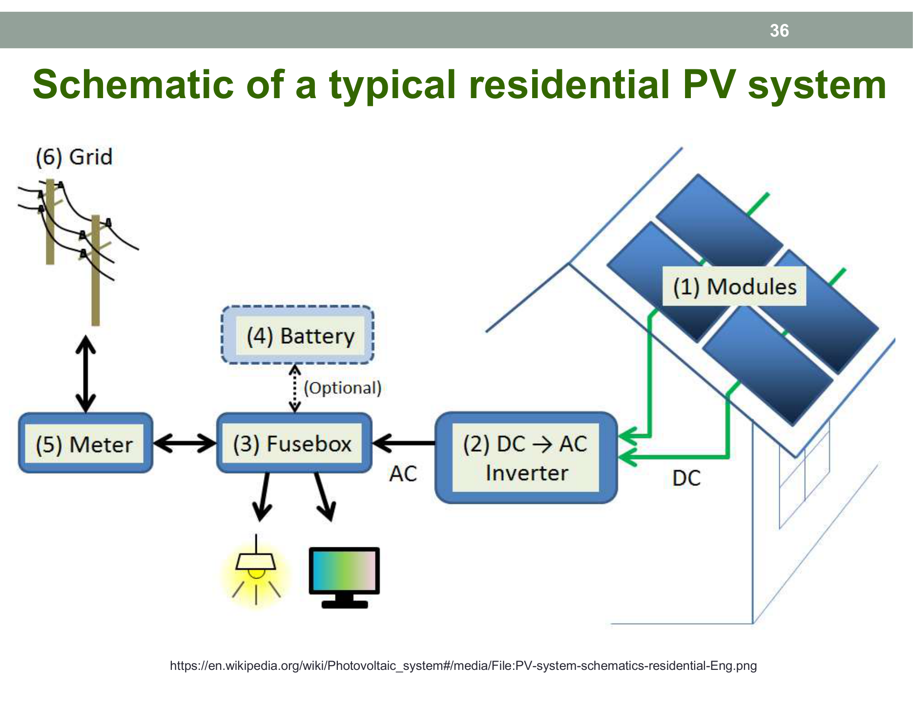
*Figure 14: Solar array, DC junction box, grid-tied inverter, and bidirectional net-metering configuration (From Slide 36).*

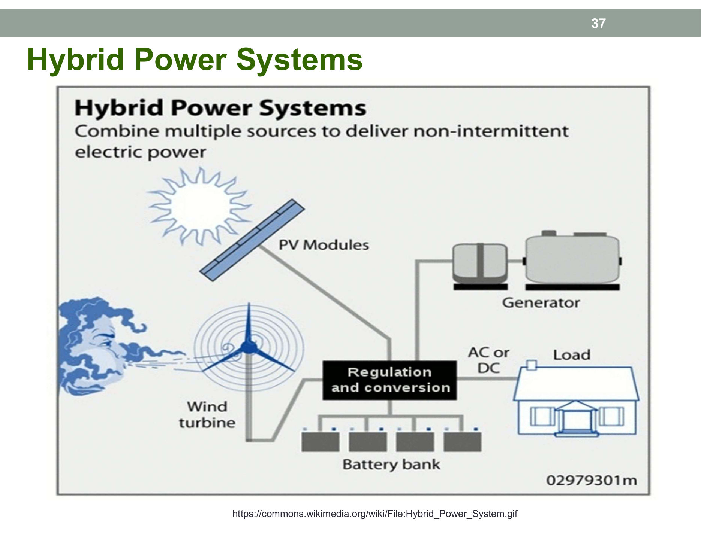
*Figure 15: Microgrid combining solar panels, battery banks, and diesel backup (From Slide 37).*

---

## 🔌 Customer Service Connections & Metering Standards

Consumer connections are categorized by **connected load capacity** and **operating voltage**:

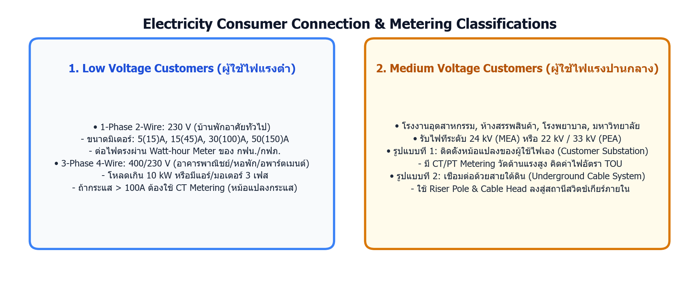
*Figure 16: Low-voltage residential connections vs medium-voltage industrial private substations.*

### 1. Standard Meter Sizing Criteria

| Meter Rating | System Voltage | Continuous / Max Current | Typical Consumer Application | Metering Method |
| :---: | :---: | :---: | :--- | :---: |
| **5(15) A** | 1-Phase 230 V | $5\text{ A}$ (Max surge $15\text{ A}$) | Small dwelling (lights, fans, refrigerator, NO air-conditioner) | Direct Meter |
| **15(45) A** | 1-Phase 230 V | $15\text{ A}$ (Max surge $45\text{ A}$) | **Standard residential home** (1–3 air-conditioners, water heater) | Direct Meter |
| **30(100) A** | 1-Phase 230 V | $30\text{ A}$ (Max surge $100\text{ A}$) | Large residence, commercial shop-house, high-power appliances | Direct Meter |
| **15(45) A** | 3-Phase 400/230 V | $15\text{ A}$ per phase ($45\text{ A}$ max) | Small commercial office, dormitories, 3-phase air-conditioners | Direct Meter |
| **30(100) A** | 3-Phase 400/230 V | $30\text{ A}$ per phase ($100\text{ A}$ max) | Commercial building, restaurant, small manufacturing workshop | Direct Meter |
| **> 100 A** | 3-Phase 400/230 V | Line current exceeds $100\text{ A}$ | Shopping malls, hospitals, universities, large factories | **CT Metering (Current Transformers)** |

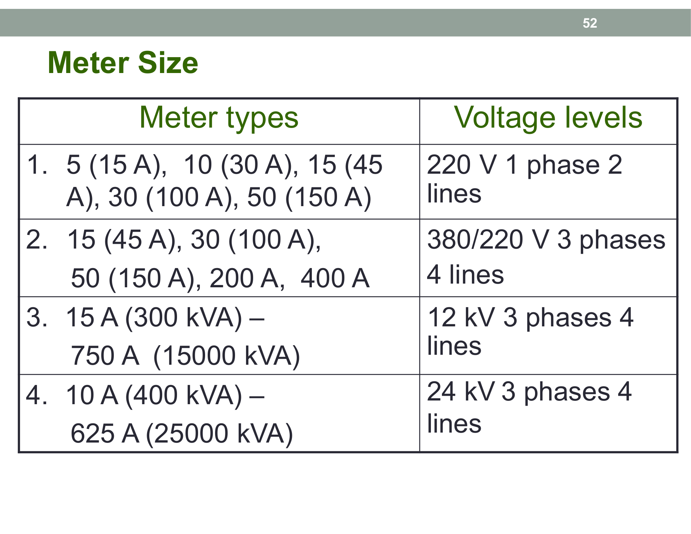
*Figure 17: Official utility criteria for meter rating and voltage level selection (From Slide 52).*

---

### 2. Medium-Voltage Customers and Underground Service Drops
* **Medium-Voltage Customers**: Commercial or industrial loads exceeding the capacity of standard pole transformers must take power at medium voltage ($24\text{ kV}$ in MEA or $22\text{ kV} / 33\text{ kV}$ in PEA). The customer builds a **Private On-Site Substation** containing their own step-down power transformers.
* **Metering**: Revenue metering is installed on the high-voltage side using **Current Transformers (CT)** and **Potential Transformers (PT)**, billed under Time-of-Use (TOU) tariffs.
* **Underground Service Connections**: In dense urban areas, power is delivered via underground armored cables using a pole-mounted cable head (Riser Pole) descending into underground ducts directly into the building's switchgear room.

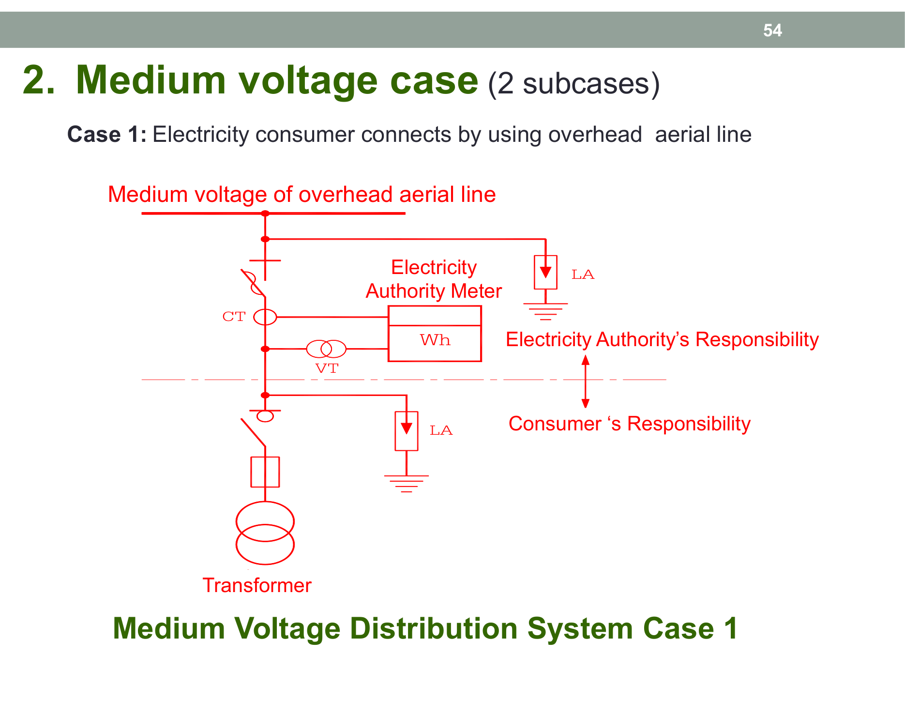
*Figure 18: Primary metering scheme with CT/PT units on the medium-voltage side (From Slide 54).*

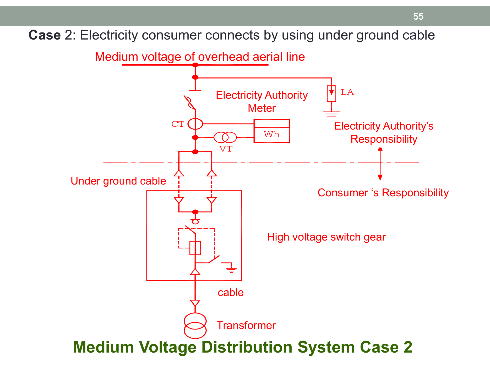
*Figure 19: Underground cable connection transition from overhead lines (From Slide 55).*

---

## 🏛️ Electrical Substations: AIS vs. GIS

Substations act as the vital switching, voltage-transformation, and protective hubs of the electrical grid:

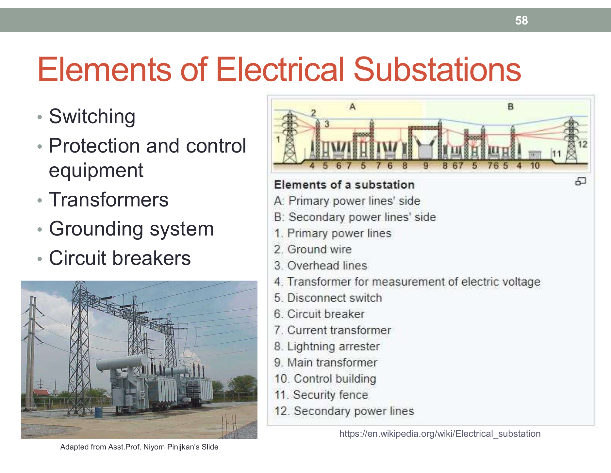
*Figure 20: Switchgear, power transformers, busbars, and lightning surge arresters (From Slide 58).*

### 1. The 6 Essential Substation Components
1. **Power Transformer**: Steps transmission voltages down to distribution levels (e.g. $115\text{ kV} \to 22\text{ kV}$).
2. **Circuit Breaker (CB)**: Switches normal load currents and **automatically interrupts catastrophic short-circuit fault currents** within milliseconds to protect grid assets.
3. **Disconnecting Switch / Isolator**: Provides a visible physical air gap break during maintenance. **Must only be opened when zero current flows (No-load switching)**.
4. **Busbars**: Heavy copper or aluminum conductors serving as common nodes distributing power to outgoing feeders.
5. **Surge / Lightning Arrester**: Connected between phase conductors and earth ground. Diverts high-voltage lightning surges safely to ground, clamping voltage across the transformer.
6. **Instrument Transformers (CT & PT)**: Step down high currents and voltages to standardized instrument levels ($5\text{ A}$ and $110\text{ V}$) for revenue meters and protective relays.

---

### 2. Air-Insulated Substation (AIS) vs. Gas-Insulated Substation (GIS)

| Comparison Parameter | Air-Insulated Substation (AIS) | Gas-Insulated Substation (GIS) |
| :--- | :--- | :--- |
| **Insulating Medium** | **Atmospheric Ambient Air** | **Sulfur Hexafluoride ($\text{SF}_6$) Gas** ($3\times$ higher dielectric strength than air) |
| **Physical Footprint** | **Requires vast land area** to maintain safe electrical clearances | **Extremely compact (occupies only $10\% - 15\%$ of AIS footprint)** |
| **Installation Location** | Rural, suburban, or industrial areas with cheap land | **High-density downtown business districts, basements of skyscrapers** |
| **Environmental Vulnerability** | Exposed to salt fog, dust, industrial soot, bird strikes | **Hermetically sealed inside grounded metal enclosures** |
| **Capital Cost** | Lower initial equipment cost | Higher equipment cost, but offset by massive savings in land acquisition |

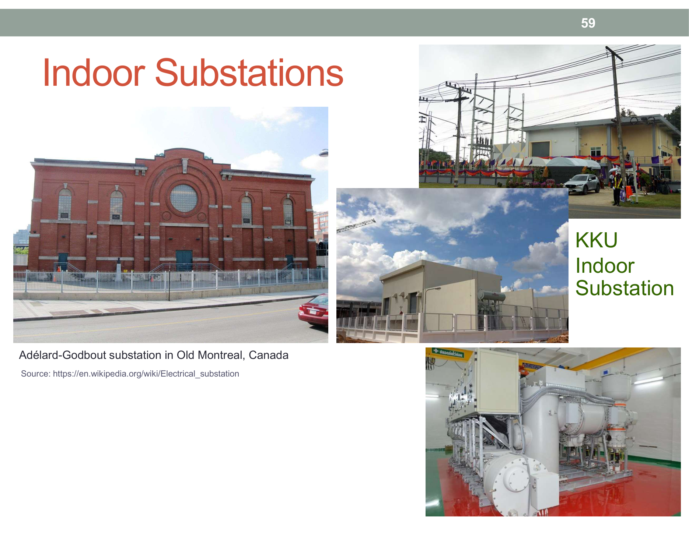
*Figure 21: Compact, sealed SF6 gas-insulated switchgear installation inside an urban substation (From Slide 59).*

---

## 📝 5 Authentic Exam Problems with Full Step-by-Step Solutions

---

### 🔴 Problem 1 (Level 1: Transmission Power Loss & Voltage Scaling)
**Problem Statement:**  
A power plant transmits $P = 120\text{ MW}$ of three-phase power to a bulk substation over a distance of $150\text{ km}$. The load power factor is $\cos\theta = 0.85\text{ lagging}$. The transmission line has a total resistance of $R_{\text{line}} = 10\ \Omega$ per phase.  
1. Calculate the line current ($I_L$) and total three-phase transmission loss ($P_{\text{loss}}$) when transmitting at **$115\text{ kV}$**.
2. Calculate the line current ($I_L$) and total three-phase transmission loss ($P_{\text{loss}}$) when transmitting at **$500\text{ kV}$**.
3. Determine the percentage reduction in power loss achieved by stepping up the voltage.

#### 💡 Step-by-Step Model Solution:
**Step 1: Calculate for $V_{L1} = 115\text{ kV}$**
$$I_{L1} = \frac{P}{\sqrt{3} V_{L1} \cos\theta} = \frac{120 \times 10^6}{\sqrt{3} \times (115 \times 10^3) \times 0.85} = \frac{120 \times 10^6}{169,308.08} \approx 708.77\text{ A}$$
Total three-phase power loss:
$$P_{\text{loss1}} = 3 I_{L1}^2 R_{\text{line}} = 3 \times (708.77)^2 \times 10 = 3 \times 502,354.91 \times 10 \approx 15.07\text{ MW}$$
*(Loss represents $\frac{15.07}{120} \times 100\% = 12.56\%$ of the transmitted power)*

**Step 2: Calculate for $V_{L2} = 500\text{ kV}$**
$$I_{L2} = \frac{P}{\sqrt{3} V_{L2} \cos\theta} = \frac{120 \times 10^6}{\sqrt{3} \times (500 \times 10^3) \times 0.85} = \frac{120 \times 10^6}{736,121.59} \approx 163.02\text{ A}$$
Total three-phase power loss:
$$P_{\text{loss2}} = 3 I_{L2}^2 R_{\text{line}} = 3 \times (163.02)^2 \times 10 = 3 \times 26,575.52 \times 10 \approx 0.80\text{ MW}$$
*(Loss represents only $\frac{0.80}{120} \times 100\% = 0.67\%$ of transmitted power!)*

**Step 3: Calculate Percentage Loss Reduction**
$$\% \text{Reduction} = \frac{P_{\text{loss1}} - P_{\text{loss2}}}{P_{\text{loss1}}} \times 100\% = \frac{15.07 - 0.80}{15.07} \times 100\% = 94.69\%$$
> [!TIP]
> **Verification via Inverse-Square Law**:
> $$\frac{P_{\text{loss2}}}{P_{\text{loss1}}} = \left(\frac{V_{L1}}{V_{L2}}\right)^2 = \left(\frac{115}{500}\right)^2 = 0.0529 \implies \text{Loss drops by } (1 - 0.0529) = 94.71\%$$

---

### 🔴 Problem 2 (Level 2: Hydroelectric Power Generation Calculation)
**Problem Statement:**  
Ubolratana Dam in Khon Kaen operates with an effective water head $H = 45\text{ m}$ and a penstock discharge rate $Q = 60\text{ m}^3/\text{s}$. Given water density $\rho = 1,000\text{ kg/m}^3$, gravitational acceleration $g = 9.81\text{ m/s}^2$, turbine efficiency $\eta_{\text{turbine}} = 90\%$, and alternator efficiency $\eta_{\text{gen}} = 95\%$.  
1. Calculate the total hydraulic power of the water flow ($P_h$) in $\text{MW}$.
2. Calculate the net electrical power delivered to the transmission lines ($P_e$) in $\text{MW}$.
3. Identify the most suitable turbine type for this operating head.

#### 💡 Step-by-Step Model Solution:
**Step 1: Total Hydraulic Power ($P_h$)**
$$P_h = \rho \cdot g \cdot Q \cdot H = (1,000\text{ kg/m}^3) \times (9.81\text{ m/s}^2) \times (60\text{ m}^3/\text{s}) \times (45\text{ m})$$
$$P_h = 26,487,000\text{ W} = 26.487\text{ MW}$$

**Step 2: Net Electrical Power Output ($P_e$)**
$$\eta_{\text{total}} = \eta_{\text{turbine}} \times \eta_{\text{gen}} = 0.90 \times 0.95 = 0.855 \quad (85.5\%)$$
$$P_e = \eta_{\text{total}} \times P_h = 0.855 \times 26.487\text{ MW} \approx 22.65\text{ MW}$$

**Step 3: Turbine Selection**
* An effective head of $H = 45\text{ m}$ falls within the medium head range ($30\text{ m} - 300\text{ m}$). The optimal turbine is the **Francis Turbine**.

---

### 🔴 Problem 3 (Level 3: Three-Phase Load Current & Meter Selection)
**Problem Statement:**  
A student dormitory in Khon Kaen is supplied by a 3-phase 4-wire, $400/230\text{ V}, 50\text{ Hz}$ system. The connected loads consist of:
* 3-Phase air-conditioning units: $45\text{ kW}$ total at $\text{pf} = 0.80\text{ lagging}$.
* 1-Phase lighting and domestic appliances (balanced across all 3 phases): $21\text{ kW}$ total at $\text{pf} = 1.0$.  
1. Find total real power ($P_{\text{total}}$) and reactive power ($Q_{\text{total}}$).
2. Calculate total apparent power ($S_{\text{total}}$) and overall building power factor ($\text{pf}_{\text{total}}$).
3. Compute the line current ($I_L$).
4. Specify the required utility meter configuration according to PEA/MEA standards.

#### 💡 Step-by-Step Model Solution:
**Step 1: Break Down $P$ and $Q$**
* Air conditioners ($P_1 = 45\text{ kW}$):
  $$\cos\theta_1 = 0.80 \implies \tan\theta_1 = 0.75 \implies Q_1 = 45 \times 0.75 = 33.75\text{ kVAR}$$
* Lighting ($P_2 = 21\text{ kW}$):
  $$\cos\theta_2 = 1.0 \implies Q_2 = 0\text{ kVAR}$$
$$P_{\text{total}} = 45 + 21 = 66\text{ kW} \qquad Q_{\text{total}} = 33.75 + 0 = 33.75\text{ kVAR}$$

**Step 2: Total Apparent Power and Power Factor**
$$S_{\text{total}} = \sqrt{P_{\text{total}}^2 + Q_{\text{total}}^2} = \sqrt{66^2 + 33.75^2} = \sqrt{4,356 + 1,139.06} \approx 74.13\text{ kVA}$$
$$\text{pf}_{\text{total}} = \frac{P_{\text{total}}}{S_{\text{total}}} = \frac{66}{74.13} \approx 0.890\text{ lagging}$$

**Step 3: Line Current Calculation**
$$I_L = \frac{S_{\text{total}}}{\sqrt{3} \times V_L} = \frac{74,130}{\sqrt{3} \times 400} = \frac{74,130}{692.82} \approx 107.0\text{ A}$$

**Step 4: Utility Meter Sizing**
* Since the line current ($107.0\text{ A}$) **exceeds $100\text{ A}$**, standard direct-connected meters cannot safely handle the thermal load.
* **Selection**: The building must install a **3-Phase 4-Wire $400/230\text{ V}$ meter with Current Transformers (CT Metering)**, typically paired with $150/5\text{ A}$ or $200/5\text{ A}$ CT ratios.

---

### 🔴 Problem 4 (Level 4: Base Load vs. Peak Load Operational Dynamics)
**Problem Statement:**  
In grid dispatch engineering:
1. Explain why Mae Moh Thermal Plant runs as **Base Load**, whereas Nam Pong Gas Turbine Plant operates as **Peak Load**.
2. Describe how a Combined Cycle plant (e.g. Bangpakong) attains nearly double the thermal efficiency of a simple-cycle gas turbine.

#### 💡 Model Engineering Solution:
1. **Base Load vs. Peak Load Operational Factors**:
   * **Mae Moh (Base Load)**: Employs massive pulverized lignite coal boilers. Bringing millions of liters of water to superheated steam requires hours of slow preheating. Frequent shutdowns waste massive thermal energy and induce thermal fatigue in thick boiler tubes. However, domestic lignite fuel costs per kWh are very low, making continuous 24/7 baseload generation the most economical mode.
   * **Nam Pong (Peak Load)**: Gas turbines operate identically to jet engines without water preheating. They accelerate from cold standstill to grid synchronization at full load within **$10 - 15\text{ minutes}$**, making them ideal for rapid ramping during brief evening demand spikes.
2. **Combined Cycle Thermodynamic Synergy**:
   * Simple-cycle gas turbines exhaust hot combustion gases into the atmosphere at $500^\circ\text{C} - 600^\circ\text{C}$, losing $65\%$ of fuel energy.
   * A Combined Cycle plant routes this hot exhaust into a **Heat Recovery Steam Generator (HRSG)** to generate high-pressure steam, driving a second steam turbine. This extracts an extra $50\%$ electrical power from the same initial fuel burn, boosting thermal efficiency from $30-35\%$ to **$55-60\%$**.

---

### 🔴 Problem 5 (Level 5: Substation Insulation Design & Lightning Protection)
**Problem Statement:**  
1. A new $115/24\text{ kV}$ distribution substation is planned in central downtown Bangkok (Siam/Silom). Justify why a **Gas-Insulated Substation (GIS)** must be chosen over an **Air-Insulated Substation (AIS)**.
2. If lightning strikes an incoming $115\text{ kV}$ overhead line, which device protects the power transformer, and what is its internal operating mechanism?

#### 💡 Model Engineering Solution:
1. **Selection of GIS Substation**:
   * **Space Optimization**: Real estate in central Bangkok costs millions of baht per square meter. The superior dielectric properties of $\text{SF}_6$ gas enable equipment clearances to shrink dramatically, occupying only **$10\% - 15\%$ of the physical land area** required by an equivalent AIS.
   * **Safety & Aesthetics**: GIS equipment is housed entirely inside an indoor architectural building, eliminating open live conductors and eliminating public contact hazards.
   * **Immunity to Pollution**: Critical live conductors are sealed inside pressurized aluminum tubes, immune to airborne soot, humidity, and bird strikes, ensuring higher reliability and lower long-term maintenance.
2. **Lightning Arrester Operation**:
   * The protective device is the **Metal-Oxide Surge Arrester (Zinc Oxide: ZnO)** connected directly in parallel ahead of the transformer terminals.
   * **Operating Mechanism**: ZnO exhibits non-linear voltage-dependent resistance:
     * At nominal operating voltage ($115\text{ kV}$): The arrester behaves as an open circuit ($R \approx \infty$), drawing negligible leakage current ($< 1\text{ mA}$).
     * When a megavolt lightning surge arrives: Its resistance collapses to near-zero ($R \approx 0\ \Omega$) within nanoseconds, safely shunting thousands of amperes of surge energy into the substation ground grid and clamping the terminal voltage below the transformer's Basic Impulse Insulation Level (BIL).

---

## 🎯 Final Exam Key Formulas & Quick Summary

1. **The 4 Grid Stages**:
   * Generation: $10 - 20\text{ kV}$ (EGAT)
   * Transmission: $69, 115, 230, 500\text{ kV}$ (EGAT)
   * Distribution: $24\text{ kV}$ (MEA), $22 / 33\text{ kV}$ (PEA)
   * Utilization: $400 / 230\text{ V}$ (3-Phase 4-Wire), $230\text{ V}$ (1-Phase 2-Wire)
2. **Transmission Power Loss**:
   * $I_L = \frac{P}{\sqrt{3} V_L \cos\theta}$
   * $P_{\text{loss}} \propto \frac{1}{V_L^2}$ (Voltage $\times k \implies$ Loss drops by $k^2$)
3. **EGAT Power Plants**:
   * Hydro: $P_e = \eta \rho g Q H$ (Pelton for high $H$, Francis for medium $H$, Kaplan for low $H$)
   * Thermal: Mae Moh Lignite (Base Load)
   * Gas Turbine: Nam Pong (Peak Load, 15 min start)
   * Combined Cycle: Bangpakong (Gas + Steam, $\eta \approx 55 - 60\%$)
4. **Meter Sizing**:
   * Standard home: $15(45)\text{ A}, 230\text{ V}$
   * Load $> 100\text{ A}$: Must use **CT Metering**
5. **Substations**:
   * AIS: Air insulated, large footprint, outdoor, cheaper equipment
   * GIS: $\text{SF}_6$ gas insulated, $10-15\%$ footprint, urban indoor, highly resilient
